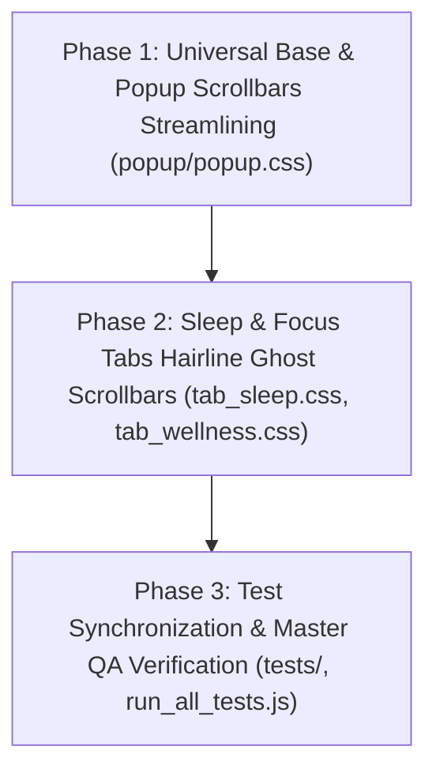

# Hairline Ghost-Style Scrollbar Refinement: Executive Summary

> **Document Type:** Executive Architecture Summary  
> **Workspace Container:** `temp_prompt/hairline_ghost_scrollbar_refinement/`  
> **Target Subsystems:** `popup/popup.css`, `popup/styles/tabs/tab_sleep.css`, `popup/styles/tabs/tab_wellness.css`, `tests/`  
> **Lead Role:** Level 3C Phase-wise Prompt Generation Specialist (`prompt_generation_specialist`)  

---

## 🌟 1. Executive Summary & Vision

The objective of this initiative is to elevate the visual refinement, ambient cyber-dark aesthetics, and ergonomics of the browser extension popup by transitioning all visible scrollbars—specifically in the Sleep tab, Focus tab, and general popup views—from the previous 4px scrollbars into an ultra-thin (2px hairline), subtle ghost-style scrollbar.

In standard desktop browsers, scrollbars frequently create jarring visual artifacts, intrude upon tight card margins, and distract from core real-time telemetry. By adopting an ultra-thin 2px hairline geometry with floating transparent tracks and subtle, whisper-level alpha opacities that gently bloom on hover, the popup interface achieves a high-end, premium "cyber-dark glassmorphism" aesthetic with zero compromise to functional scrolling ergonomics or test suite reliability.

---

## 🎯 2. Architectural Objectives & Scope Boundaries

### In-Scope
1. **Universal Popup Scrollbar Geometry:**
   - Reducing `::-webkit-scrollbar` width and height from 4px to 2px across `body`, `.tab-pane`, `.drawer-inner-content`, `.drawer-expandable-wrap`, `.domains-list`, and `.studio-items-list`.
2. **Subtle Ghost Alpha Styling:**
   - Dark theme base: `rgba(255, 255, 255, 0.12)` default, `0.28` hover.
   - Light theme base: `rgba(0, 0, 0, 0.12)` default, `0.25` hover.
   - Sleep tab: `rgba(129, 140, 248, 0.28)` default, `0.65` hover; light theme `rgba(99, 102, 241, 0.25)` default, `0.55` hover.
   - Focus tab: `rgba(6, 182, 212, 0.28)` default, `0.65` hover; light theme `rgba(15, 118, 110, 0.22)` default, `0.45` hover.
3. **Cross-Browser & W3C Standard Compliance:**
   - Maintaining `scrollbar-width: thin;` and aligning `scrollbar-color` properties to match ghost thumb values with transparent tracks.
4. **Automated Test Synchronization:**
   - Updating `tests/test_popup_drawer_docking_and_scrollbar_fix.js` assertions to reflect 2px hairline geometry and ghost tokens.
   - Verifying `tests/test_popup_collapsible_settings_drawer.js` regression pass.
   - Validating all 99+ repository test suites via `node run_all_tests.js`.
   - Certifying 100% UTF-8 with BOM and 0 secrets via `gitleaks detect --redact`.

### Out-of-Scope
- Mutating DOM structures in `popup/popup.html`.
- Mutating JavaScript state machines in `popup/popup.js` or `background.js`.
- Altering dashboard styles in `dashboard/` (scoped strictly to popup views).

---

## 🗺️ 3. Execution Topology & Milestone Roadmap

- **Phase 1:** Streamlines base popup scrollbars, list containers, and light mode overrides to 2px hairline ghost tokens.
- **Phase 2:** Refines Sleep and Focus tab pane and drawer scrollbars with specialized indigo and cyan ghost styling.
- **Phase 3:** Updates test assertions, runs regression batteries, and certifies Grade A+ signoff.

---

## ⚖️ 4. Risk Mitigation & Architectural Invariants

| Risk Identified | Mitigation Strategy |
| :--- | :--- |
| **Test Suite Breakage:** Existing Battery 3 in `test_popup_drawer_docking_and_scrollbar_fix.js` asserts `width: 4px;`. | Phase 3 explicitly synchronizes assertions to validate `width: 2px; height: 2px;` and updated ghost opacity. |
| **Usability / Grab Hit Area:** 2px width might feel narrow for mouse dragging. | WebKit scrollbar thumb hit areas remain active and smoothly draggable; popup panes support mousewheel, touch-trackpad, and keyboard scrolling. |
| **Encoding Regressions:** Accidental UTF-8 BOM loss during CSS or test edits. | Mandatory UTF-8 with BOM preservation on all touched files, checked with Node byte-inspection script. |
| **Zero innerHTML:** W3C Trusted Types compliance. | No HTML/JS DOM mutations; 100% CSS and test assertion refinements only. |
