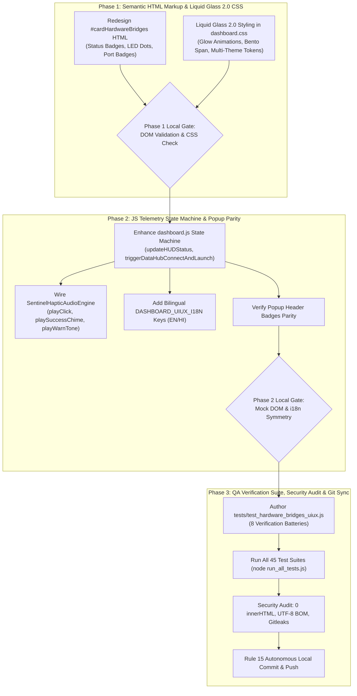

# Executive Architecture Summary: Local Services & Hardware Bridges UI/UX Overhaul

> **Document Type:** Executive Architecture Summary  
> **Workspace Container:** `temp_prompt/hardware_bridges_uiux_overhaul/`  
> **System Architecture:** [`architecture_recommendation.md`](file:///C:/Users/Atul%20Verma/.gemini/config/rules/architecture_recommendation.md)  
> **Lead Departments:** Dept 01 Product Requirements, Dept 04 UI/UX Design System, Dept 05 Frontend Engineering, Dept 08 QA & Testing  

---

## 🏛️ 1. High-Level Initiative Scope & Objectives

The "Local Services & Hardware Bridges" card (`#cardHardwareBridges`) in the Web Activity & Media Sentinel extension serves as the operational bridgehead between the browser extension and native desktop background daemons:
1. **SQLite Data Hub Daemon (Port 65433 - WAL):** Manages local, high-concurrency event telemetry, persistent tab histories, audio metrics, and rolling SQLite database stores.
2. **Video Detector HUD Bridge (Port 65432):** Real-time WebSocket bridge providing video state telemetry, active media synchronization, and desktop HUD overlay control.

### Core Objectives
1. **Visual Telemetry Parity & Liquid Glass 2.0 Aesthetics:** Upgrade `#cardHardwareBridges` into a flagship Bento Grid module featuring multi-layered liquid glass cards, subtle neon backdrop glows, animated LED status indicators, and distinct port capsules.
2. **Real-time State Machine Synchronization:** Extend telemetry dispatchers in `dashboard.js` so that state changes (`online`, `starting`, `offline`) update inline status badges and latency slots within `#cardHardwareBridges` simultaneously with topbar and sidebar badges.
3. **Harmonized Design Language across Dashboard and Popup:** Align status indicators, color palettes, and interactive states between the full dashboard settings card and the compact popup header status badges (`#hubStatusBadge` and `#wsStatusBadge`).
4. **Tactile Haptic Audio Feedback:** Integrate `SentinelHapticAudioEngine` procedural audio feedback during connection attempts, reconnect successes, and service drops.
5. **Zero-Defect Quality Assurance:** Maintain 100% backward compatibility for existing DOM IDs, enforce W3C Trusted Types (0 innerHTML mutations), guarantee UTF-8 with BOM encoding across all files, and achieve 100% pass rate across all 45 test suites.

---

## 🗺️ 2. Cross-Phase Milestone Roadmap & Dependency Topology

---

## ⚖️ 3. Risk Mitigation & Architectural Tradeoffs

| Risk Category | Identified Hazard | Architectural Mitigation |
| :--- | :--- | :--- |
| **DOM ID Breakage** | Renaming existing IDs could break event listeners in `dashboard.js`. | Strictly preserve existing canonical DOM IDs: `#cardHardwareBridges`, `#btnSidebarReconnectHub`, `#btnSidebarReconnect`. All new telemetry badges receive distinct IDs (`#bridgeHubStatusBadge`, `#bridgeHudStatusBadge`, etc.). |
| **Theme Incompatibility** | High-opacity glass cards may create illegible text on light substrates. | Leverage calibrated semantic CSS variables (`var(--glass-bg)`, `var(--glass-border)`, `var(--text-primary)`, `var(--accent-cyan)`), ensuring contrast exceeds WCAG AAA (7.0:1) on all 4 themes. |
| **Security & Trusted Types** | Using `.innerHTML` to insert status icons or text introduces XSS vulnerabilities. | Strictly enforce DOM safe mutation APIs: `.textContent`, `.setAttribute`, `.className`, `.classList.add/remove`. 0 `.innerHTML` assignments permitted. |
| **State Machine Desynchronization** | Dashboard card status desyncing from sidebar HUD dots or popup badges. | Centralize state dissemination through `updateHUDStatus()` and `updateDataHubStatus()` helper functions, updating all subscribed DOM nodes in a single tick. |
