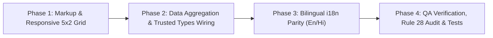

# Executive Architecture Summary: 10x2 KPI Expansion

> **Workspace Container:** `temp_prompt/kpi_expansion_10x2/`  
> **Author:** Level 3C Phase-wise Prompt Generation Specialist (`prompt_generation_specialist`)  
> **Date:** 2026-11-19  

---

## 🎯 1. Architectural Scope & Objectives

The goal of this initiative is to elevate the **Web Activity & Media Sentinel** dashboard by expanding the KPI reporting tier across two primary views:
1. **Time Tracking View (Tab A):** Transition from a 6-card layout to a mathematically balanced **10-card Bento Grid** arranged in a **5 x 2 matrix** (2 rows of 5 cards).
2. **Media Analytics View (Tab B):** Transition from a loose 6-card row to a symmetrical **10-card Bento Grid** arranged in a **5 x 2 matrix** (2 rows of 5 cards).

### Key Architectural Pillars:
- **Symmetry & Aesthetics:** Standardized Liquid-Glass Bento Cards with unified height, consistent border treatments, cyber-accented icon boxes, and responsive 5x2 CSS Grid containers.
- **Granular Analytics:** Enriches raw user tracking data into actionable behavioral dimensions (Distraction Time, Peak Hour, Longest Continuous Session, Top Streaming Platform, Live Stream Count, Muted Sessions).
- **Zero-Trust DOM Security:** Strict adherence to W3C Trusted Types with zero `innerHTML` usage across all card updates and animated number counters.
- **Bilingual i18n Parity:** 100% translation coverage in both English (`en.json`) and Hindi (`hi.json`) with dynamic language switching support.
- **Zero Regression Guarantee:** Clean integration with existing dashboard state machines and passing 100% of test suites in `run_all_tests.js`.

---

## 🗺️ 2. Cross-Phase Milestone Roadmap

### Milestone Breakdown:
- **Phase 1: Markup & CSS Grid Architecture (`dashboard.html`, `dashboard.css`)**
  - Define 10 semantic KPI cards for Time Tracking in `#trackingMetricsGrid`.
  - Create dedicated `#mediaMetricsGrid` containing 10 semantic KPI cards for Media Analytics.
  - Implement `.kpi-grid-5x2` CSS grid system with responsive breakpoints:
    - Desktop (>= 1200px): `repeat(5, 1fr)` (2 rows of 5 cards).
    - Tablet / Laptop (768px - 1199px): `repeat(3, 1fr)` or `repeat(2, 1fr)`.
    - Mobile (< 768px): `repeat(1, 1fr)`.
- **Phase 2: Data Aggregation & State Engine (`dashboard.js`)**
  - Implement pure aggregation utilities for:
    - Active Domains Count (`Object.keys(activeDomains).length`).
    - Distraction / Leisure Time (filter domains by entertainment/social categories).
    - Peak Activity Hour (aggregate hourly bins and find maximum).
    - Longest Continuous Session (interval merging algorithm).
    - Top Media Platform (domain grouping of media duration).
    - Active Live Streams (`isLive === true` / active streams with infinite duration).
    - Muted Sessions Count (`isMuted === true` or volume = 0).
    - Longest Media Session (`Math.max(...durations)`).
  - Bind updates to dashboard render cycles (`renderTimeTrackingView`, `renderMediaAnalyticsView`).
  - Implement safe Trusted Types DOM text assignment with `animateNumberRoll`.
- **Phase 3: Bilingual i18n Parity (`locales/en.json`, `locales/hi.json`)**
  - Add 20 localized label keys, 20 subtitle keys, and tooltip keys.
  - Wire `data-i18n` attributes for static elements and verify dynamic `t()` lookups.
- **Phase 4: Verification, Rule 28 Audit & Master QA**
  - Author comprehensive test suite `tests/test_kpi_expansion_10x2.js`.
  - Fix pre-existing Rule 28 violation in `bindFocusAdvancedEventListeners` in `focus_advanced_suite.js`.
  - Verify all 89 test suites pass cleanly with exit code 0.
  - Gitleaks audit & autonomous commit per Rule 15.

---

## ⚡ 3. Architectural Risk Mitigation

| Identified Risk | Severity | Mitigation Strategy |
| :--- | :---: | :--- |
| **Grid Breakage on Mid-sized Screens (1024px-1280px)** | Medium | Implement flex-wrapping and fractional minimum bounds `minmax(0, 1fr)` so cards scale down elegantly without horizontal overflow. |
| **Trusted Types Policy Violation** | High | Strictly forbid `innerHTML` or `outerHTML`. All text updates use `.textContent` and attribute updates use `.setAttribute`. Radial gauges use dedicated SVG DOM element handles. |
| **Rule 28 Function Bloat in `dashboard.js`** | High | Extract all calculation math into small pure helper functions (e.g., `calculatePeakHour`, `calculateLongestSession`, `extractTopMediaPlatform`), each <= 40 lines. |
| **i18n Key Desynchronization** | Medium | Author an automated parity verification test ensuring every key present in `en.json` is also present and non-empty in `hi.json`. |
| **Pre-existing Rule 28 Test Failure in `focus_advanced_suite.js`** | Medium | Proactively refactor `bindFocusAdvancedEventListeners` into modular handlers so `node run_all_tests.js` passes with 100% clean exit code 0. |

---

## 📦 4. Deliverables & File Manifest

- `dashboard/dashboard.html` (Markup restructuring for 20 KPI cards)
- `dashboard/dashboard.css` (Bento-Grid 5x2 styles & responsive breakpoints)
- `dashboard/dashboard.js` (Calculation helpers, event bindings, Trusted Types updates)
- `src/dashboard/features/focus_advanced_suite.js` (Rule 28 modularity fix)
- `locales/en.json` (English translation tokens)
- `locales/hi.json` (Hindi translation tokens)
- `tests/test_kpi_expansion_10x2.js` (Automated verification battery)
