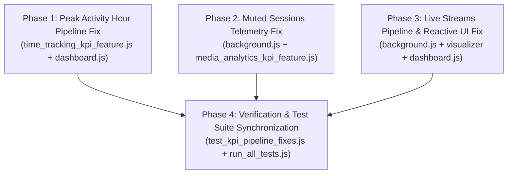

# Executive Architecture Summary: 3 KPI Data Pipeline Fixes

> **Document Path:** `temp_prompt/kpi_pipeline_fixes/SUMMARY.md`  
> **Initiative:** Web Activity & Media Sentinel - KPI Telemetry Pipeline Stabilization  
> **Specialist Advisory:** Level 3C Phase-wise Prompt Generation Specialist  
> **Target Release:** MV3 Extension Stabilization  
> **Date:** 2026-11-21  

---

## 🎯 1. High-Level Initiative Scope & Technical Objectives

The Web Activity & Media Sentinel dashboard provides two 10-card Bento Grids: Tab A (Time Tracking & Productivity) and Tab B (Media Deck & Audio Analytics). Recent audits identified data pipeline disconnects in 3 key metrics:
1. **Peak Activity Hour (Tab A, Card 9):** Schema mismatch between background hourly recording (`hourlyBuckets`) and frontend feature extraction (`hourlyBreakdown` / `hourlyActivity`).
2. **Muted Sessions Count (Tab B, Card 9):** Omission of mute flags during media session serialization and history persistence in `background.js`.
3. **Active Live Streams (Tab B, Card 5):** Missing `isLive` flag in background multi-stream synthesis and lack of reactive UI propagation upon asynchronous polling and IPC updates.

The primary objective is to restore end-to-end data integrity from service worker event ingestion to real-time DOM rendering, without breaking backward compatibility or violating Universal Rule 28 code modularity constraints.

---

## 🗺️ 2. Cross-Phase Milestone Roadmap & Dependency Topology

### Milestone Schedule:
- **Phase 1:** Correct telemetry extraction in `computePeakActivityHour` to ingest real-time domain `hourlyBuckets` from `background.js` and `dashboard.js`.
- **Phase 2:** Instrument mute state tracking on `activeMediaSessions` and serialize `isMuted` into permanent `mediaHistory` entries.
- **Phase 3:** Include `isLive` in `getAllActiveMediaStreams()` and wire reactive re-render calls on stream poll resolution and `LIVE_MEDIA_UPDATE` IPC.
- **Phase 4:** Author comprehensive 7-battery standalone test suite (`tests/test_kpi_pipeline_fixes.js`), verify 100% exit code 0 on `run_all_tests.js`, run `gitleaks detect`, and verify UTF-8 with BOM.

---

## ⚖️ 3. Architectural Tradeoff & Risk Analysis

| Risk / Tradeoff | Impact | Mitigation Strategy |
| :--- | :--- | :--- |
| **Legacy Telemetry Compatibility** | Older storage entries lack `hourlyBuckets`. | Multi-tier fallback hierarchy: `data.hourlyBuckets` -> `domain.days[today].hourlyBuckets` -> legacy `data.hourlyBreakdown` -> `data.hourlyActivity` -> `'--:--'`. |
| **Transient Mute Glitches** | Brief mute during ad breaks or page loads. | Enforce minimum 5s playback threshold before committing history; sample audio volume across lifecycle. |
| **Re-render Thrashing on Live Streams** | Frequent IPC updates could cause UI jitter. | Only re-render when stream counts or primary media state actually change; debounce high-frequency updates. |
| **Rule 28 Function Length Violations** | Modifying large functions in `dashboard.js` or `background.js` could breach 50-line limit. | Extract discrete helper functions (e.g., `extractHourlyBucketsFromData`, `formatPeakHourWindow`) strictly <= 30 lines with nesting depth <= 2. |
