# Technical Requirements Document (TRD): 3 KPI Data Pipeline Fixes

> **Document Path:** `temp_prompt/kpi_pipeline_fixes/TRD.md`  
> **Initiative:** Web Activity & Media Sentinel - KPI Telemetry Pipeline Stabilization  
> **Lead Department:** Dept 02 Solution Architecture  
> **Date:** 2026-11-21  

---

## 🏛️ 1. Low-Level & High-Level Design (LLD / HLD)

### 1.1 Peak Activity Hour Pipeline Architecture

```mermaid
flowchart LR
    SW["background.js<br/>updateHourlyBucket"] -->|Persists hourlyBuckets| Storage["chrome.storage.local<br/>activityData.domains[d].days[today]"]
    Storage -->|GET_DASHBOARD_DATA| Dash["dashboard.js<br/>aggregateDomainsHistoryMap"]
    Dash -->|Passes aggregated data & stats| Feature["time_tracking_kpi_feature.js<br/>computePeakActivityHour"]
    Feature -->|Returns '14:00 - 15:00'| DOM["dashboard.html<br/>#trackMetricPeakHour"]
```


#### Detailed Data Flow:
1. `background.js` records foreground active seconds into `dayEntry.hourlyBuckets[currentHour] = { activeSeconds, activeTime, mediaSeconds, sessions }`.
2. In `dashboard/dashboard.js`, `aggregateDomainsHistoryMap()` aggregates per-domain hourly buckets into `historyMap[dateStr].hourlyBuckets[h]`.
3. In `src/dashboard/features/time_tracking_kpi_feature.js`, `computePeakActivityHour(data, todayStr, stats)` is refactored with a multi-level resolver:
   ```javascript
   function extractHourlyBins(data, todayStr, stats) {
     const bins = new Array(24).fill(0);
     // 1. Direct hourlyBuckets map on data
     if (data && data.hourlyBuckets && typeof data.hourlyBuckets === 'object') {
       accumulateBuckets(bins, data.hourlyBuckets);
     }
     // 2. ActivityData domains breakdown
     if (data && data.activityData && data.activityData.domains) {
       accumulateDomainBuckets(bins, data.activityData.domains, todayStr);
     }
     // 3. Direct domains map on data
     if (data && data.domains) {
       accumulateDomainBuckets(bins, data.domains, todayStr);
     }
     // 4. Stats hourlyBuckets
     if (stats && stats.hourlyBuckets) {
       accumulateBuckets(bins, stats.hourlyBuckets);
     }
     // 5. Legacy backward compatibility
     if (data && data.hourlyBreakdown && data.hourlyBreakdown[todayStr]) {
       accumulateLegacyBreakdown(bins, data.hourlyBreakdown[todayStr]);
     } else if (data && Array.isArray(data.hourlyActivity)) {
       accumulateLegacyArray(bins, data.hourlyActivity);
     }
     return bins;
   }
   ```
4. Find `maxSec` and `peakHour`: if `maxSec === 0`, return `'--:--'`. Format `peakHour` as `${pad(peakHour)}:00 - ${pad((peakHour + 1) % 24)}:00`.

---

### 1.2 Muted Sessions Telemetry Architecture

#### Detailed Data Flow:
1. In `background.js` `handleMediaReport(tabId, payload)`:
   - When creating `newSession`, set `isMuted: Boolean(pm.isMuted || (vol === 0) || (tab && tab.mutedInfo && tab.mutedInfo.muted))`.
   - When updating an existing session: if `pm.isMuted !== undefined`, update `session.isMuted = Boolean(pm.isMuted || (vol === 0))`.
2. In `background.js` `updateMediaHistoryEntry(session, persist)`:
   - Ensure `isMuted: Boolean(session.isMuted || session.averageVolume === 0 || session.volume === 0)` is explicitly added to the serialized `entry` object.
3. In `src/dashboard/features/media_analytics_kpi_feature.js`:
   - Refactor `computeMutedSessionsCount(history, activeStreams)`:
   ```javascript
   function computeMutedSessionsCount(history, activeStreams) {
     let count = 0;
     if (Array.isArray(history)) {
       count += history.filter(s => s && (
         s.isMuted === true ||
         s.muted === true ||
         s.averageVolume === 0 ||
         s.volume === 0 ||
         (Array.isArray(s.volumeSamples) && s.volumeSamples.length > 0 && s.volumeSamples.every(v => v === 0))
       )).length;
     }
     return count;
   }
   ```
4. In `dashboard/dashboard.js` `updateMediaAnalyticsKpiView`:
   - Set `#mediaMetricMutedSessions.textContent = String(kpi.mutedSessionsCount);`.

---

### 1.3 Live Streams Pipeline & Reactive UI Architecture

#### Detailed Data Flow:
1. In `background.js` `getAllActiveMediaStreams()`:
   - For `tabMediaMap` entries: include `isLive: Boolean(pm.isLive || pm.duration === Infinity || mediaState.isLive || duration === Infinity)`.
   - For `chrome.tabs.query` audible tabs: include `isLive: false` (or evaluate URL/state).
2. In `src/dashboard/features/media_deck_visualizer_feature.js` `pollMultiTabMediaStreams()`:
   - Ensure the stream filter allows live streams where `s.isLive === true` even if `s.duration === 0` or `duration === Infinity`.
3. In `dashboard/dashboard.js`:
   - When `pollMultiTabMediaStreams()` resolves:
     ```javascript
     function pollMultiTabMediaStreams(options = {}) {
       ...
       return viz.pollMultiTabMediaStreams(opt).then(streams => {
         activeMediaStreams = streams || [];
         if (typeof updateMediaAnalyticsKpiView === 'function' && Array.isArray(mediaHistoryData)) {
           updateMediaAnalyticsKpiView(mediaHistoryData, null, activeMediaStreams);
         }
         return activeMediaStreams;
       });
     }
     ```
   - In `browserAPI.runtime.onMessage.addListener`:
     When `message.type === 'LIVE_MEDIA_UPDATE'`:
     ```javascript
     if (message && message.type === 'LIVE_MEDIA_UPDATE') {
       if (currentTab === 'media') {
         if (message.payload && message.payload.primaryMedia) {
           renderHeroMediaPlayer(message.payload.primaryMedia);
         }
         if (typeof updateMediaAnalyticsKpiView === 'function') {
           updateMediaAnalyticsKpiView(mediaHistoryData, message.payload && message.payload.primaryMedia, activeMediaStreams);
         }
       }
     }
     ```

---

## 🔒 2. Security & Error Handling

- **Null/Undefined Guards:** All helper extraction functions must defensively handle missing properties, malformed objects, and undefined dates.
- **Trusted Types Safety:** Strictly zero `innerHTML`; text node injection via `textContent`.
- **Infinite Loop Protection:** Loop iterations over hourly buckets are strictly bounded to 24 slots (indices 0..23).
