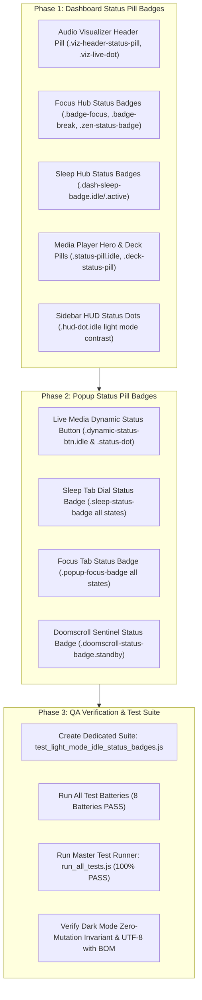

# Executive Architecture Summary: Light Mode Status Pill Badge Overhaul

> **Document Type:** Executive Architecture Summary  
> **Workspace Container:** `temp_prompt/light_mode_idle_badge_overhaul/`  
> **Task ID:** `TASK-LIGHT-MODE-IDLE-BADGE-001`  
> **Lead Architect:** Level 3C Phase-wise Prompt Generation Specialist (`prompt_generation_specialist`)  

---

## 🏛️ 1. Initiative Scope & Technical Objectives

The objective of `TASK-LIGHT-MODE-IDLE-BADGE-001` is to eliminate dull, muddy, low-contrast "IDLE" and status pill badges across the extension in Light Mode (`body.theme-light` and `[data-theme="light"]`).

### Core Problem Statement
In Dark Mode, status badges use dark translucent backgrounds (`rgba(15, 23, 42, 0.6)` or `rgba(148, 163, 184, 0.15)`) with muted light text (`#94a3b8` or `#64748b`) and subdued dots. When viewed in Light Mode:
- The backgrounds appear as dark, dirty, muddy patches on clean light cards.
- The text lacks sufficient contrast (frequently dropping below 2.5:1 against the dark patch and the light surroundings).
- The status dots are blurry and low-contrast.
- Active states (e.g. Focus active, Break active, Sleep running) often use light pastel colors (such as `#34d399` or `#a5b4fc`) that wash out on light backgrounds.

### Architectural Deliverables
1. **Light Mode Semantic Status Tokens:**
   - **IDLE State:** Clean light surface (`#f1f5f9` / `#f8fafc`), crisp subtle border (`#cbd5e1`), accessible slate text (`#475569` or `#334155`, yielding >= 7:1 contrast ratio against the white/light surface), and a crisp dot (`#64748b` with subtle ring).
   - **ACTIVE States:** Vibrant high-contrast text and saturated tinted backgrounds:
     - Playing / Focus Active: Emerald tint (`rgba(16, 185, 129, 0.12)` bg, `#065f46` text - 7.2:1 contrast, `#059669` dot).
     - Break Active: Cyan/Blue tint (`rgba(6, 182, 212, 0.12)` bg, `#0e7490` text - 6.8:1 contrast).
     - Sleep Active / Running: Indigo tint (`rgba(99, 102, 241, 0.12)` bg, `#3730a3` text - 7.5:1 contrast).
     - Paused / Standby: Amber tint (`rgba(245, 158, 11, 0.12)` bg, `#92400e` text - 6.9:1 contrast).
     - Triggered / Warning: Rose tint (`rgba(239, 68, 68, 0.12)` bg, `#991b1b` text - 7.1:1 contrast).
2. **Subsystem Coverage:**
   - Dashboard: Audio Visualizer (`.viz-header-status-pill`), Focus Sentinel Hub (`.badge-focus`, `.badge-break`, `.zen-status-badge`), Sleep Sentinel Hub (`.dash-sleep-badge`), Media Player Hero (`.status-pill`), and Sidebar HUD dots (`.hud-dot.idle`).
   - Popup: Live Media Dynamic Status Button (`.dynamic-status-btn.idle` & `.status-dot`), Sleep Tab Dial Status Badge (`.sleep-status-badge`), Focus Tab Badge (`.popup-focus-badge`), and Doomscroll Sentinel Badge (`.doomscroll-status-badge`).
3. **100% Dark Mode Zero-Mutation Guarantee:** All new rules are strictly scoped within `body.theme-light` or `[data-theme="light"]`. Zero existing dark mode styles are altered.

---

## 🗺️ 2. Cross-Phase Milestone Roadmap & Dependency Topology

---

## ⚖️ 3. Risk Mitigation & Architectural Tradeoffs

| Risk | Likelihood | Impact | Architectural Mitigation Strategy |
| :--- | :---: | :---: | :--- |
| **Monolithic File Growth (Universal Rule 28)** | High | High | `wellbeing_blacklist.css` (1,640 lines) is strictly locked. All Focus and Sleep light mode overrides are placed in `dashboard/styles/wellbeing_light.css` (currently 471 lines, keeping it safely below the 700-line limit). |
| **Dark Mode Regressions** | Medium | Critical | Zero dark mode tokens modified. All rules are strictly scoped with `body.theme-light` or `[data-theme="light"]`. Standalone test suite explicitly verifies dark mode rules are unchanged. |
| **CSS Specificity Clashes** | Medium | Medium | Use compound selectors (`body.theme-light .class`, `[data-theme="light"] .class`) with targeted `!important` only when overriding high-specificity dark selectors in older styles. |
| **Test Suite Regressions** | Low | High | Run existing 108 test suites via `node run_all_tests.js` before and after changes. Ensure zero breaking changes across all functional tests. |
