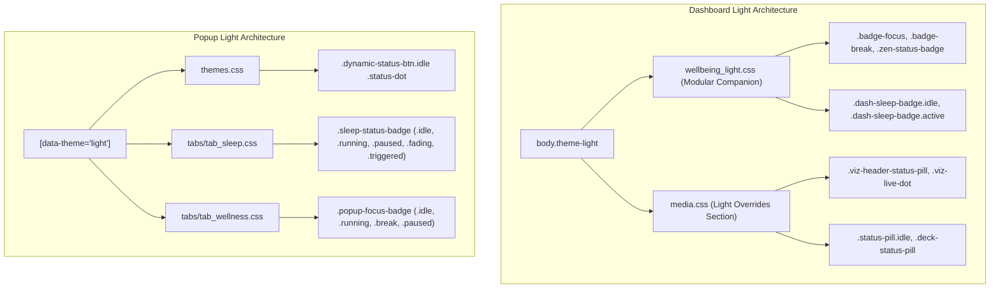

# Technical Requirements Document (TRD): Light Mode Status Pill Badge Overhaul

> **Document Type:** Technical Requirements Document (TRD)  
> **Workspace Container:** `temp_prompt/light_mode_idle_badge_overhaul/`  
> **Task ID:** `TASK-LIGHT-MODE-IDLE-BADGE-001`  
> **Lead Department:** Dept 02 (Solution Architecture) & Dept 05 (Frontend Engineering)  

---

## 🏛️ 1. Architecture & CSS Hierarchy Overview



### 1.1 Specificity Strategy
- **Dashboard:** Styles in `dashboard/styles/wellbeing_light.css` use compound parent selectors:
  ```css
  body.theme-light .viz-header-status-pill,
  [data-theme="light"] .viz-header-status-pill {
    background: #f8fafc !important;
    border: 1px solid #cbd5e1 !important;
    color: #475569 !important;
  }
  ```
  This guarantees that light mode styles override any default dark selectors while remaining 100% inactive in dark mode.
- **Popup:** Styles in `popup/styles/themes.css`, `tab_sleep.css`, and `tab_wellness.css` use:
  ```css
  [data-theme="light"] .sleep-status-badge.idle {
    background: #f1f5f9;
    border: 1px solid #cbd5e1;
    color: #475569;
  }
  ```

---

## 🎨 2. Component-by-Component Technical Specifications

### 2.1 Audio Visualizer Status Pill & Live Dot
- **Target File:** `dashboard/styles/media.css` (or `dashboard/styles/wellbeing_light.css`)
- **Selectors:**
  - `body.theme-light .viz-header-status-pill`, `[data-theme="light"] .viz-header-status-pill`
  - `body.theme-light .viz-header-status-pill .viz-live-dot`, `[data-theme="light"] .viz-header-status-pill .viz-live-dot`
  - `body.theme-light .viz-header-status-pill .viz-live-text`, `[data-theme="light"] .viz-header-status-pill .viz-live-text`
  - `body.theme-light .viz-header-status-pill.active`, `[data-theme="light"] .viz-header-status-pill.active`
- **Specification:**
  ```css
  body.theme-light .viz-header-status-pill,
  [data-theme="light"] .viz-header-status-pill {
    background: #f8fafc;
    border: 1px solid #cbd5e1;
    color: #475569;
    box-shadow: 0 1px 2px rgba(0, 0, 0, 0.04);
  }
  body.theme-light .viz-live-dot,
  [data-theme="light"] .viz-live-dot {
    background: #64748b;
    box-shadow: none;
  }
  body.theme-light .viz-live-dot.active,
  [data-theme="light"] .viz-live-dot.active {
    background: #059669;
    box-shadow: 0 0 6px rgba(5, 150, 105, 0.4);
  }
  body.theme-light .viz-header-status-pill.active,
  [data-theme="light"] .viz-header-status-pill.active {
    background: rgba(16, 185, 129, 0.12);
    border-color: rgba(16, 185, 129, 0.35);
    color: #065f46;
  }
  ```

### 2.2 Focus Sentinel Hub Status Badges
- **Target File:** `dashboard/styles/wellbeing_light.css`
- **Selectors:**
  - `body.theme-light .badge-focus`, `[data-theme="light"] .badge-focus`
  - `body.theme-light .badge-break`, `[data-theme="light"] .badge-break`
  - `body.theme-light .badge-focus-micro`, `[data-theme="light"] .badge-focus-micro`
  - `body.theme-light .badge-break-micro`, `[data-theme="light"] .badge-break-micro`
  - `body.theme-light .zen-status-badge`, `[data-theme="light"] .zen-status-badge`
- **Specification:**
  ```css
  body.theme-light .badge-focus,
  [data-theme="light"] .badge-focus {
    background: rgba(16, 185, 129, 0.12) !important;
    border: 1px solid rgba(16, 185, 129, 0.4) !important;
    color: #065f46 !important;
    font-weight: 700;
  }
  body.theme-light .badge-break,
  [data-theme="light"] .badge-break {
    background: rgba(59, 130, 246, 0.12) !important;
    border: 1px solid rgba(59, 130, 246, 0.4) !important;
    color: #1e40af !important;
    font-weight: 700;
  }
  body.theme-light .badge-focus-micro,
  [data-theme="light"] .badge-focus-micro {
    background: rgba(16, 185, 129, 0.12) !important;
    color: #065f46 !important;
  }
  body.theme-light .badge-break-micro,
  [data-theme="light"] .badge-break-micro {
    background: rgba(59, 130, 246, 0.12) !important;
    color: #1e40af !important;
  }
  body.theme-light .zen-status-badge,
  [data-theme="light"] .zen-status-badge {
    background: #f8fafc !important;
    border: 1px solid #cbd5e1 !important;
    color: #1e293b !important;
  }
  ```

### 2.3 Dashboard Hero Player & Deck Status Pills
- **Target File:** `dashboard/styles/media.css` (or `dashboard/styles/wellbeing_light.css`)
- **Specification:**
  ```css
  body.theme-light .status-pill.idle,
  [data-theme="light"] .status-pill.idle {
    background: #f1f5f9;
    border: 1px solid #cbd5e1;
    color: #475569;
  }
  body.theme-light .status-pill.playing,
  [data-theme="light"] .status-pill.playing {
    background: rgba(16, 185, 129, 0.12);
    border: 1px solid rgba(16, 185, 129, 0.35);
    color: #065f46;
  }
  body.theme-light .status-pill.paused,
  [data-theme="light"] .status-pill.paused {
    background: rgba(245, 158, 11, 0.12);
    border: 1px solid rgba(245, 158, 11, 0.35);
    color: #92400e;
  }
  body.theme-light .deck-status-pill,
  [data-theme="light"] .deck-status-pill {
    background: #f1f5f9;
    border-color: #cbd5e1;
    color: #475569;
  }
  ```

### 2.4 Popup Live Media Dynamic Status Button
- **Target File:** `popup/styles/themes.css`
- **Specification:**
  ```css
  [data-theme="light"] .dynamic-status-btn.idle .status-dot {
    background: #64748b;
    box-shadow: none;
  }
  [data-theme="light"] .dynamic-status-btn.playing .status-dot {
    background: #059669;
    box-shadow: 0 0 6px rgba(5, 150, 105, 0.4);
  }
  [data-theme="light"] .dynamic-status-btn.paused .status-dot {
    background: #d97706;
  }
  [data-theme="light"] .dynamic-status-btn.buffering .status-dot {
    background: #0891b2;
    box-shadow: 0 0 6px rgba(8, 145, 178, 0.4);
  }
  [data-theme="light"] .dynamic-status-btn.muted .status-dot {
    background: #7c3aed;
  }
  ```

### 2.5 Popup Sleep Tab Dial Status Badge
- **Target File:** `popup/styles/tabs/tab_sleep.css`
- **Specification:**
  ```css
  [data-theme="light"] .sleep-status-badge.idle {
    background: #f1f5f9;
    border-color: #cbd5e1;
    color: #475569;
  }
  [data-theme="light"] .sleep-status-badge.running {
    background: rgba(99, 102, 241, 0.12);
    border-color: rgba(99, 102, 241, 0.4);
    color: #3730a3;
    box-shadow: 0 1px 3px rgba(99, 102, 241, 0.15);
  }
  [data-theme="light"] .sleep-status-badge.paused {
    background: rgba(245, 158, 11, 0.12);
    border-color: rgba(245, 158, 11, 0.4);
    color: #92400e;
  }
  [data-theme="light"] .sleep-status-badge.fading {
    background: rgba(245, 158, 11, 0.15);
    border-color: rgba(245, 158, 11, 0.4);
    color: #92400e;
  }
  [data-theme="light"] .sleep-status-badge.triggered {
    background: rgba(239, 68, 68, 0.12);
    border-color: rgba(239, 68, 68, 0.4);
    color: #991b1b;
  }
  ```

### 2.6 Popup Focus Tab Status Badge
- **Target File:** `popup/styles/tabs/tab_wellness.css`
- **Specification:**
  ```css
  [data-theme="light"] .popup-focus-badge.idle {
    background: #f1f5f9;
    border-color: #cbd5e1;
    color: #475569;
  }
  [data-theme="light"] .popup-focus-badge.running {
    background: rgba(16, 185, 129, 0.12);
    border-color: rgba(16, 185, 129, 0.4);
    color: #065f46;
  }
  [data-theme="light"] .popup-focus-badge.break {
    background: rgba(6, 182, 212, 0.12);
    border-color: rgba(6, 182, 212, 0.4);
    color: #0e7490;
  }
  [data-theme="light"] .popup-focus-badge.paused {
    background: rgba(245, 158, 11, 0.12);
    border-color: rgba(245, 158, 11, 0.4);
    color: #92400e;
  }
  ```

---

## 🛡️ 3. Quality, Security & Encoding Invariants
- **UTF-8 with BOM:** All modified CSS and test files must be encoded in UTF-8 with BOM (`0xEF, 0xBB, 0xBF`).
- **Universal Rule 28 File Budgets:**
  - `dashboard/styles/wellbeing_blacklist.css`: strictly preserved **100% UNTOUCHED**.
  - `dashboard/styles/wellbeing_light.css`: maintain file length < 700 lines (currently ~471 lines, addition of ~80 lines leaves it at ~550 lines, well within limits).
- **Zero-Mutation Dark Mode Verification:** Dark mode styles must be confirmed identical via AST or text diff checks in the test suite.
