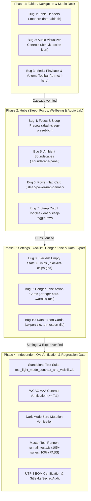

# Executive Architecture Summary: Light Mode Visibility & Contrast Fix

> **Initiative Name:** Comprehensive Light Mode UI/UX Visibility & Contrast Hardening  
> **Workspace Container:** `temp_prompt/light_mode_visibility_contrast_fix/`  
> **Document Role:** Architectural Blueprint & Cross-Phase Roadmap  
> **Author:** Level 3C Phase-wise Prompt Generation Specialist (`prompt_generation_specialist`)  
> **Target Subsystems:** Dashboard Navigation, Data Tables, Media Deck, Audio Visualizer, Focus Hub, Sleep Sentinel Hub, Ambient Soundscapes, Settings, Blacklist, Danger Zone, Data Export  
> **Autonomy Strategy:** Strategy A (Fully Autonomous Phase-wise Execution, Score: 1.0)  

---

## 🎯 1. High-Level Initiative Scope & Technical Objectives

### 1.1 Mission Statement
The Sentinel Web Activity & Media Sentinel dashboard provides rich dark cyber-glassmorphism visuals by default (`body.theme-dark`). However, when users toggle to Light Mode (`body.theme-light` or `[data-theme="light"]`), 10 core interface components suffer from contrast degradation, invisible text on hover, unreadable light-on-light color tokens, or dark background remnants.

The primary objective is to perform surgical, scoped CSS enhancements that elevate Light Mode to **WCAG 2.1 AA / AAA standard (contrast >= 7:1 for text, >= 3:1 for UI controls)** across all 10 bug items while upholding the **CRITICAL CONSTITUTIONAL INVARIANT: Modify styles ONLY for Light Mode (`body.theme-light`, `[data-theme="light"]`). Never break, mutate, or alter Dark Mode.**

### 1.2 Target Bug Inventory
1. **Table Headers:** `#domainAnalyticsTable` & `#mediaHistoryTable` `.modern-data-table th` dark background overrides.
2. **Audio Visualizer Controls & Buttons:** `.btn-viz-action-icon`, `.viz-btn-segmented`, `.btn-viz-drawer-close` light theme tokens.
3. **Media Playback Controls & Volume Toolbar:** `.btn-ctrl-hero`, `.btn-ctrl-hero-stepper`, `.hero-volume-track`, `.vol-floating-tooltip`.
4. **Focus Sentinel & Sleep Sentinel Presets/Buttons:** `.dash-sleep-preset-btn`, `.dash-focus-preset-btn`, `.dash-sleep-extender-btn`, `.btn-sleep-secondary`.
5. **Ambient Soundscapes & Sound Card Containers:** `.sleep-soundscape-panel`, `.focus-soundscape-panel`, `.soundscape-title`, select controls.
6. **Power-Nap Card & Duration Controls:** `.sleep-power-nap-banner`, `.power-nap-title`, `.power-nap-desc`, `.btn-power-nap`.
7. **Sleep Cutoff Sentinel Toggle Cards:** `.dash-sleep-toggle-row`, `.toggle-title`, `.toggle-desc`, `.dash-sleep-select-sm`.
8. **Blacklist Pattern Empty State:** `.blacklist-chips-grid`, empty placeholder text, `.blacklist-chip`.
9. **Danger Zone Action Cards:** `.settings-card.danger-card`, `.danger-warning-notice`, `.warning-text`, `.danger-action-item`.
10. **Data Export Cards:** `.export-tile`, `.export-tile-title`, `.export-tile-desc`, `.btn-export-tile`.

---

## 🗺️ 2. Cross-Phase Milestone Roadmap & Dependency Topology

### 2.1 Sequential Phase Breakdown
- **Phase 1 (Dashboard Navigation, Tables & Media Deck):** Resolves core analytical tables and media deck controls in `dashboard/styles/themes.css`, `dashboard/styles/tracking.css`, `dashboard/styles/media/hero_player.css`, and `dashboard/styles/media/visualizer_deck.css`.
- **Phase 2 (Hubs — Sleep, Focus, Wellbeing & Audio Lab):** Resolves interactive widgets, soundscape panels, preset grids, power-nap card, and cutoff toggles in `dashboard/styles/focus_sleep_advanced.css`, `dashboard/styles/wellbeing_blacklist.css`, and `dashboard/dashboard.css`.
- **Phase 3 (Settings, Blacklist, Danger Zone & Data Export):** Resolves privacy exclusion chips, danger zone notices and action cards, and data export cards in `dashboard/styles/layout.css`, `dashboard/styles/wellbeing_blacklist.css`, and `dashboard/dashboard.css`.
- **Phase 4 (Independent QA Verification & Regression Gate):** Executes independent test validation, mathematical contrast calculations, dark mode parity audits, and full 105+ test suite run.

---

## 🛡️ 3. Risk Mitigation & Architectural Tradeoff Analysis

### 3.1 Critical Risks & Guardrails
1. **CSS Specificity Collision Risk:**
   - *Risk:* Modular stylesheets are loaded before `dashboard.css`. If `dashboard.css` contains unscoped rules with high specificity, scoped light mode rules in `themes.css` might be overridden.
   - *Mitigation:* Ensure all light mode overrides use the double-scoped ancestor selector pattern: `body.theme-light <selector>, [data-theme="light"] <selector>`. When necessary to override existing `!important` flags (such as in `visualizer_deck.css`), apply matching scoped `!important` tokens.
2. **Dark Mode Mutation Risk (Constitutional Invariant):**
   - *Risk:* Accidental mutation of base classes without the `body.theme-light` or `[data-theme="light"]` prefix will degrade the cyber-dark dark mode.
   - *Mitigation:* Zero modifications to existing base CSS rules. All additions MUST be strictly appended inside dedicated light mode blocks or within scoped `body.theme-light` rules. Phase 4 explicitly asserts zero regression on dark mode property definitions.
3. **Contrast Ratio Strictness (WCAG AAA >= 7:1):**
   - *Risk:* Using mid-tone grays (e.g. `#64748b` on `#f1f5f9` gives 4.1:1 contrast, failing AAA).
   - *Mitigation:* Explicitly enforce high-contrast tokens: `#1e293b` (11.8:1 contrast against `#f1f5f9`), `#0f172a` (15.6:1 contrast against `#ffffff`), and `#991b1b` (8.5:1 contrast against `#fef2f2`).

---

## ⚡ 4. Autonomy Strategy Justification

- **Selected Strategy:** **Strategy A (Fully Autonomous Phase-wise Execution)**
- **Target Autonomy Score:** **1.0**
- **Justification:**
  1. The 10 defect items are precisely identified with exact DOM IDs and CSS class targets.
  2. The boundary constraint is absolute and non-negotiable (modify ONLY light mode styles).
  3. No business logic, data structures, or API contracts are being modified.
  4. There are no architectural forks or subjective choices requiring user pause.
  5. The execution can proceed autonomously phase-by-phase through Level 4 Sub Agents under Manager authorization.
