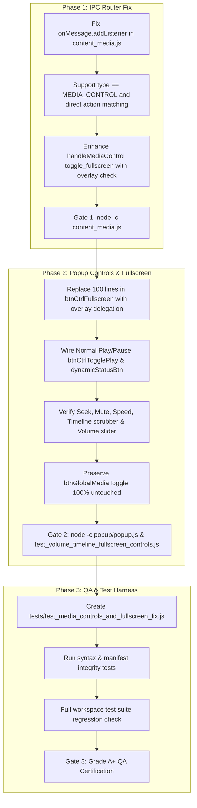

# Media Controls & Fullscreen Linking Fix — Executive Architecture Summary

> **Task ID:** `TASK-MEDIA-CTRL-FS-FIX-001`  
> **Workspace:** `c:\Users\Atul Verma\Desktop\Win App Tracker\Browser Detection`  
> **Lead Architect:** Level 3C Phase-wise Prompt Generation Specialist (`prompt_generation_specialist`)  
> **Target Path:** `temp_prompt/media_controls_and_fullscreen_fix/SUMMARY.md`  

---

## 🎯 1. Technical Objectives & Initiative Scope

The Web Activity & Media Sentinel extension features rich in-popup media controls and an on-page Floating Sentinel Fullscreen HUD Button. However, due to a flaw in message routing within `content_media.js` and an overly complex separate script implementation in `popup.js`, the popup media controls fail to control playing video tabs.

This initiative delivers three targeted objectives:
1. **Restore IPC Dispatch Fidelity:** Correct the message listener in `content_media.js` so all control messages sent from `popup.js` (`toggle_play`, `seek_relative`, `seek_percent`, `step_speed`, `set_volume`, `toggle_fullscreen`, etc.) reach `handleMediaControl` without being dropped.
2. **On-Video Overlay Fullscreen Linking:** Replace the ~100 lines of complex script injection on `#btnCtrlFullscreen` in `popup.js` with clean delegation that triggers the on-video overlay button (`#__sentinel_fs_floating_btn__`) and calls `window.__SentinelFullscreenController.toggle()`, eliminating redundant code and double-toggle race conditions.
3. **Clean Control Wiring & Invariant Preservation:**
   - Wire Normal Play/Pause (`#btnCtrlTogglePlay` and `#dynamicStatusBtn`) to toggle playback for the active media tab.
   - Wire Seek +/-10s (`#btnCtrlRewind`, `#btnCtrlForward`) to dispatch `seek_relative`.
   - Wire Mute/Unmute (`#btnCtrlToggleMute`, `#btnQuickMute`) to dispatch `toggle_mute`.
   - Wire Speed +/- (`#btnCtrlSpeedDown`, `#btnCtrlSpeedUp`) to dispatch `step_speed`.
   - Wire Timeline scrubber (`#progressBarContainer`) to dispatch `seek_percent`.
   - Wire Volume slider (`#volumeBarContainer`) to dispatch `set_volume`.
   - **PRESERVE `#btnGlobalMediaToggle` 100% UNTOUCHED:** The Universal Play/Pause toggle in the footer toolbar operates across all browser tabs via `TOGGLE_GLOBAL_MEDIA` and must remain untouched.

---

## 🗺️ 2. Milestone Roadmap & Dependency Topology

---

## 🛡️ 3. Risk Mitigation & Architectural Constraints

1. **W3C Trusted Types Compliance:**
   Zero assignments to `.innerHTML` across all modified scripts. All DOM operations must utilize `createElement`, `textContent`, `setAttribute`, and `classList`.
2. **Single-Tab vs Multi-Tab Isolation:**
   - Single-tab media actions use `type: 'CONTROL_MEDIA'` with `action: '<action_name>'` targeting a specific `tabId`.
   - Multi-tab universal playback uses `type: 'TOGGLE_GLOBAL_MEDIA'` and must not be touched or altered.
3. **No Redundant Main-World / Isolated-World Race Conditions:**
   By linking directly to `#__sentinel_fs_floating_btn__` or using `__SentinelFullscreenController.toggle()`, the cross-world lock attribute (`data-sentinel-fs-ts`) ensures zero double-toggle glitches.

---

## 📁 4. File Manifest & Touchpoints

| File Path | Nature of Modification | Phase |
| :--- | :--- | :--- |
| `content_media.js` | Surgical fix to `onMessage.addListener` (lines 1879-1893) and `handleMediaControl` (lines 1652-1669) | Phase 1 |
| `popup/popup.js` | Replace `#btnCtrlFullscreen` logic (lines 3501-3625) with overlay linking; verify media control handlers (lines 3290-3490, 3762-3830) | Phase 2 |
| `tests/test_media_controls_and_fullscreen_fix.js` | New dedicated integration test suite covering IPC routing and control actions | Phase 3 |
| `temp_prompt/media_controls_and_fullscreen_fix/INDEX.md` | Tracking board and problem-solution dossier | Architecture |
| `temp_prompt/media_controls_and_fullscreen_fix/SUMMARY.md` | Executive architecture summary | Architecture |
| `temp_prompt/media_controls_and_fullscreen_fix/PHASE_1_IPC_ROUTER_FIX.md` | Standalone execution prompt for Phase 1 | Architecture |
| `temp_prompt/media_controls_and_fullscreen_fix/PHASE_2_POPUP_CONTROLS_AND_FULLSCREEN.md` | Standalone execution prompt for Phase 2 | Architecture |
| `temp_prompt/media_controls_and_fullscreen_fix/PHASE_3_QA_AND_TEST_HARNESS.md` | Standalone execution prompt for Phase 3 | Architecture |
