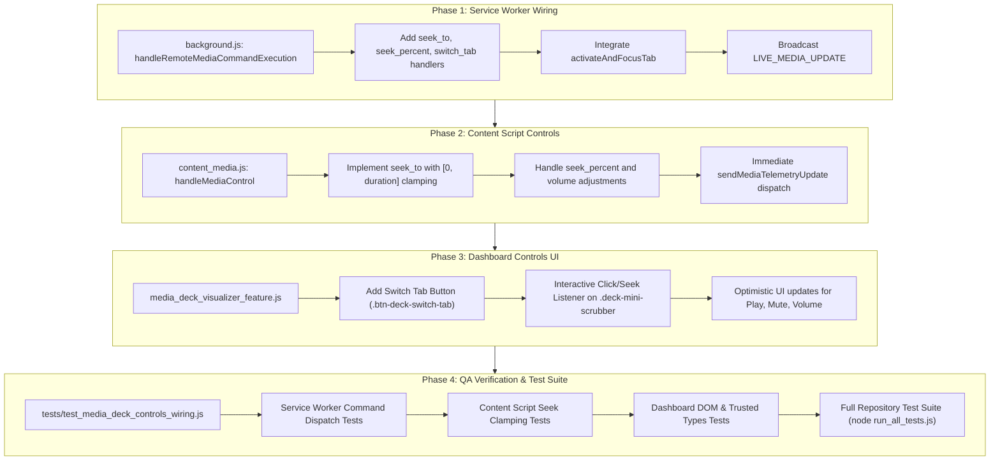

# Executive Architecture Summary: Multi-Tab Live Media Deck Controls Functional Backend Logic & Bidirectional Wiring

> **Document Type:** Executive Architecture Summary  
> **Workspace Container:** `temp_prompt/media_deck_controls_wiring/`  
> **Governing Architecture:** [`PHASE_WISE_PROMPT_GENERATION_ARCHITECTURE.md`](file:///C:/Users/Atul%20Verma/.gemini/config/rules/PHASE_WISE_PROMPT_GENERATION_ARCHITECTURE.md)  
> **Specialist Author:** Level 3C Phase-wise Prompt Generation Specialist (`prompt_generation_specialist`)  
> **Target Task ID:** `TASK-MEDIA-DECK-CONTROLS-001`  
> **Target Platform:** Google Chrome & Microsoft Edge (Manifest V3)

---

## 🎯 1. High-Level Initiative Scope & Technical Objectives

The **Multi-Tab Live Media Deck** is an essential monitoring and control capability within the Web Activity & Media Sentinel extension. It allows users viewing the central Dashboard to observe all active media streams (across YouTube, Netflix, Spotify, Twitch, HTML5 video/audio) and command playback remotely without leaving the dashboard.

While previous sprints established the visual layout and passive telemetry rendering of media deck cards, this initiative delivers the **functional backend logic and bidirectional wiring** required to make all card controls fully operational, responsive, and robust.

### Core Technical Objectives:
1. **Interactive Timeline Seeking (Mini-Scrubber):** Transform the `.deck-mini-scrubber` bar from a passive progress indicator into an interactive scrubber that calculates the clicked timestamp and dispatches an absolute seek command to the target tab.
2. **Tab Switching Remote Navigation:** Provide a clean, accessible "Switch Tab" button on every media card that immediately activates the tab in Google Chrome or Microsoft Edge and un-minimizes/focuses the corresponding browser window.
3. **Comprehensive Remote Command Execution:** Extend the background service worker's `handleRemoteMediaCommandExecution` and the content script's `handleMediaControl` to handle `seek_to` / `seek_absolute`, `seek_percent`, `switch_tab`, and volume/mute controls with rigorous parameter validation and boundary clamping.
4. **Instant Bidirectional Feedback Loop:** Ensure that when a user issues a command from the dashboard, optimistic UI updates take effect immediately, followed by an immediate broadcast of updated telemetry (`LIVE_MEDIA_UPDATE`) across all extension views.
5. **Absolute Security & Stability Guarantee:** Maintain 100% compliance with W3C Trusted Types (zero `innerHTML`), ensure UTF-8 with BOM encoding across all modified files, pass pre-commit secret scans (`gitleaks`), and achieve zero regressions across all 54 existing automated test suites.

---

## 🗺️ 2. Cross-Phase Milestone Roadmap & Dependency Topology

### Dependency Chain:
- **Phase 1 (Service Worker)** must be implemented first to provide the backend IPC handlers for `seek_to` and `switch_tab`.
- **Phase 2 (Content Script)** builds upon Phase 1's IPC messages by receiving `MEDIA_CONTROL` payloads and safely applying `currentTime` and `volume` mutations on target HTML5 video/audio elements.
- **Phase 3 (Dashboard UI)** wires the user-facing buttons and interactive scrubber to send the commands established in Phases 1 and 2.
- **Phase 4 (QA Verification)** verifies the complete end-to-end integration across all components and validates that no regressions have been introduced into the existing test suites.

---

## ⚖️ 3. Risk Mitigation & Architectural Tradeoff Analysis

| Technical Risk | Severity | Root Cause | Mitigation Strategy |
| :--- | :--- | :--- | :--- |
| **Seek Overflow / NaN Duration** | High | Media streams (e.g. live streams, web radio, or initial loading states) may have `duration === Infinity` or `NaN`. | Content script strictly clamps seek targets between `0` and `Number.isFinite(duration) ? duration : 0`. If duration is unknown or infinite, seeking is safely no-opped with a warning log. |
| **Window Focus Permission / Minimized State** | Medium | When calling `chrome.tabs.update(tabId, { active: true })`, the containing browser window might be minimized or in the background. | Re-use `activateAndFocusTab(targetId)`, which first inspects `chrome.windows.get(winId)`. If `state === 'minimized'`, it explicitly updates the window state to `'normal'` and sets `focused: true`. |
| **Rapid Scrubbing Flooding IPC** | Medium | Continuous dragging or repeated clicking on the mini-scrubber could flood Chrome's extension message bus. | UI uses immediate optimistic scrubber progress bar movement and debounces/throttles IPC dispatch (or dispatches on click release) to guarantee smooth visual feedback without IPC message exhaustion. |
| **DOM Destruction during Live Telemetry Updates** | Medium | If `renderMultiTabMediaDeck` clears and rebuilds the card DOM every 500ms, user interactions (like volume slider dragging or button hovering) are disrupted. | Provide a granular update path (`updateMediaDeckCard`) or check active focused elements (`document.activeElement`) to update only time displays and progress bars rather than blowing away input elements. |
| **XSS / HTML Injection via Tab Titles** | High | Tab titles or URLs containing special characters could compromise the dashboard if injected into DOM. | Strict adherence to W3C Trusted Types: zero `innerHTML` or `outerHTML`. All text is inserted via `textContent`, and all attributes via `setAttribute`. |
| **Regressions in Existing 54 Test Suites** | High | Changing command switch statements in `background.js` or `content_media.js` could break existing media control tests. | Strict backward-compatibility: all existing command names (`seek`, `seek_relative`, `play`, `pause`, `toggle`, `mute`, `unmute`, `solo`) are 100% preserved. New commands (`seek_to`, `seek_absolute`, `seek_percent`, `switch_tab`) are additive. |
