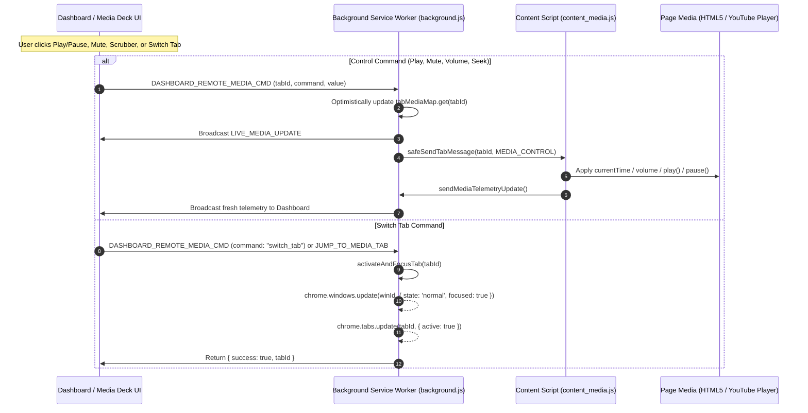

# Technical Requirements Document (TRD): Multi-Tab Live Media Deck & Hero Player Controls

> **Document Type:** Technical Requirements Document (TRD)  
> **Workspace Container:** `temp_prompt/media_deck_controls_wiring/`  
> **Governing Architecture:** [`PHASE_WISE_PROMPT_GENERATION_ARCHITECTURE.md`](file:///C:/Users/Atul%20Verma/.gemini/config/rules/PHASE_WISE_PROMPT_GENERATION_ARCHITECTURE.md)  
> **Specialist Author:** Level 3C Phase-wise Prompt Generation Specialist (`prompt_generation_specialist`)  
> **Target Task ID:** `TASK-MEDIA-DECK-CONTROLS-001`  
> **Target Platform:** Google Chrome & Microsoft Edge (Manifest V3)

---

## 🏛️ 1. Technical Architecture & Component Interaction Map



---

## 📡 2. IPC Message Envelopes & Schemas

### 2.1 Dashboard to Background: `DASHBOARD_REMOTE_MEDIA_CMD`
```typescript
interface DashboardRemoteMediaCmd {
  type: 'DASHBOARD_REMOTE_MEDIA_CMD';
  tabId: number;
  command: 
    | 'play'
    | 'pause'
    | 'toggle'
    | 'mute'
    | 'unmute'
    | 'set_volume'
    | 'seek'
    | 'seek_to'
    | 'seek_absolute'
    | 'seek_percent'
    | 'switch_tab'
    | 'focus_tab'
    | 'solo';
  value: number | string | Record<string, unknown>;
}
```

### 2.2 Background to Content Script: `MEDIA_CONTROL`
```typescript
interface MediaControlMessage {
  type: 'MEDIA_CONTROL';
  action: 
    | 'play'
    | 'pause'
    | 'toggle_play'
    | 'mute'
    | 'unmute'
    | 'set_volume'
    | 'seek_relative'
    | 'seek_percent'
    | 'seek_to'
    | 'seek_absolute';
  data?: {
    offsetSeconds?: number;
    positionSeconds?: number;
    seconds?: number;
    percent?: number;
    volume?: number;
  };
}
```

### 2.3 Window Focus & Navigation: `JUMP_TO_MEDIA_TAB`
```typescript
interface JumpToMediaTabMessage {
  type: 'JUMP_TO_MEDIA_TAB';
  tabId?: number;
  windowId?: number;
}
```

---

## 🧮 3. Precision Seeking & Duration Boundary Clamping Logic

### 3.1 Mini-Scrubber Client Coordinates Calculation
```javascript
function handleDeckScrubberClick(e, stream, options) {
  const rect = e.currentTarget.getBoundingClientRect();
  if (rect.width <= 0) return;
  const clickX = Math.max(0, Math.min(rect.width, e.clientX - rect.left));
  const ratio = clickX / rect.width;
  const dur = (typeof stream.duration === 'number' && Number.isFinite(stream.duration) && stream.duration > 0)
    ? stream.duration
    : 0;
  if (dur <= 0) return; // Prevent division by zero or NaN seeking

  const targetSeconds = Math.max(0, Math.min(dur, ratio * dur));
  
  // Optimistic UI update
  const progressEl = e.currentTarget.querySelector('.deck-scrubber-progress');
  if (progressEl) {
    progressEl.style.width = `${(ratio * 100).toFixed(1)}%`;
  }
  
  // Dispatch remote command
  handleRemoteMediaCommand(stream.tabId, 'seek_to', targetSeconds, options);
}
```

### 3.2 Content Script Seek Clamping Contract
```javascript
case 'seek_to':
case 'seek_absolute': {
  let dur = primaryMediaElement.duration;
  if (!Number.isFinite(dur) || dur <= 0) {
    dur = extractYouTubeDuration(primaryMediaElement);
  }
  const maxDuration = (Number.isFinite(dur) && dur > 0) ? dur : 999999;
  const rawTarget = typeof data.positionSeconds === 'number'
    ? data.positionSeconds
    : (typeof data.seconds === 'number' ? data.seconds : 0);
  
  const clampedSeconds = Math.max(0, Math.min(maxDuration, rawTarget));
  primaryMediaElement.currentTime = clampedSeconds;
  
  // Also synchronize with YouTube iframe player if present
  try {
    const moviePlayer = document.getElementById('movie_player') || window.movie_player;
    if (moviePlayer && typeof moviePlayer.seekTo === 'function') {
      moviePlayer.seekTo(clampedSeconds, true);
    }
  } catch (_) {}
  
  // Broadcast immediate telemetry so dashboard updates without lag
  sendMediaTelemetryUpdate();
  break;
}
```

---

## 🪟 4. Browser Tab Activation & Window Focus Bridge

### 4.1 Implementation in `background.js`
`activateAndFocusTab` must be hoisted to top-level module scope in `background.js` and attached to `globalThis`:
```javascript
async function activateAndFocusTab(tabId, windowId) {
  try {
    const numTabId = Number(tabId);
    if (!numTabId) return { success: false, error: 'Invalid tabId' };
    
    const targetTab = await browserAPI.tabs.get(numTabId);
    if (!targetTab) return { success: false, error: 'Tab not found' };
    
    // 1. Activate tab within window
    await browserAPI.tabs.update(numTabId, { active: true });
    
    // 2. Un-minimize window and set focus
    const winId = windowId || targetTab.windowId;
    if (winId && browserAPI.windows) {
      try {
        const win = await browserAPI.windows.get(winId);
        if (win && win.state === 'minimized') {
          await browserAPI.windows.update(winId, { state: 'normal', focused: true });
        } else {
          await browserAPI.windows.update(winId, { focused: true });
        }
      } catch (_) {
        await browserAPI.windows.update(winId, { state: 'normal', focused: true }).catch(() => {});
      }
    }
    return { success: true, tabId: numTabId, windowId: winId };
  } catch (err) {
    return { success: false, error: err.message || String(err) };
  }
}
```

---

## 🔒 5. W3C Trusted Types & DOM Security

1. **Zero HTML Parsing APIs:** Never use `.innerHTML`, `.outerHTML`, or `insertAdjacentHTML`.
2. **Safe Element Creation:** Use `document.createElement`, `classList.add`, `setAttribute`, and `textContent`.
3. **Safe Text Content:** Tab titles, channel names, and domain strings must be written exclusively to `.textContent`.
4. **Attribute Sanitization:** `title`, `aria-label`, and `data-tab-id` must be clean strings without executable JavaScript syntax.

---

## 🧪 6. Verification Gates

1. **Gate 1 (Syntax AST Validation):**
   - `node -c background.js`
   - `node -c content_media.js`
   - `node -c src/dashboard/features/media_deck_visualizer_feature.js`
   - `node -c dashboard/dashboard.js`
2. **Gate 2 (Component Unit Tests):**
   - Execution of `tests/test_media_deck_controls_wiring.js` (validating all 6 controls).
3. **Gate 3 (Full Workspace Regression):**
   - `node run_all_tests.js` (all 55 existing test suites + new suite must pass with exit code 0).
4. **Gate 4 (Secret & Security Compliance):**
   - `gitleaks detect --redact` (0 leaks detected).
