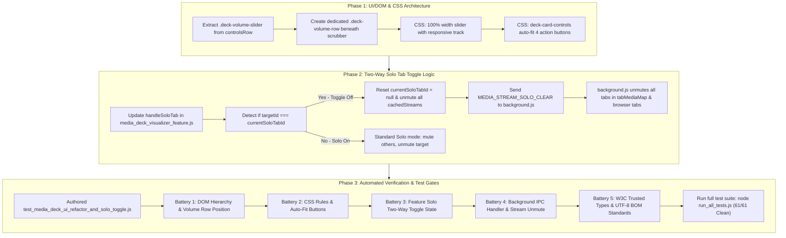

# Multi-Tab Live Media Deck UI Refactor & Two-Way Solo Tab Toggle
# Architecture Executive Summary & Technical Roadmap

> **Document Type:** Executive Architecture Summary (`SUMMARY.md`)  
> **Container:** `temp_prompt/media_deck_ui_solo_toggle/`  
> **Task ID:** TASK-MEDIA-DECK-UI-SOLO-TOGGLE-001  
> **Target Release:** Sentinel v2.4 (Multi-Tab Media Deck UI/UX Overhaul)

---

## 🏛️ 1. Initiative Scope & Objectives

The **Multi-Tab Live Media Deck** in the Web Activity & Media Sentinel dashboard provides real-time visibility and control over all active browser media streams (YouTube, Spotify, Netflix, Twitch, etc.).

This architectural refactor delivers three critical enhancements:
1. **Full-Width Volume Bar Layout:** Elevate the volume slider from a cramped 55px inline element to a dedicated, full-width interactive row matching the timeline scrubber row (`.deck-scrubber-row`). This gives users precise 0-100% volume control across the entire card width.
2. **Controls Row Auto-Fit:** The bottom controls bar now cleanly houses the 4 core actions (`Play/Pause`, `Mute/Unmute`, `Solo Tab`, `Switch Tab`) in an evenly spaced auto-fitting grid/flex layout, ensuring visual balance across all responsive dashboard widths.
3. **Two-Way Solo Tab Toggle:** Implement a two-way toggle mechanism on the `btnSolo` control. When a tab is currently in solo mode, clicking the button again deactivates solo mode, clears the active solo state, restores all previously muted streams, and synchronizes the background service worker via `MEDIA_STREAM_SOLO_CLEAR`.

---

## 🗺️ 2. Milestone Roadmap & Dependency Topology

---

## 🛡️ 3. Risk Analysis & Mitigation

| Risk Area | Potential Failure Mode | Architectural Mitigation |
| :--- | :--- | :--- |
| **DOM Hierarchy Breakage** | Existing tests might expect volume slider inside `.deck-card-controls` | Audited `tests/test_media_deck_controls_wiring.js`; existing tests check `deckFeatureCode.includes('deck-volume-slider')` and `handleRemoteMediaCommand('set_volume')`. New test suite specifically validates the new `.deck-volume-row` container. |
| **State Synchronization Drift** | Solo toggle clears local state but background fails to unmute audio | Explicit IPC contract `MEDIA_STREAM_SOLO_CLEAR` with dual-direction confirmation, clearing both `tabMediaMap` muted states and calling `browserAPI.tabs.update(tId, { muted: false })`. |
| **W3C Trusted Types Violation** | Direct `innerHTML` injection during DOM updates | Strict enforcement of `document.createElement`, `setAttribute`, and `textContent` as required by project architecture. |
| **Encoding Regressions** | Modified files losing UTF-8 BOM | Strict preservation of UTF-8 with BOM (`0xEF, 0xBB, 0xBF`) on all modified and newly created files. |

---

## 🎯 4. Completion Acceptance Criteria
- [ ] `.deck-volume-row` exists as a separate DOM node directly beneath `.deck-scrubber-row` and above `.deck-card-controls`.
- [ ] `.deck-volume-slider` has 100% width matching `.deck-mini-scrubber`.
- [ ] `.deck-card-controls` has exactly 4 buttons (`Play/Pause`, `Mute/Unmute`, `Solo Tab`, `Switch Tab`) auto-fitted evenly.
- [ ] Clicking `btnSolo` on an active solo tab toggles it off, resets `currentSoloTabId`, unmutes all streams, removes `.solo-active` class, and notifies `background.js`.
- [ ] All 61 test suites in `run_all_tests.js` pass with exit code 0.
