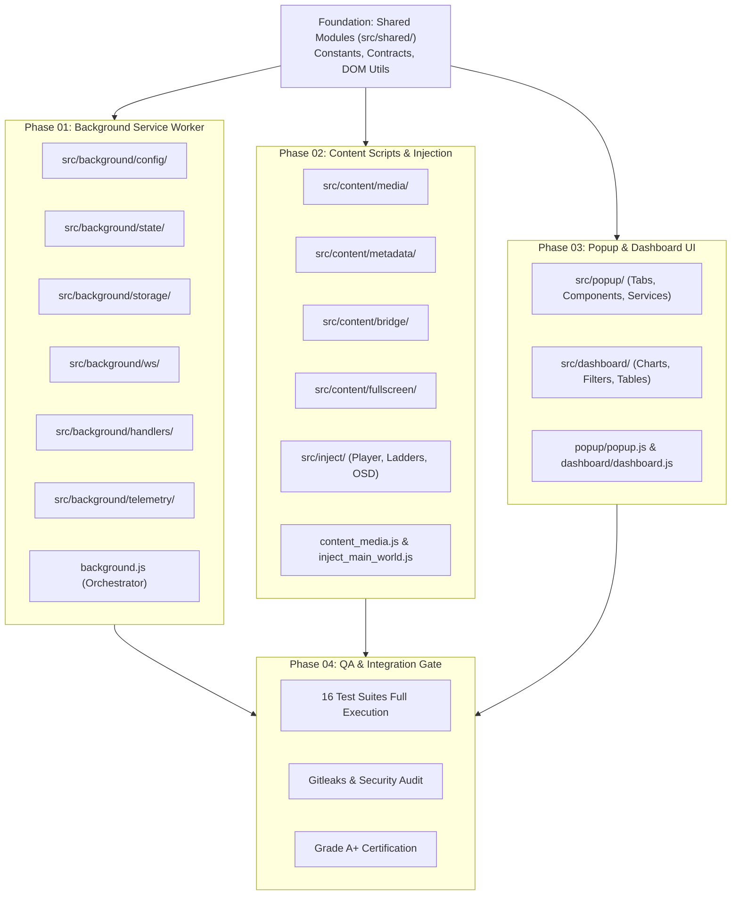

# Executive Architecture Summary — Modular Architecture Refactor

> **Initiative:** Chrome Extension MV3 Multi-Modular Industry-Standard Architecture  
> **Workspace:** `c:\Users\Atul Verma\Desktop\Win App Tracker\Browser Detection`  
> **Author & Architect:** Atul Verma (`aiprincekumar` / `aiprincekumar010100@gmail.com`)  
> **Governance:** [`PHASE_WISE_PROMPT_GENERATION_ARCHITECTURE.md`](file:///C:/Users/Atul%20Verma/.gemini/config/rules/PHASE_WISE_PROMPT_GENERATION_ARCHITECTURE.md)  
> **Target Path:** `temp_prompt/modular_architecture_refactor/SUMMARY.md`

---

## 🏛️ 1. Executive Summary & Strategic Scope

The Web Activity & Media Sentinel browser extension is a mission-critical component of the Win App Tracker suite, communicating over RFC 6455 WebSockets with the local Video Detector HUD and Python Host daemons. Over progressive sprints, the extension has accumulated cutting-edge features:
- Dual media tracking and audible background detection
- 4-Pillar Hub UI (Player, Audio Lab with 5-Band EQ & 200% Boost, Studio Vault, and Focus Tracker)
- SQLite Data Hub synchronization with multi-browser filtering (Chrome, Edge, Firefox)
- Web Fullscreen CSS engine with cross-world debounce locking
- Sleep Timer automation with volume fade ladders

However, all of these features currently reside in 6 massive monolithic script files totaling over 500 KB:
- `background.js` (105 KB)
- `popup/popup.js` (143 KB)
- `dashboard/dashboard.js` (135 KB)
- `content_media.js` (54 KB)
- `inject_main_world.js` (44 KB)
- `fullscreen_controller.js` (30 KB)

This refactoring initiative adopts the **Industry-Standard Modular Architecture for Manifest V3 Extensions and Modern Web Frontends**. It establishes a domain-driven `src/` architecture that decouples state, storage, networking, DOM telemetry, UI components, and test bridges into discrete, single-responsibility ES modules while preserving 100% backward compatibility with all 16 existing automated test suites.

---

## 🎯 2. Technical Objectives & Quality Attributes

1. **High Cohesion & Low Coupling:** Break down monolithic god-objects into focused modules (<200 lines each) with strictly defined interfaces.
2. **Manifest V3 Native Module Compliance:** Leverage `"type": "module"` in `manifest.json` for service workers, and ES module script tags for popup and dashboard HTML pages.
3. **W3C Trusted Types & CSP Compliance:** Zero `innerHTML` assignments; all dynamic DOM generation uses safe element creation and Trusted Types compliant utilities in `src/shared/dom_utils.js`.
4. **Single Source of Truth (SSOT):** Centralize all action constants, IPC channels, default configurations, and storage schemas in `src/shared/`.
5. **Zero Regression Standard:** All 16 automated test suites in `tests/` must pass unconditionally with exit code 0.

---

## 🗺️ 3. Cross-Phase Milestone Roadmap & Dependency Topology

---

## ⚖️ 4. Risk Mitigation & Architectural Tradeoff Analysis

| Technical Risk | Likelihood | Impact | Architectural Mitigation Strategy |
| :--- | :--- | :--- | :--- |
| **Breaking Existing Test Suites** | High | Critical | The 16 existing test suites in `tests/` inspect root script files (`background.js`, `popup/popup.js`, etc.) using regex and `vm.Script`. Root files will act as orchestrators, re-exporting and exposing required functions and integration hooks to maintain 100% test contract compatibility. |
| **MV3 Content Script Module Constraints** | Medium | High | Chrome MV3 does not natively support `type="module"` in `content_scripts` declarations in `manifest.json`. For content scripts, modules will be composed cleanly using lightweight UMD/IIFE patterns or concatenated modular namespaces, while background, popup, and dashboard use native ES modules. |
| **Cross-World Event Race Conditions** | Low | High | Centralize the debounce locking mechanism (`LOCK_ATTR = 'data-sentinel-fs-ts'`, 350ms window) in `src/content/fullscreen/debounce_lock.js` and bridge contracts in `src/shared/contracts.js`. |
| **State Drift between Popup and Background** | Low | Medium | Encapsulate storage operations behind reactive getters/setters in `src/background/storage/` and `src/popup/services/storage_service.js`, using single-source `chrome.storage.onChanged` events. |

---

## ⚡ 5. Execution Strategy Recommendation

- **Selected Strategy:** `STRATEGY_A_AUTONOMOUS`
- **Autonomy Score:** `1.0` (Target: 1.0)
- **Rationale:** The project scope is well-defined, the existing code is fully covered by 16 comprehensive test suites that act as deterministic verification gates, and the refactoring is purely architectural and behavior-preserving without ambiguous requirements. Execution can proceed sequentially through Phases 1 to 4 under autonomous Level 4 subagents with zero-pause local test validation.
