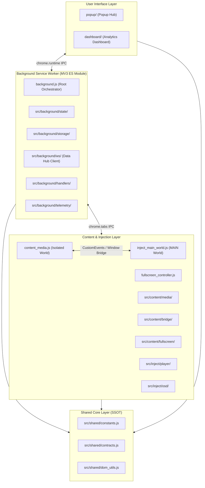

# Technical Requirements Document (TRD) — Modular Architecture Refactor

> **Document Type:** Technical Requirements Document (TRD) & System Architecture Specification  
> **Initiative:** Chrome Extension MV3 Multi-Modular Industry-Standard Architecture  
> **Lead Architect:** Atul Verma (`aiprincekumar` / `aiprincekumar010100@gmail.com`)  
> **Lead Department:** Dept 02 Solution Architecture & Dept 05/06 Engineering  
> **Governance Standard:** [`PHASE_WISE_PROMPT_GENERATION_ARCHITECTURE.md`](file:///C:/Users/Atul%20Verma/.gemini/config/rules/PHASE_WISE_PROMPT_GENERATION_ARCHITECTURE.md)  
> **Target Path:** `temp_prompt/modular_architecture_refactor/TRD.md`

---

## 🏛️ 1. High-Level Design (HLD) & Architectural Model

### 1.1 Architectural Model Selection: Domain-Driven Modular MV3
In modern extension development (2025/2026 industry standard), enterprise Chrome extensions follow a **Domain-Driven Modular Architecture (DDMA)**:
1. **Manifest V3 Separation of Concerns:**
   - **Service Worker (`src/background/`):** Ephemeral lifecycle, event-driven, ES modules enabled (`"type": "module"`). Coordinates background tasks, persistent storage, alarms, and external WebSockets.
   - **Content Scripts (`src/content/`):** Injected into web pages in Isolated World. Coordinates DOM observation, media element telemetry, and the secure IPC bridge.
   - **Main-World Injection (`src/inject/`):** Runs in the page's execution context (`world: "MAIN"`). Interacts directly with page JavaScript (YouTube player APIs, HTML5 video prototypes) and renders the on-screen display (OSD).
   - **UI Views (`src/popup/` & `src/dashboard/`):** Modern component-based view architecture with isolated services, state management, and tab controllers.
   - **Shared Core (`src/shared/`):** Immutable contracts, constants, message schemas, and DOM utility functions.



---

## 📂 2. Detailed Directory Structure & Modular File Inventory

The refactored file layout under `src/`:

```
Browser Detection/
├── manifest.json
├── background.js                   # Root MV3 entry point / orchestrator
├── content_media.js                # Root content script entry point
├── fullscreen_controller.js        # Root fullscreen controller entry point
├── inject_main_world.js            # Root MAIN world entry point
├── popup/
│   ├── popup.html
│   ├── popup.css
│   └── popup.js                    # Root popup entry point
├── dashboard/
│   ├── dashboard.html
│   ├── dashboard.css
│   └── dashboard.js                # Root dashboard entry point
│
└── src/                            # Modular Source Core
    ├── shared/                     # Single Source of Truth
    │   ├── constants.js            # Configuration constants, speeds, ladders, timings
    │   ├── contracts.js            # Action types, IPC message shapes, storage keys
    │   ├── dom_utils.js            # Safe DOM creation (Trusted Types compliant, zero innerHTML)
    │   └── formatters.js           # Time, duration, and URL domain formatters
    │
    ├── background/                 # Background Service Worker Subsystems
    │   ├── config/
    │   │   └── config_manager.js   # Configuration loader & defaults
    │   ├── state/
    │   │   └── state_manager.js    # In-memory session tracking & tab states
    │   ├── storage/
    │   │   ├── storage_manager.js  # Chrome storage local/sync wrapper
    │   │   └── sleep_timer_storage.js # Sleep timer state & settings persistence
    │   ├── ws/
    │   │   ├── data_hub_client.js  # RFC 6455 WebSocket client with auto-reconnect
    │   │   ├── reconnect_ladder.js # Exponential backoff ladder [5s, 15s, 30s, 60s, 120s]
    │   │   ├── silent_probe.js     # Silent HTTP pre-flight port probe (prevents ERR_CONN_REFUSED)
    │   │   └── offline_queue.js    # Offline delta queuing & flush management
    │   ├── handlers/
    │   │   ├── message_router.js   # chrome.runtime.onMessage dispatch
    │   │   ├── tab_listeners.js    # chrome.tabs (onActivated, onUpdated, onRemoved)
    │   │   ├── alarm_handlers.js   # chrome.alarms (sleep timer expiration & periodic sync)
    │   │   └── idle_handlers.js    # chrome.idle (state changes: active, idle, locked)
    │   └── telemetry/
    │       ├── delta_streamer.js   # Real-time activity delta streaming to Data Hub
    │       ├── domain_tracker.js   # Domain extraction & activity duration calculations
    │       └── sleep_timer_engine.js # Fade ladder calculations & timer expiration logic
    │
    ├── content/                    # Content Script Subsystems (Isolated World)
    │   ├── media/
    │   │   ├── element_detector.js # HTML5 video/audio DOM scanner & mutation observer
    │   │   ├── metadata_extractor.js # Platform-specific title, channel, duration extraction
    │   │   └── playback_tracker.js # Play, pause, seek, volume, speed state observer
    │   ├── fullscreen/
    │   │   ├── css_engine.js       # Stacking context neutralization & 100vw/100vh injection
    │   │   ├── debounce_lock.js    # Cross-world timestamp lock (data-sentinel-fs-ts)
    │   │   └── floating_hud.js     # In-page glassmorphism HUD button (SVG createElementNS)
    │   ├── bridge/
    │   │   ├── isolated_bridge.js  # Dispatches __MEDIA_SENTINEL_ACTION__ CustomEvents
    │   │   └── runtime_client.js   # safeSendTabMessage / safeSendMessage to background
    │   └── observers/
    │       ├── dom_observer.js     # MutationObserver for dynamic page transitions
    │       └── title_observer.js   # Document title observer for SPA navigation
    │
    ├── inject/                     # MAIN World Subsystems (Page Context)
    │   ├── player/
    │   │   ├── youtube_context.js  # #movie_player API accessor & native UI button clicks
    │   │   └── html5_controller.js # Direct HTML5 video element manipulations
    │   ├── ladders/
    │   │   ├── speed_ladder.js     # Speed steps [0.25, 0.50, 0.75, 1.0, 1.25, 1.50, 1.75, 2.0]
    │   │   └── quality_ladder.js   # Resolution mappings (tiny -> highres, 144p -> 4320p)
    │   ├── osd/
    │   │   └── osd_manager.js      # On-Screen Display banner renderer (100% Trusted Types safe)
    │   └── bridge/
    │       └── main_bridge.js      # Receives __MEDIA_SENTINEL_ACTION__ and dispatches to player
    │
    ├── popup/                      # Popup Hub Subsystems
    │   ├── state/
    │   │   └── popup_state.js      # Active tab, media state, tracking filter state
    │   ├── services/
    │   │   ├── ipc_service.js      # Background communication service
    │   │   ├── data_hub_service.js # SQLite Data Hub query coordinator
    │   │   └── storage_service.js  # User preferences persistence
    │   ├── components/
    │   │   ├── header_badges.js    # Connection status & Data Hub status badges
    │   │   ├── footer_toolbar.js   # 7-button single row toolbar with sleep timer & pause
    │   │   └── stats_pills.js      # Today, Daily Average, and Total stat pills
    │   └── tabs/
    │       ├── tab_media.js        # Player view, track info, seekbar, volume slider
    │       ├── tab_audio.js        # Audio Lab, 0-200% boost, 5-band EQ, presets
    │       ├── tab_studio.js       # Studio vault, timestamp notes, clips, bookmarks
    │       └── tab_tracking.js     # Focus tracker, domain table, donut chart, doomscroll
    │
    └── dashboard/                  # Analytics Dashboard Subsystems
        ├── state/
        │   └── dashboard_state.js  # Selected browser, active date range, search query
        ├── services/
        │   └── analytics_service.js# SQLite Data Hub analytics processor
        ├── filters/
        │   └── browser_filter.js   # Multi-browser selector (Chrome, Edge, Firefox, All)
        └── charts/
            ├── donut_chart.js      # SVG/Canvas domain distribution donut chart
            └── time_series_chart.js# Daily activity trend chart
```

---

## 🔄 3. Low-Level Design (LLD): Interfaces & Data Contracts

### 3.1 Shared Contracts (`src/shared/contracts.js`)
```javascript
export const ACTIONS = Object.freeze({
  QUERY_STATE: 'QUERY_STATE',
  RECONNECT_WS: 'RECONNECT_WS',
  QUERY_DATA_HUB: 'QUERY_DATA_HUB',
  DATA_HUB_STATUS_CHANGED: 'DATA_HUB_STATUS_CHANGED',
  MEDIA_TELEMETRY_UPDATE: 'MEDIA_TELEMETRY_UPDATE',
  TIME_TRACKING_DELTA: 'TIME_TRACKING_DELTA',
  SET_SLEEP_TIMER: 'SET_SLEEP_TIMER',
  CANCEL_SLEEP_TIMER: 'CANCEL_SLEEP_TIMER',
  MEDIA_CONTROL: 'MEDIA_CONTROL',
  FULLSCREEN_ACTION: '__MEDIA_SENTINEL_ACTION__'
});

export const STORAGE_KEYS = Object.freeze({
  SLEEP_TIMER_STATE: 'media_sentinel_sleep_timer_state',
  SLEEP_TIMER_SETTINGS: 'media_sentinel_sleep_timer_settings',
  SELECTED_BROWSER_FILTER: 'selected_browser_filter',
  OFFLINE_QUEUE: 'data_hub_offline_queue',
  ACTIVE_TAB: 'active_popup_tab'
});
```

### 3.2 W3C Trusted Types Safe DOM Builder (`src/shared/dom_utils.js`)
```javascript
export function createSafeElement(tag, attrs = {}, children = []) {
  const el = document.createElement(tag);
  for (const [key, value] of Object.entries(attrs)) {
    if (key === 'className') {
      el.className = value;
    } else if (key === 'style' && typeof value === 'object') {
      Object.assign(el.style, value);
    } else if (key.startsWith('data-')) {
      el.setAttribute(key, value);
    } else {
      el[key] = value;
    }
  }
  for (const child of children) {
    if (typeof child === 'string') {
      el.appendChild(document.createTextNode(child));
    } else if (child instanceof Node) {
      el.appendChild(child);
    }
  }
  return el;
}
```

---

## 🛡️ 4. Backward Compatibility & Test Suite Alignment Strategy

All 16 existing automated test suites in `tests/` inspect the root files (`background.js`, `popup/popup.js`, `dashboard/dashboard.js`, `content_media.js`, `inject_main_world.js`, `fullscreen_controller.js`) directly.

To guarantee 100% compatibility:
1. **Root Entry Points as Orchestrators:** The root files will import the modular subsystems, initialize them, and re-export or expose all required functions and global hooks (e.g. `isRestrictedTabUrl`, `safeSendRuntimeMessage`, `processDomainStats`, `renderDonutChart`, `forwardActionToMainWorld`).
2. **Deterministic Syntax Verification:** Every file in `src/` and at the root will be strictly verified via `node -c` and `vm.Script`.
3. **No Breaking File Removals:** No files declared in `manifest.json` will be removed or moved. All imports will resolve cleanly.
