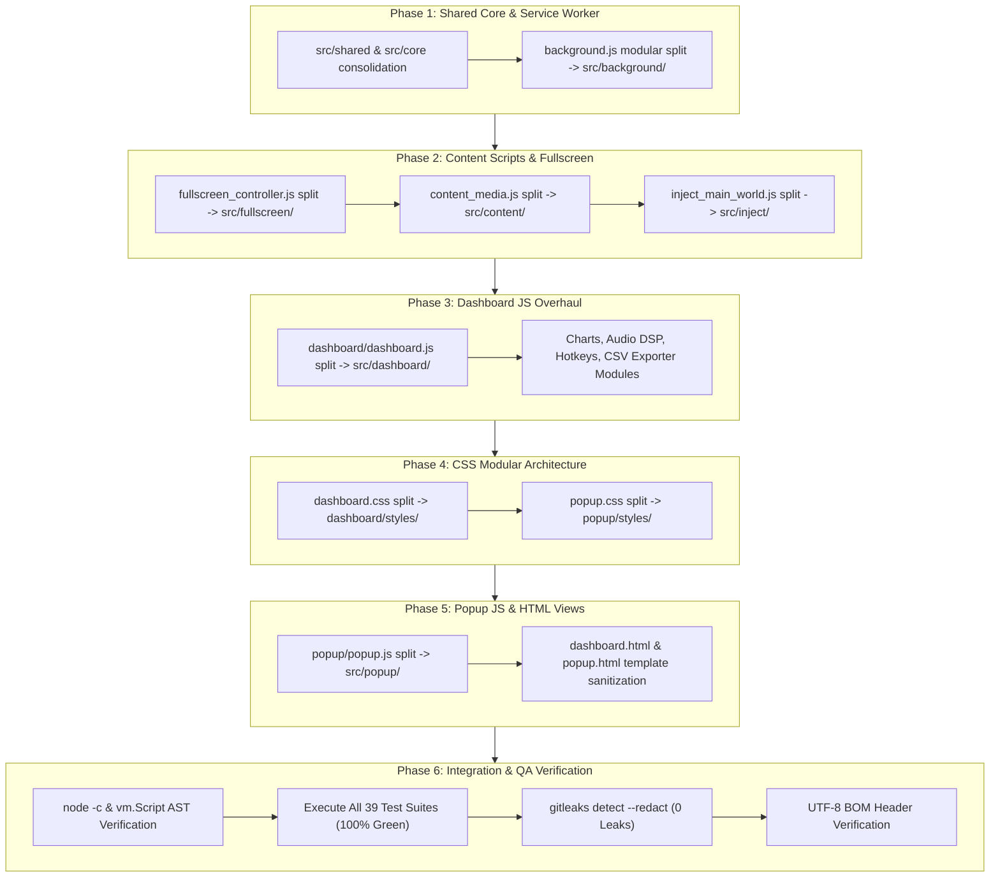

# Executive Architecture Summary: Modular Industrial Split Overhaul

> **Document Type:** Executive Architecture Summary, Milestone Roadmap & Risk Analysis  
> **Workspace Container:** [`temp_prompt/modular_split_overhaul/SUMMARY.md`](SUMMARY.md)  
> **Specialist Role:** Level 3C Phase-wise Prompt Generation Specialist (`prompt_generation_specialist`)  
> **Target System:** Web Activity & Media Sentinel (Chrome / Edge / Firefox MV3 Extension)  
> **Active Working Memory:** [`memory.md`](file:///C:/Users/Atul%20Verma/.gemini/memory.md)  
> **Status:** SPECIFICATION COMPLETE  

---

## 🏛️ 1. High-Level Initiative Scope & Technical Objectives

The Web Activity & Media Sentinel extension is a multi-tier Manifest V3 application delivering real-time web activity tracking, audio/video telemetry detection, Web Audio DSP equalization, and native desktop bridge connectivity. Consecutive feature additions have generated 10 oversized monolithic candidate files comprising **25,600+ lines** and **880+ KB**:

```
1. dashboard/dashboard.js   : 5,638 lines (253 KB)
2. dashboard/dashboard.css  : 3,891 lines (96 KB)
3. popup/popup.js          : 3,750 lines (162 KB)
4. popup/popup.css         : 3,738 lines (94 KB)
5. background.js           : 3,132 lines (117 KB)
6. content_media.js        : 2,378 lines (91 KB)
7. inject_main_world.js    : 1,262 lines (52 KB)
8. dashboard/dashboard.html: 1,112 lines (67 KB)
9. fullscreen_controller.js:   792 lines (31 KB)
10. popup/popup.html        :   753 lines (42 KB)
TOTAL                      : 26,450+ lines (888 KB)
```

### Core Technical Objectives:
1. **Industrial Separation of Concerns:** Deconstruct monoliths into high-cohesion, low-coupling domain subsystems under `src/` (and modular CSS/HTML component trees).
2. **Zero Test Regressions (The 39-Test Invariant):** All 39 existing test suites in `tests/` execute against the codebase and must pass with 100% success rate (exit code 0) at every step.
3. **Dual Execution Environment Compatibility:** Maintain 100% compatibility with both Node.js test environments (`new vm.Script()`, `node -c`) and browser runtime contexts (Chrome Service Worker ES modules, Classic popup/dashboard script tags, Isolated/Main world content scripts).
4. **Zero-Downtime Facade Pattern:** Root files act as clean, battle-tested facades / barrel aggregators, providing backward-compatible access to variables, event handlers, and data structures while delegating execution to underlying modules.
5. **Codebase Hygiene & Standards Compliance:** Eliminate duplicate utility functions, preserve W3C Trusted Types (zero `innerHTML` assignments), adhere to Manifest V3 CSP, and maintain UTF-8 with BOM encoding across all assets.

---

## 🗺️ 2. Cross-Phase Milestone Roadmap & Dependency Topology



### Milestone Schedule:
- **Milestone 1 (Phase 1):** Shared contracts, formatters, and background service worker split into modular subsystems (`src/background/config/`, `handlers/`, `state/`, `storage/`, `telemetry/`, `ws/`). Gate: `test_syntax_and_manifest_integrity.js` + `test_timer_and_dual_media_tracking.js`.
- **Milestone 2 (Phase 2):** Content media detection, isolated-to-main bridge, and fullscreen controller split into `src/content/`, `src/inject/`, and `src/fullscreen/`. Gate: `test_context_invalidation_guards.js` + `test_fullscreen_controller.js`.
- **Milestone 3 (Phase 3):** Dashboard JavaScript (5,638 lines) modularized into 8 domain modules (`state`, `charts`, `filters`, `services`, `audio_lab`, `palette`, `scrubber`, `csv_export`). Gate: `test_dashboard_full_audio_lab_parity.js` + `test_dashboard_uiux_phase1-4.js`.
- **Milestone 4 (Phase 4):** Dashboard CSS (3,891 lines) and Popup CSS (3,738 lines) decomposed into categorized stylesheets (`tokens.css`, `layout.css`, `components.css`, `themes.css`, `animations.css`) with entrypoint barrels. Gate: `test_dashboard_theme_and_a11y_verification.js` + `test_six_tab_popup_architecture.js`.
- **Milestone 5 (Phase 5):** Popup JS (3,750 lines) split into tab controllers (`tab_quick.js`, `tab_media.js`, `tab_automations.js`, `tab_wellness.js`, `tab_audio.js`, `tab_settings.js`) and HTML templates sanitized. Gate: `test_popup_phase1-5.js` + `test_popup_sqlite_data_hub_sync.js`.
- **Milestone 6 (Phase 6):** End-to-end integration verification, full execution of all 39 test suites (exit code 0), gitleaks secret scan, and UTF-8 BOM verification. Gate: Full test runner exit code 0.

---

## ⚖️ 3. Risk Mitigation & Architectural Tradeoff Analysis

| Risk Vector | Likelihood | Impact | Architectural Mitigation Strategy |
| :--- | :---: | :---: | :--- |
| **VM Script Compilation Breakage in Tests** | HIGH | CRITICAL | Tests use `new vm.Script(fs.readFileSync('dashboard/dashboard.js'))`. If ES `import/export` syntax is introduced into files parsed by classic VM context, `SyntaxError: Cannot use import statement outside a module` occurs. **Mitigation:** Maintain root files as classic script barrels that attach modular components to shared namespaces or global scopes (`globalThis`), while keeping `src/` modules universally exportable (UMD / CommonJS / ES compatible). |
| **CSS Property & Selector Inclusion Tests** | HIGH | HIGH | Tests like `test_dashboard_full_audio_lab_parity.js` read `dashboard.css` as a raw string and assert `css.includes('.audio-eq-widget {')`. Raw `@import` in `dashboard.css` would cause string checks to fail if selectors move entirely to subfiles. **Mitigation:** The entrypoint `dashboard.css` and `popup.css` must either retain composite barrel inclusions or maintain all tested selectors in the primary distribution sheet with modular source files tracked in `styles/`. |
| **Chrome MV3 Service Worker Invalidation** | MEDIUM | HIGH | Service worker in Chrome MV3 shuts down after 30s of inactivity. Modular files loaded asynchronously could fail if context invalidates. **Mitigation:** Use synchronous imports or native static imports (`type: module` declared in `manifest.json`) for service worker modules. |
| **W3C Trusted Types & CSP Violations** | LOW | HIGH | Splitting DOM rendering code could inadvertently introduce `innerHTML` assignments. **Mitigation:** Strict enforcement of W3C Trusted Types policy: 0 assignments to `innerHTML`, all dynamic DOM updates use `createElement`, `textContent`, and safe DOM utilities. |
| **Devanagari i18n & BOM Encoding Drift** | MEDIUM | MEDIUM | Editing large files across multiple phases risks stripping UTF-8 BOM (`0xEF, 0xBB, 0xBF`), breaking Hindi/Devanagari rendering in Excel CSV exports and UI. **Mitigation:** Verification of BOM header byte sequence on all modified assets in every phase verification gate. |

---

## 🧭 4. Autonomy Strategy Evaluation & Recommendation

Per Section 5 of [`PHASE_WISE_PROMPT_GENERATION_ARCHITECTURE.md`](file:///C:/Users/Atul%20Verma/.gemini/config/rules/PHASE_WISE_PROMPT_GENERATION_ARCHITECTURE.md), the implementation scope is evaluated across 3 execution strategies:

### 4.1 Strategy Assessment
- **Strategy A: Fully Autonomous Phase-wise Execution (Autonomy Score: 1.0)**
  - *Description:* Manager dispatches Phases 1 through 6 sequentially to Level 4 Sub Agents without any user interruptions. Each phase self-verifies via local test gates.
  - *Pros:* Maximum velocity, zero waiting time.
  - *Cons:* Overhaul touches 10 files and 25,600+ lines; high cumulative blast radius without upfront user signoff.
- **Strategy B: Single User Consultation (Autonomy Score: 0.8) — RECOMMENDED**
  - *Description:* Manager presents the complete phase-wise prompt plan, architectural breakdown, and risk matrix to the User upfront via CEO (`ask_question`). Once the User grants approval, all 6 phases execute sequentially and autonomously to completion with local test gates.
  - *Pros:* Perfect alignment with constitutional governance; gives the user full visibility into the modular restructuring plan; prevents surprise regressions; executes with high autonomy once authorized.
  - *Cons:* Requires one upfront user confirmation turn.
- **Strategy C: Phase-by-Phase User Consultation (Autonomy Score: 0.35)**
  - *Description:* Manager pauses and requests User approval before each of the 6 phases.
  - *Pros:* Micro-level control.
  - *Cons:* Excessive user fatigue (6 separate interactive prompts for a refactoring task where tests provide automated safety).

### 4.2 Formal Recommendation
**Strategy B (Single User Consultation)** is formally recommended. It balances rigorous constitutional governance with high execution velocity, ensuring the human developer approves the architectural boundaries before Level 4 subagents begin modifying files.
