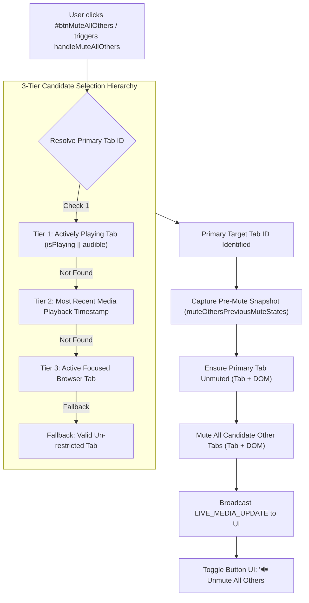

# Primary Media Tab Selection for "Mute All Others": Executive Summary

> **Document Type:** Executive Architecture & Strategy Summary  
> **Workspace Container:** `temp_prompt/mute_all_others_primary_tab_selection/`  
> **Specialist Role:** Level 3C Phase-wise Prompt Generation Specialist (`prompt_generation_specialist`)  

---

## 🎯 1. Initiative Scope & Objectives

The goal of this initiative is to update and harden the primary/preserved tab selection algorithm for the "Mute All Others" feature across the background service worker (`background.js`) and the dashboard visualizer feature module (`src/dashboard/features/media_deck_visualizer_feature.js` / `dashboard/dashboard.js`).

When a user triggers "Mute All Others" (via `#btnMuteAllOthers` or programmatic IPC):
1. The system must intelligently resolve the single primary media tab that should remain audible.
2. The selection follows a strict 3-tier candidate hierarchy:
   - **Tier 1 (Active Playback):** Tab currently actively playing media (`isPlaying === true` or `audible === true`).
   - **Tier 2 (Playback Recency):** If no tab is actively playing, tab with the most recent playback timestamp or activity.
   - **Tier 3 (Active Focus):** If no active or recent media session exists, the currently focused browser tab (`active: true, lastFocusedWindow: true`).
3. The selected primary tab is guaranteed to remain unmuted.
4. All other candidate tabs are muted at both the tab level (`chrome.tabs.update`) and in-page DOM level (`MEDIA_CONTROL` -> `mute`).
5. Pre-mute states are reliably snapshotted to enable bidirectional toggle restoration.

---

## 🏗️ 2. Architectural Blueprint & Data Flow

---

## ⚡ 3. Strategy & Execution Governance

- **Recommended Strategy:** **Strategy A (Fully Autonomous Phase-wise Execution)**
- **Target Autonomy Score:** 1.0
- **Phasing Breakdown:**
  - **Phase 01:** Backend Candidate Resolution & State Preservation (`background.js`)
  - **Phase 02:** Visualizer Feature Module & Dashboard UI Alignment (`src/dashboard/features/media_deck_visualizer_feature.js`, `dashboard/dashboard.js`)
  - **Phase 03:** Comprehensive Test Suite & Independent QA Verification (`tests/test_mute_all_others_primary_tab_selection.js`)
- **Key Risk Controls:**
  - Zero regression on existing bidirectional toggle tests (`test_bidirectional_mute_toggle_phase*.js`).
  - Strict preservation of UTF-8 with BOM (`0xEF, 0xBB, 0xBF`).
  - Strict adherence to function length constraint (<= 50 lines per function in `background.js`).
