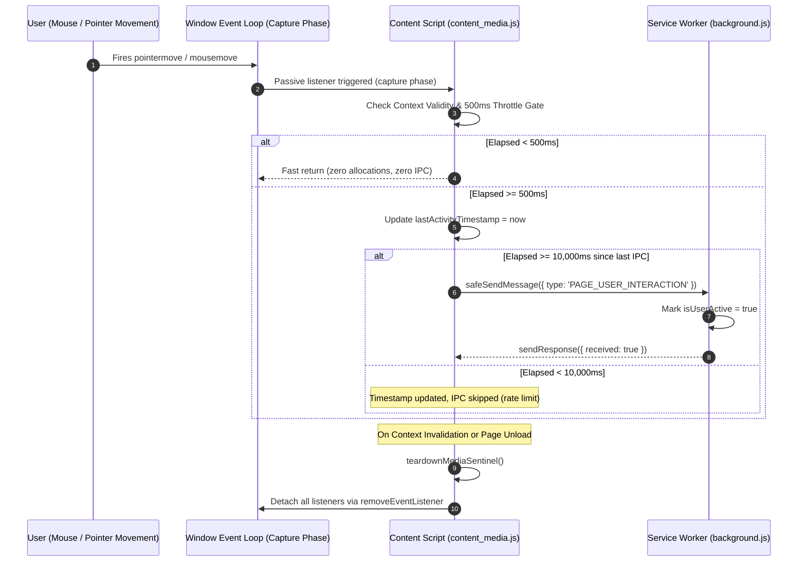
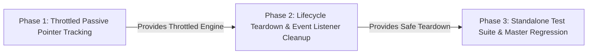

# Executive Architecture Summary: Passive Mouse Movement Tracking in content_media.js

> **Task Container:** `temp_prompt/passive_mouse_movement_tracking/`  
> **Document Type:** Executive Summary & Architectural Topology  
> **Lead Architecture Department:** Dept 05 Frontend Engineering (`departments_archive/05_frontend_engineering_dept.md`)  
> **Governing Specialist:** Level 3C Phase-wise Prompt Generation Specialist (`prompt_generation_specialist`)  

---

## 🏛️ 1. Technical Context & Strategic Scope

### Background
In browser extension telemetry, accurately determining whether a user is actively reading or interacting with a page versus being genuinely idle is fundamental to time tracking precision.
Manifest V3 architecture uses periodic keepalive pings and page interaction events (`PAGE_USER_INTERACTION`) sent from in-page content scripts to the background service worker.

### The Problem
Previously, `content_media.js` registered listeners only for:
`['pointerdown', 'keydown', 'wheel']`
While these events capture explicit actions (clicking, typing, scrolling), they miss passive cursor movements (such as moving the mouse across text while reading, hovering over UI elements, or micro-adjustments). When users spend minutes reading text without clicking or wheeling, the extension risks misidentifying them as idle.

However, naively adding `mousemove` or `pointermove` introduces severe performance hazards:
- High-polling mice emit hundreds of events per second.
- Running unthrottled execution on the main thread introduces input latency (INP degradation).
- Firing IPC messages on every move overwhelms the extension's message ports.

### The Architectural Solution: VueUse `useIdle` Pattern
By adapting the industry-standard VueUse `useIdle` pattern:
1. **Passive Event Listeners:** Use `{ passive: true, capture: true }` to guarantee that browser scrolling and layout pipelines are never blocked.
2. **Two-Tier Rate Limiting:**
   - **Tier 1 (Event Debounce/Throttle):** Updates an in-memory `lastInteractionTimestamp` at most once every 500ms, minimizing main-thread footprint to < 0.05ms.
   - **Tier 2 (IPC Throttle):** Sends `PAGE_USER_INTERACTION` to the background script at most once every 10,000ms (10 seconds).
3. **Deterministic Unregistration:**
   - Track all registered listener tuples `(window, eventName, handler, options)`.
   - On extension context invalidation or page teardown, cleanly invoke `removeEventListener`.

---

## 🔄 2. End-to-End Architectural Sequence Diagram

---

## 🗺️ 3. Milestone Roadmap & Dependency Topology

### Phase Summary
1. **Phase 1: Throttled Passive Pointer Tracking**  
   Refactors `setupUserActivityListeners()` to monitor `pointermove` (with fallback to `mousemove`) alongside `pointerdown`, `keydown`, `wheel`, and `touchstart` using `{ passive: true, capture: true }` and a 500ms micro-throttle.
2. **Phase 2: Lifecycle Teardown & Event Listener Cleanup**  
   Introduces an unregistration registry for user activity listeners, ensuring all window event listeners are cleanly removed when `teardownMediaSentinel()` executes.
3. **Phase 3: Standalone Test Suite & Master Regression**  
   Authors comprehensive test suite `tests/test_passive_mouse_movement_activity.js` verifying throttled execution, passive configuration, IPC rate limiting, and teardown, followed by full execution of `run_all_tests.js`.
