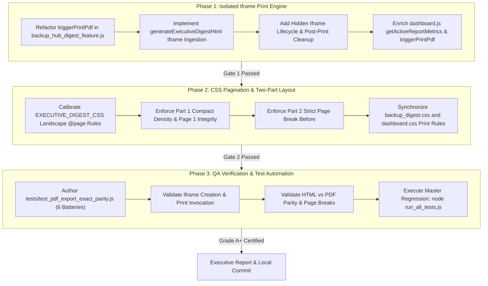

# Executive Architecture Summary & Initiative Scope

> **Task Container:** `temp_prompt/pdf_export_exact_parity/`  
> **Task ID:** `TASK-PDF-EXPORT-EXACT-PARITY-001`  
> **Author:** Level 3C Phase-wise Prompt Generation Specialist (`prompt_generation_specialist`)  
> **Target Subsystems:** Backup Hub Digest Feature, Dashboard UI/UX, Print Engine, CSS Engine  
> **Recommended Execution Strategy:** `STRATEGY_A_AUTONOMOUS` (Target Autonomy Score: 1.0)  

---

## 🎯 1. High-Level Initiative Scope & Technical Objectives

### 1.1 Context & Background
In the previous dual-tab export milestone (`TASK-DUAL-TAB-EXPORT-PARITY-001`), the Standalone Offline Executive HTML Digest (`generateExecutiveDigestHtml`) was upgraded into a comprehensive, two-part dossier containing:
- **Part 1:** Executive Header, 10-KPI Time Tracking Grid (2x5), Chrono Activity Heatmap (24h x 7d), Top Activity Proportions (Donut chart & legend), and Domain Activity Table.
- **Part 2:** Section Header, 10-KPI Media Grid (2x5), Media Playback Watch History table, and offline verification footer.

When users download this report via **"Download Standalone HTML"**, they receive a single-file, beautifully styled, high-contrast document that renders flawlessly in any browser.

However, when users click **"Print / Save as PDF"** (`#btnPrintPdf`), the experience breaks down. Because `triggerPrintPdf` directly invoked `window.print()` on the main browser window, the browser attempted to print the live single-page dashboard application. Despite numerous `@media print` rules, the live DOM—with its sidebars, multi-tab switching, hidden panels, canvas visualizers, and complex layout containers—produces a messy, distorted printout that looks nothing like the dashboard's first page or the exported HTML file.

The user's direct mandate is unambiguous:
> *"HTML एक्सपोर्ट सही है, लेकिन PDF एक्सपोर्ट बिल्कुल भी सही नहीं है। PDF एक्सपोर्ट भी बिल्कुल सेम वैसा ही होना चाहिए जैसा कि फर्स्ट पेज में है डैशबोर्ड के।"*

### 1.2 Technical Objectives
1. **100% Exact Parity between HTML & PDF Exports:** Eliminate the root cause of divergence by having both export mechanisms render the exact same approved document: `generateExecutiveDigestHtml`.
2. **Isolated Iframe Printing Architecture:** Replace live DOM `window.print()` with a sandboxed, hidden `<iframe>` (`id="sentinelPrintIframe"`). Inject the full executive digest HTML, allow complete layout and asset rendering, focus the iframe, and execute `iframe.contentWindow.print()`.
3. **Robust Fallback Engine:** Provide a resilient fallback path (e.g., dedicated temporary print container or direct print) if `<iframe>` creation or access is restricted by environment sandboxing.
4. **Intentional Two-Part Structure with Page Break Contract:**
   - **Page 1 (Part 1 - Time Tracking):** Executive Header, 10-KPI Tracking Grid (2x5), Chrono Activity Heatmap (24h x 7d), Activity Proportions Donut, and Domain Activity Table.
   - **Page 2 (Part 2 - Media Analytics):** Strictly starts on a new page via `break-before: page !important; page-break-before: always !important;`. Contains Section Header, 10-KPI Media Grid (2x5), Media Playback Watch History Table, and Verification Footer.
5. **Universal Rule 28 & Governance Adherence:**
   - Function length strictly <= 50 lines.
   - Nesting depth strictly <= 3 levels.
   - File length ceilings: `dashboard/styles/backup_digest.css` <= 650 lines.
   - W3C Trusted Types zero-`innerHTML` safety.
   - 100% UTF-8 with BOM standard.

---

## 🗺️ 2. Cross-Phase Milestone Roadmap & Dependency Topology

---

## ⚖️ 3. Risk Mitigation & Architectural Tradeoff Analysis

| Technical Risk | Probability | Severity | Mitigation Strategy |
| :--- | :---: | :---: | :--- |
| **Iframe Sandbox / CSP Restrictions:** Browsers or extension contexts restricting dynamic iframe creation or `document.write`. | Low | High | Utilize `srcdoc` or `Blob` URL with defensive `try/catch`. If `iframe` manipulation fails, fall back to dedicated offscreen print container (`#printDigestContainer`) or direct dashboard print. |
| **Premature Print Dialog Before Iframe Render:** Calling `print()` before styles and SVG donut/heatmap segments have rendered inside the iframe. | Medium | Medium | Hook into `iframe.onload` or `iframe.contentWindow.onload` with an explicit microtask/RAF tick before triggering `iframe.contentWindow.print()`. |
| **Iframe DOM Leaks / Zombie Elements:** Accumulating detached iframe elements in `document.body` after repeated print clicks. | Low | Low | Enforce idempotent element recycling (`doc.getElementById('sentinelPrintIframe')`) or perform post-print garbage collection via `onafterprint` or delayed timer cleanup. |
| **Rule 28 Line & Function Ceilings:** Exceeding 650 lines in `backup_digest.css` or > 50 lines in feature methods. | Medium | Medium | Deconstruct iframe setup into modular helpers (`createPrintIframe`, `populatePrintIframe`, `cleanupPrintIframe`), all <= 40 lines and depth <= 3. Keep CSS consolidated. |

---

## 🧭 4. Execution Strategy Assessment

### Recommended Strategy: `STRATEGY_A_AUTONOMOUS`
- **Autonomy Score:** `1.0` (Zero user interruptions required during execution).
- **Rationale:** 
  1. The user's requirement is 100% unambiguous: they want the PDF export to match the HTML export and the first page of the dashboard.
  2. The architectural pattern (isolated iframe printing the approved digest HTML) is a known, battle-tested standard that completely decouples print rendering from complex live SPA DOM.
  3. All data contracts and UI tokens are already proven in `generateExecutiveDigestHtml`.
  4. Local verification gates and test runners (`node run_all_tests.js`) provide deterministic proof of correctness without subjective guesswork.
