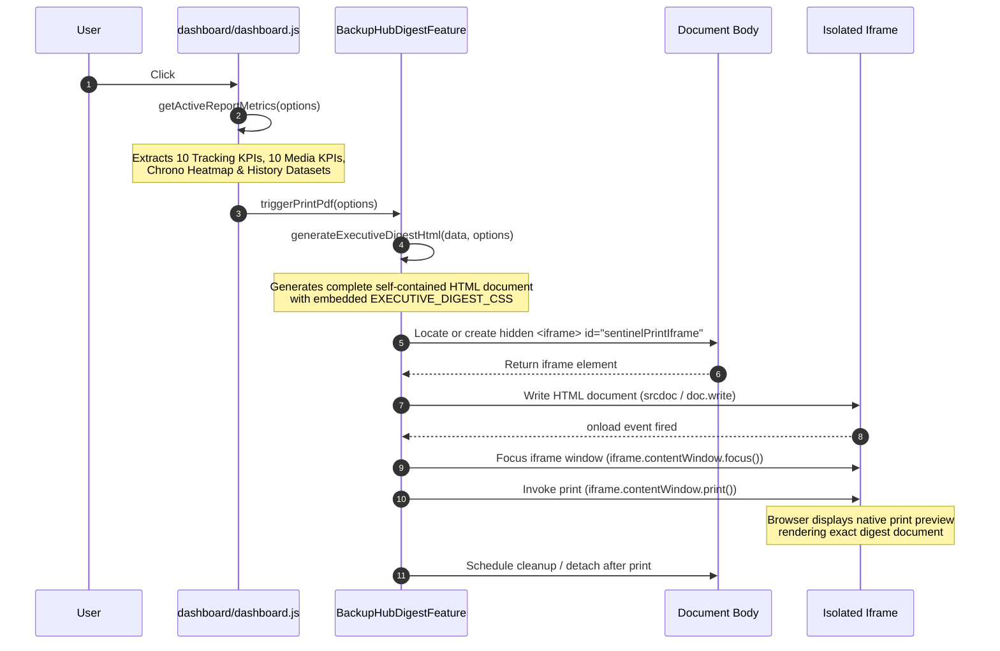

# Technical Requirements Document (TRD)

> **Task ID:** `TASK-PDF-EXPORT-EXACT-PARITY-001`  
> **Initiative:** PDF Export Exact Parity Overhaul  
> **Target Subsystems:** Print Engine, Backup Hub Digest Feature, Dashboard UI/UX, CSS Engine  
> **Governance:** Universal Rule 28 (Modularity), Universal Rule 15 (Git Intelligence), W3C Trusted Types  

---

## 🏛️ 1. System Architecture & Component Interaction

The print engine decouples PDF generation from the interactive dashboard DOM by generating an isolated, static Executive Digest HTML document and printing it via an offscreen `<iframe>`.



---

## 🔧 2. Detailed Technical Design & Code Specifications

### 2.1 Isolated Iframe Print Engine in `backup_hub_digest_feature.js`
Refactor `triggerPrintPdf` to delegate printing to a dedicated, modular iframe engine:

```javascript
/**
 * Triggers PDF export by generating the standalone Executive Digest HTML
 * and printing it within an isolated hidden iframe.
 * 
 * @param {Object} options - Configuration and telemetry metrics
 * @returns {Object} Result status { printed: boolean, method: string, error?: string }
 */
function triggerPrintPdf(options = {}) {
  const doc = options.doc || (typeof document !== 'undefined' ? document : null);
  const win = options.win || (typeof window !== 'undefined' ? window : null);
  if (!doc || !win) return { printed: false, error: 'Document or Window unavailable' };

  try {
    const data = options.data || {};
    const htmlContent = generateExecutiveDigestHtml(data, options);
    
    // Attempt printing via isolated iframe
    const iframeResult = printViaIsolatedIframe(doc, win, htmlContent);
    if (iframeResult.success) {
      return { printed: true, method: 'iframe' };
    }

    // Graceful fallback: Dedicated print container or direct print
    return printViaFallbackContainer(doc, win, htmlContent, options);
  } catch (err) {
    return { printed: false, error: err.message };
  }
}
```

#### Modular Sub-Functions (Universal Rule 28: <= 50 lines, max depth <= 3):
1. **`createPrintIframe(doc)`:**
   - Queries `doc.getElementById('sentinelPrintIframe')`.
   - If not present, creates `doc.createElement('iframe')`.
   - Sets attributes: `id="sentinelPrintIframe"`, `name="sentinelPrintIframe"`, `aria-hidden="true"`, `tabindex="-1"`.
   - Applies stealth styling: `position: fixed; top: -9999px; left: -9999px; width: 1024px; height: 768px; border: none; opacity: 0; pointer-events: none; z-index: -9999;`.
   - Appends to `doc.body`.
2. **`printViaIsolatedIframe(doc, win, htmlContent)`:**
   - Retrieves or creates iframe via `createPrintIframe(doc)`.
   - Writes `htmlContent` into `iframe.contentDocument` or `iframe.contentWindow.document`.
   - Safely executes `iframeDoc.open()`, `iframeDoc.write(htmlContent)`, and `iframeDoc.close()`.
   - Handles `load` event or uses an immediate microtask tick:
     ```javascript
     iframe.contentWindow.focus();
     iframe.contentWindow.print();
     ```
   - Schedules post-print cleanup:
     ```javascript
     scheduleIframeCleanup(iframe, 60000); // Clean after 60s or onafterprint
     ```
3. **`printViaFallbackContainer(doc, win, htmlContent, options)`:**
   - Fallback if iframe fails: creates or injects into `#printFallbackContainer`.
   - Sets print-only CSS visibility and invokes `win.print()`.

---

### 2.2 Telemetry Extraction & Dashboard Wiring in `dashboard/dashboard.js`
In `dashboard/dashboard.js`, update `triggerPrintPdf` and `handleExportPdfClick`:

```javascript
function triggerPrintPdf(options = {}) {
  // 1. Gather all active dashboard telemetry (matching downloadStandaloneHtmlDigest)
  const payload = {
    activityData: (dashboardData && dashboardData.activityData) || {},
    tracking_history: (dashboardData && dashboardData.activityData) || {},
    media_history: (typeof mediaHistoryData !== 'undefined' && Array.isArray(mediaHistoryData)) 
      ? mediaHistoryData 
      : ((dashboardData && dashboardData.mediaHistory) || [])
  };

  const activeMetrics = (typeof getActiveReportMetrics === 'function') 
    ? getActiveReportMetrics(options) 
    : {};
  const activePeriod = options.reportingPeriod || 
    (typeof currentTemporalRange !== 'undefined' && currentTemporalRange 
      ? `Range: ${currentTemporalRange}` 
      : 'All Recorded Time');
  const prodIndex = options.productivityIndex !== undefined 
    ? options.productivityIndex 
    : (activeMetrics.productivityScore || 85);

  const opts = Object.assign({
    data: payload,
    metrics: activeMetrics,
    mediaMetrics: activeMetrics.mediaMetrics || options.mediaMetrics || {},
    chronoHeatmap: activeMetrics.chronoHeatmap || options.chronoHeatmap || 
      (typeof window !== 'undefined' && window.__CHRONO_HEATMAP_DATA__) || null,
    reportingPeriod: activePeriod,
    productivityIndex: prodIndex,
    doc: typeof document !== 'undefined' ? document : null,
    win: typeof window !== 'undefined' ? window : null
  }, options);

  if (_BackupHubDigest && typeof _BackupHubDigest.triggerPrintPdf === 'function') {
    return _BackupHubDigest.triggerPrintPdf(opts);
  }
  if (typeof window !== 'undefined' && typeof window.print === 'function') {
    window.print();
    return { printed: true, method: 'direct_fallback' };
  }
  return { printed: false, error: 'Print engine unavailable' };
}
```

---

### 2.3 CSS Pagination & Print Rules Specification
In `src/dashboard/features/backup_hub_digest_feature.js` (`EXECUTIVE_DIGEST_CSS`):

```css
@media print {
  @page {
    size: A4 landscape;
    margin: 10mm 12mm 10mm 12mm;
  }
  *, *::before, *::after {
    box-shadow: none !important;
    text-shadow: none !important;
  }
  html, body {
    margin: 0 !important;
    padding: 0 !important;
    background: #ffffff !important;
    color: #0f172a !important;
    font-size: 11pt !important;
    width: 100% !important;
  }
  .digest-container {
    max-width: 100% !important;
    width: 100% !important;
    padding: 0 !important;
    margin: 0 !important;
    border: none !important;
    background: #ffffff !important;
  }
  .no-print {
    display: none !important;
  }
  .header {
    margin-bottom: 12px !important;
    padding-bottom: 8px !important;
    border-bottom: 2px solid #cbd5e1 !important;
    break-after: avoid !important;
    page-break-after: avoid !important;
  }
  /* Part 1: Time Tracking Section */
  .part-tracking-section {
    display: block !important;
    width: 100% !important;
    page-break-after: avoid !important;
    break-after: avoid !important;
  }
  .metrics-grid {
    display: grid !important;
    grid-template-columns: repeat(5, 1fr) !important;
    gap: 8px !important;
    margin-bottom: 12px !important;
    break-inside: avoid !important;
    page-break-inside: avoid !important;
  }
  .metric-card {
    break-inside: avoid !important;
    page-break-inside: avoid !important;
    background: #f8fafc !important;
    border: 1px solid #cbd5e1 !important;
    padding: 8px 10px !important;
  }
  .chrono-heatmap-section {
    break-inside: avoid !important;
    page-break-inside: avoid !important;
    margin-bottom: 12px !important;
  }
  .chart-section {
    break-inside: avoid !important;
    page-break-inside: avoid !important;
    margin-bottom: 12px !important;
  }
  /* Part 2: Media Analytics Section (Strict Page Break Before) */
  .part-media-section {
    display: block !important;
    width: 100% !important;
    page-break-before: always !important;
    break-before: page !important;
    margin-top: 0 !important;
    padding-top: 8px !important;
  }
  .media-metrics-grid {
    display: grid !important;
    grid-template-columns: repeat(5, 1fr) !important;
    gap: 8px !important;
    margin-bottom: 12px !important;
    break-inside: avoid !important;
    page-break-inside: avoid !important;
  }
  /* Tables and Data Rows */
  table {
    width: 100% !important;
    border-collapse: collapse !important;
    page-break-inside: auto !important;
    break-inside: auto !important;
    margin-bottom: 14px !important;
  }
  thead {
    display: table-header-group !important;
  }
  tbody {
    display: table-row-group !important;
  }
  tr {
    page-break-inside: avoid !important;
    break-inside: avoid !important;
  }
  th, td {
    padding: 6px 8px !important;
  }
  .footer {
    border-top: 1px solid #cbd5e1 !important;
    padding-top: 8px !important;
    margin-top: 14px !important;
    break-inside: avoid !important;
    page-break-inside: avoid !important;
  }
}
```

---

## 🔒 3. Security, Trusted Types & Governance

1. **W3C Trusted Types Compliance:**
   - The standalone HTML string is generated via clean string interpolation with strictly sanitized variables via `escapeHtml()`.
   - Numerical values and dates are parsed with strict types (`parseInt`, `Number`, regex).
   - Zero unsanitized `innerHTML` calls.
2. **Universal Rule 28 Modularity Constraints:**
   - Every newly created function MUST NOT exceed 50 lines.
   - Max cyclomatic complexity / nesting depth <= 3 levels.
   - `dashboard/styles/backup_digest.css` line count MUST NOT exceed 650 lines.
3. **Encoding:**
   - All modified files MUST be saved as UTF-8 with BOM (`0xEF, 0xBB, 0xBF`).
