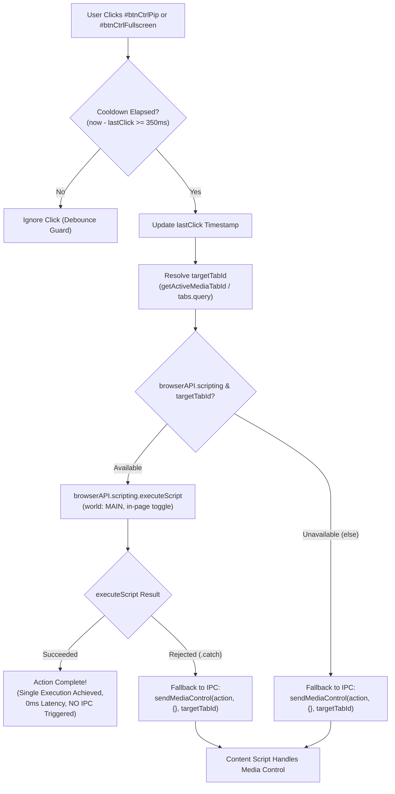

# Technical Requirements Document (TRD)
## PiP & Fullscreen Single-Execution Alignment & Deterministic Fallback Architecture

> **Document Version:** 1.0.0  
> **Status:** APPROVED FOR IMPLEMENTATION  
> **Target Files:**  
> - [`popup/popup.js`](file:///c:/Users/Atul%20Verma/Desktop/Win%20App%20Tracker/Browser%20Detection/popup/popup.js)  
> - [`tests/test_media_controls_and_fullscreen_fix.js`](file:///c:/Users/Atul%20Verma/Desktop/Win%20App%20Tracker/Browser%20Detection/tests/test_media_controls_and_fullscreen_fix.js)  

---

## 1. Architectural Architecture & Flow



---

## 2. Technical Code Analysis & Transformations

### 2.1 File: `popup/popup.js`

#### Fullscreen Handler (`#btnCtrlFullscreen`)
**Before (Buggy Dual Actuation):**
```javascript
  const btnFullscreen = document.getElementById('btnCtrlFullscreen');
  if (btnFullscreen) {
    btnFullscreen.addEventListener('click', async () => {
      const now = Date.now();
      if (now - lastFullscreenClick < 350) return;
      lastFullscreenClick = now;

      let targetTabId = getActiveMediaTabId();

      // Resolve active tabId reliably if not cached yet
      if (!targetTabId && browserAPI.tabs && typeof browserAPI.tabs.query === 'function') {
        try {
          const tabs = await browserAPI.tabs.query({ active: true, currentWindow: true });
          if (tabs && tabs[0] && tabs[0].id) targetTabId = tabs[0].id;
        } catch (_) {}
      }

      if (browserAPI.scripting && typeof browserAPI.scripting.executeScript === 'function' && targetTabId) {
        browserAPI.scripting.executeScript({
          target: { tabId: targetTabId },
          world: 'MAIN',
          func: () => {
            const floatingBtn = document.getElementById('__sentinel_fs_floating_btn__');
            if (floatingBtn) {
              floatingBtn.click();
              return;
            }
            const ctrl = window.__SentinelFullscreenController || globalThis.__SentinelFullscreenController;
            if (ctrl && typeof ctrl.toggleWebFullscreen === 'function') {
              ctrl.toggleWebFullscreen();
              return;
            }
            if (ctrl && typeof ctrl.toggle === 'function') {
              ctrl.toggle(null, { forceWeb: true });
              return;
            }
            try {
              window.dispatchEvent(new CustomEvent('__SENTINEL_FULLSCREEN_ACTION__', {
                detail: { action: 'toggle', options: { forceWeb: true } }
              }));
            } catch (_) {}
          }
        }).catch(() => {});
      }

      sendMediaControl('toggle_fullscreen', {}, targetTabId); // <-- BUG: RUNS UNCONDITIONALLY!
    });
  }
```

**After (Deterministic Single Execution with Fallback):**
```javascript
  const btnFullscreen = document.getElementById('btnCtrlFullscreen');
  if (btnFullscreen) {
    btnFullscreen.addEventListener('click', async () => {
      const now = Date.now();
      if (now - lastFullscreenClick < 350) return;
      lastFullscreenClick = now;

      let targetTabId = getActiveMediaTabId();

      // Resolve active tabId reliably if not cached yet
      if (!targetTabId && browserAPI.tabs && typeof browserAPI.tabs.query === 'function') {
        try {
          const tabs = await browserAPI.tabs.query({ active: true, currentWindow: true });
          if (tabs && tabs[0] && tabs[0].id) targetTabId = tabs[0].id;
        } catch (_) {}
      }

      if (browserAPI.scripting && typeof browserAPI.scripting.executeScript === 'function' && targetTabId) {
        browserAPI.scripting.executeScript({
          target: { tabId: targetTabId },
          world: 'MAIN',
          func: () => {
            const floatingBtn = document.getElementById('__sentinel_fs_floating_btn__');
            if (floatingBtn) {
              floatingBtn.click();
              return;
            }
            const ctrl = window.__SentinelFullscreenController || globalThis.__SentinelFullscreenController;
            if (ctrl && typeof ctrl.toggleWebFullscreen === 'function') {
              ctrl.toggleWebFullscreen();
              return;
            }
            if (ctrl && typeof ctrl.toggle === 'function') {
              ctrl.toggle(null, { forceWeb: true });
              return;
            }
            try {
              window.dispatchEvent(new CustomEvent('__SENTINEL_FULLSCREEN_ACTION__', {
                detail: { action: 'toggle', options: { forceWeb: true } }
              }));
            } catch (_) {}
          }
        }).catch(() => {
          sendMediaControl('toggle_fullscreen', {}, targetTabId);
        });
      } else {
        sendMediaControl('toggle_fullscreen', {}, targetTabId);
      }
    });
  }
```

---

#### PiP Handler (`#btnCtrlPip`)
**Before (Buggy Dual Actuation):**
```javascript
  const btnPip = document.getElementById('btnCtrlPip');
  if (btnPip) {
    btnPip.addEventListener('click', () => {
      const now = Date.now();
      if (now - lastPipClick < 350) return;
      lastPipClick = now;

      const targetTabId = getActiveMediaTabId();

      if (browserAPI.scripting && typeof browserAPI.scripting.executeScript === 'function' && targetTabId) {
        browserAPI.scripting.executeScript({
          target: { tabId: targetTabId },
          world: 'MAIN',
          func: () => {
            const video = Array.from(document.querySelectorAll('video')).find(v => !v.paused) || document.querySelector('video');
            if (!video) return;
            if (document.pictureInPictureElement) {
              if (document.exitPictureInPicture) document.exitPictureInPicture().catch(() => {});
            } else if (video.requestPictureInPicture) {
              video.requestPictureInPicture().catch(() => {});
            }
          }
        }).catch(() => {});
      }

      sendMediaControl('toggle_pip', {}, targetTabId); // <-- BUG: RUNS UNCONDITIONALLY!
    });
  }
```

**After (Deterministic Single Execution with Fallback):**
```javascript
  const btnPip = document.getElementById('btnCtrlPip');
  if (btnPip) {
    btnPip.addEventListener('click', () => {
      const now = Date.now();
      if (now - lastPipClick < 350) return;
      lastPipClick = now;

      const targetTabId = getActiveMediaTabId();

      if (browserAPI.scripting && typeof browserAPI.scripting.executeScript === 'function' && targetTabId) {
        browserAPI.scripting.executeScript({
          target: { tabId: targetTabId },
          world: 'MAIN',
          func: () => {
            const video = Array.from(document.querySelectorAll('video')).find(v => !v.paused) || document.querySelector('video');
            if (!video) return;
            if (document.pictureInPictureElement) {
              if (document.exitPictureInPicture) document.exitPictureInPicture().catch(() => {});
            } else if (video.requestPictureInPicture) {
              video.requestPictureInPicture().catch(() => {});
            }
          }
        }).catch(() => {
          sendMediaControl('toggle_pip', {}, targetTabId);
        });
      } else {
        sendMediaControl('toggle_pip', {}, targetTabId);
      }
    });
  }
```

---

## 3. Test Suite Overhaul Specifications

### Target File: `tests/test_media_controls_and_fullscreen_fix.js`

#### 3.1 Assertion Updates in Static AST Checks
- **Section 3.2 & Section 4:**
  - Verify that `popup.js` contains `sendMediaControl('toggle_fullscreen', {}, targetTabId)` inside the catch block (`.catch(() => { sendMediaControl(...) })`) AND inside the `else` block.
  - Verify that `popup.js` does NOT call `sendMediaControl('toggle_fullscreen')` outside or after the `if/else` block.
  - Assert that `#btnCtrlFullscreen` line count remains compact (<= 55 lines).
- **Section 6 (Extended Controls Verification):**
  - Verify that `popup.js` contains `sendMediaControl('toggle_pip', {}, targetTabId)` inside `.catch()` and `else`.
  - Verify that `btnCtrlPip` does not call `sendMediaControl` outside the `if/else` block.

#### 3.2 Assertion Updates in VM Functional Mock Simulation (Section 9.9 & 9.10)
- In the existing mock environment, `browserAPI.scripting.executeScript` returns a resolving Promise:
  - When `#btnCtrlFullscreen.click()` is called with active `scripting.executeScript`:
    * `interceptedExecuteScripts.length` MUST be `1`.
    * `interceptedMediaControls.length` MUST be `0` (asserting that `sendMediaControl` was NOT triggered, eliminating double-toggle!).
  - When `#btnCtrlPip.click()` is called with active `scripting.executeScript`:
    * `interceptedExecuteScripts.length` MUST be `1`.
    * `interceptedMediaControls.length` MUST be `0` (asserting that `sendMediaControl` was NOT triggered, eliminating double-toggle!).
- Add explicit fallback simulation:
  - When `browserAPI.scripting.executeScript` rejects (simulating error) or `browserAPI.scripting` is null:
    * `sendMediaControl` is called with action `toggle_fullscreen` or `toggle_pip`.
    * `interceptedMediaControls.length` MUST be `1`.

---

## 4. Invariant Protection

| Component | Target Location | Preservation Mandate |
| :--- | :--- | :--- |
| **Universal Media Toggle** | `popup/popup.js` lines ~3194–3207 (`#btnGlobalMediaToggle`) | Strictly bound to `TOGGLE_GLOBAL_MEDIA`. Zero modifications. |
| **Time Tracking Pause** | `popup/popup.js` lines ~3209–3225 (`#btnToggleTrackingPause`) | Strictly bound to `TOGGLE_TRACKING_PAUSE`. Zero modifications. |
| **Debounce Timestamps** | `popup/popup.js` lines 3644–3645 (`lastFullscreenClick`, `lastPipClick`) | Must guard against re-entry within 350ms. |
| **W3C Trusted Types** | Extension scripts | Zero `innerHTML` assignments; zero dynamic eval. |
| **All Test Suites** | `tests/*.js` (36 files) | 100% passing status maintained. |
