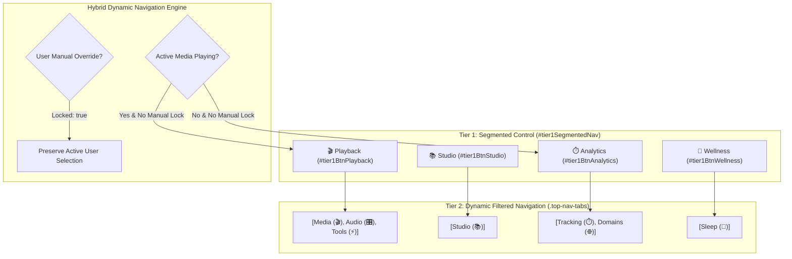
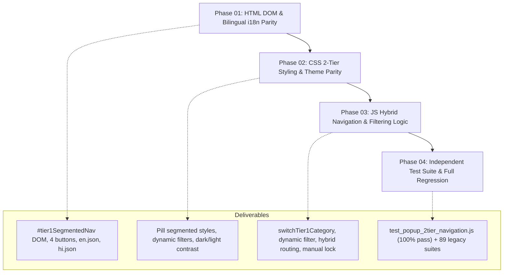

# Executive Architecture Summary — Popup 2-Tier Segmented Control & Hybrid Dynamic Navigation

> **Task ID:** `TASK-POPUP-2TIER-NAV-001`  
> **Workspace:** `c:\Users\Atul Verma\Desktop\Win App Tracker\Browser Detection`  
> **Author & Lead Architect:** Atul Verma (`aiprincekumar` / `aiprincekumar010100@gmail.com`)  
> **Status:** `ACTIVE / PROMPTS_GENERATED`  
> **Target Path:** `temp_prompt/popup_2tier_navigation/SUMMARY.md`  
> **Implementation Strategy:** `STRATEGY_A_AUTONOMOUS` (Autonomy Score: 1.0)

---

## 🏛️ 1. Strategic Context & Vision

The **Web Activity & Media Sentinel** Chrome Extension is an enterprise-grade observability and media telemetry cockpit. In popup mode (constrained to standard 420px width), the navigation layer has evolved from 2 tabs to 4 tabs, then 6 tabs, and finally 7 tabs with the addition of the Sleep tab.

While functionally rich, presenting 7 tabs horizontally in a single strip compresses interactive buttons down to ~56px width, straining touch ergonomics and visual hierarchy.

The **2-Tier Segmented Control & Hybrid Dynamic Navigation** architecture solves this by introducing a cognitive two-level taxonomy:
1. **Tier 1 (Category Layer):** 4 high-level clusters (`Playback`, `Studio`, `Analytics`, `Wellness`) styled as a sleek, low-profile segmented pill control.
2. **Tier 2 (Action Layer):** The existing `.top-nav-tabs` dynamically filtered to show only the 1 to 3 relevant child tabs for the selected category.
3. **Hybrid Dynamic Media Intelligence:** Automatically promotes the `Playback` cluster when active media is playing, and defaults to `Analytics` when browsing without media, while strictly latching and preserving manual user selections.

---

## 🗺️ 2. Milestone Roadmap & Dependency Topology

### Milestone Breakdown
- **Milestone 1 (Phase 01): Semantic DOM & i18n Foundation**
  - Inject `#tier1SegmentedNav` with 4 accessible category buttons into `popup/popup.html`.
  - Tag child tabs in `.top-nav-tabs` with `data-group="playback|studio|analytics|wellness"`.
  - Add bilingual translation tokens in `locales/en.json` and `locales/hi.json`.
- **Milestone 2 (Phase 02): High-Density Aesthetic & Theme Parity**
  - Author responsive glassmorphism styles for the Tier 1 segmented bar.
  - Implement dynamic child tab filtering transitions with zero horizontal overflow in 420px container.
  - Deliver 100% dark mode and light mode visual contrast parity matching WCAG 2.1 AA.
- **Milestone 3 (Phase 03): Hybrid Dynamic Engine & User Intent Latch**
  - Wire bidirectional synchronization between Tier 1 categories and Tier 2 tabs in `popup/popup.js`.
  - Integrate contextual media detection: promote `Playback` when active media plays; fall back to `Analytics` when idle.
  - Implement `userManualOverride` latch to guarantee user click intent is never clobbered by background polling.
- **Milestone 4 (Phase 04): Automated Verification & Zero-Regression Signoff**
  - Construct comprehensive unit and integration test suite `tests/test_popup_2tier_navigation.js`.
  - Execute full regression across all 89 existing test suites in `run_all_tests.js`.

---

## ⚖️ 3. Risk Mitigation & Architectural Tradeoffs

| Risk Category | Identified Risk | Architectural Mitigation Strategy |
| :--- | :--- | :--- |
| **Backward Compatibility** | Existing features or test suites expect `#mainTabMedia`, `#mainTabSleep`, etc. in `.top-nav-tabs` | 100% preservation of all 7 original tab IDs, data-view attributes, and pane IDs. Dynamic filtering toggles display/active classes rather than destroying DOM nodes. |
| **Polling Overwrite / UX Flicker** | Background heartbeat periodically polling media state could force-switch tabs while user is configuring equalizer or inspecting domains | `userManualOverride` state flag is latched on any explicit user click. Auto-switching only activates on initial launch or when media transitions from inactive to active. |
| **CSP / W3C Trusted Types** | Dynamically altering DOM classes or content might trigger CSP unsafe-eval / unsafe-inline | All modifications execute through native DOM APIs (`classList.toggle`, `setAttribute`, `textContent`). Zero use of `innerHTML` or `eval`. |
| **Viewport Overcrowding** | Adding a second navigation tier increases vertical consumption in a 600px max height popup | Tier 1 uses an ultra-compact 28px height segmented control with 11px micro-typography; Tier 2 tabs expand dynamically horizontally without increasing vertical footprint. |
| **Theme / Contrast Regressions** | Segmented pill borders or text might become illegible in Light Mode | CSS custom variables with explicit high-contrast values for `.light-mode` (`--tier1-bg: rgba(0,0,0,0.06)`, `--tier1-active: #ffffff`, `--tier1-border: rgba(0,0,0,0.12)`). |

---

## ⚡ 4. Implementation Strategy Recommendation

### Recommendation: `STRATEGY_A_AUTONOMOUS`
- **Autonomy Score:** **1.0** (Fully Autonomous Phase-wise Execution).
- **Justification:**
  1. The tactical scope is 100% frontend UI/UX logic within `popup/` and `locales/`.
  2. Zero backend, daemon, native host, or WebSocket changes are involved.
  3. All requirements, DOM structures, and behavioral state transitions are fully specified and deterministic.
  4. The project possesses a robust 89-suite automated test harness, allowing immediate continuous automated validation after each phase.
- **Execution Path:** The Level 2 Tactical Manager can safely authorize execution subagents phase-by-phase sequentially without requiring blocking user interruptions.
