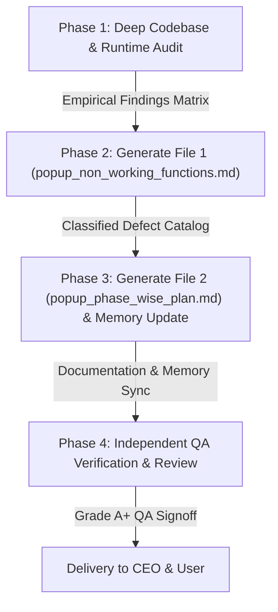

# Executive Architecture Summary: Popup Mode Audit & Phased Implementation Roadmap

> **Initiative:** Web Activity & Media Sentinel - Popup Mode Comprehensive Audit & Phased Plan  
> **Workspace Container:** `temp_prompt/popup_audit_and_roadmap/`  
> **Date:** 2026-11-14  
> **Author:** Level 3C Phase-wise Prompt Generation Specialist  

---

## 🎯 1. High-Level Initiative Scope & Objectives

The primary objective of this initiative is to perform an exhaustive, empirical code audit of all features within **Popup Mode** (`popup/popup.html`, `popup/popup.js`, `popup/popup.css`) across all 6 navigation tabs, header badges, footer actions, floating popovers, and background IPC bridges.

Following the audit, the initiative delivers two authoritative user-facing documentation assets:
1. **`popup_non_working_functions.md` (File 1):** A concise, high-clarity catalog of every feature that is broken, stubbed, or missing execution logic, categorized by UI tab/component.
2. **`popup_phase_wise_plan.md` (File 2):** A structured, multi-phase technical implementation specification outlining exact procedures, architectural patterns, APIs, files to modify, test gates, and memory updates required to bring every non-working feature to full operational maturity.

---

## 🗺️ 2. Cross-Phase Milestone Roadmap & Dependency Topology

### Milestone Schedule:
- **Milestone 1 (Phase 1):** Complete codebase scan across 3,600+ lines of `popup/popup.js`, `content_media.js`, `inject_main_world.js`, and `background.js`. Verify event listeners, IPC dispatch, and background message handling for every UI control.
- **Milestone 2 (Phase 2):** Produce `popup_non_working_functions.md` containing simple tables, status pills, and root-cause summaries written in clear bilingual (Hindi & English) terms.
- **Milestone 3 (Phase 3):** Produce `popup_phase_wise_plan.md` structuring the resolution of defects into 5 logical implementation phases (Audio Pipeline, Smart Automations, Wellness/Doomscroll, Quick Settings & Studio Polish, Multi-Browser Data Hub Hardening), and update `project_feature_memory.md` / `memory.md`.
- **Milestone 4 (Phase 4):** Execute full verification suite (`node tests/test_*.js`), verify UTF-8 BOM encoding across all generated files, and validate git status.

---

## ⚖️ 3. Risk Mitigation & Architectural Tradeoff Analysis

### Risk 1: Chrome Manifest V3 Web Audio & `chrome.tabCapture` Constraints
- **Risk:** Web Audio API processing (Equalizer, 200% Master Boost, Vocal Clarity) in Chrome extensions typically requires an offscreen document or `chrome.tabCapture.capture()`, which mutes default audio output and requires an active AudioContext destination.
- **Mitigation:** In the roadmap (File 2), clearly document the trade-off between:
  1. HTML5 `<video>.volume` clamping (capped at 1.0; cannot exceed 100% without Web Audio GainNode).
  2. Tab capture via MV3 offscreen document for true 200% boost and 5-band BiquadFilter equalizer.

### Risk 2: Background Service Worker Lifecycle & Event Loss
- **Risk:** MV3 background service workers go inactive after 30 seconds of idle time. Smart automations (like `auto_pause_new_tab`) must use standard Chrome event listeners (`chrome.tabs.onActivated`) rather than in-memory volatile timers.
- **Mitigation:** The architecture specifies persisting active state in `chrome.storage.session` and registering declarative top-level event listeners in `background.js`.

### Risk 3: Scope Creep During Audit Phase
- **Risk:** Attempting to fix complex audio or background automation bugs during an audit/roadmap request.
- **Mitigation:** Strict phase separation. Phases 1-3 are strictly dedicated to auditing, documenting, cataloging, and architecting the resolution roadmap. Codebase modification of application logic is reserved for future implementation phases under explicit user approval.
