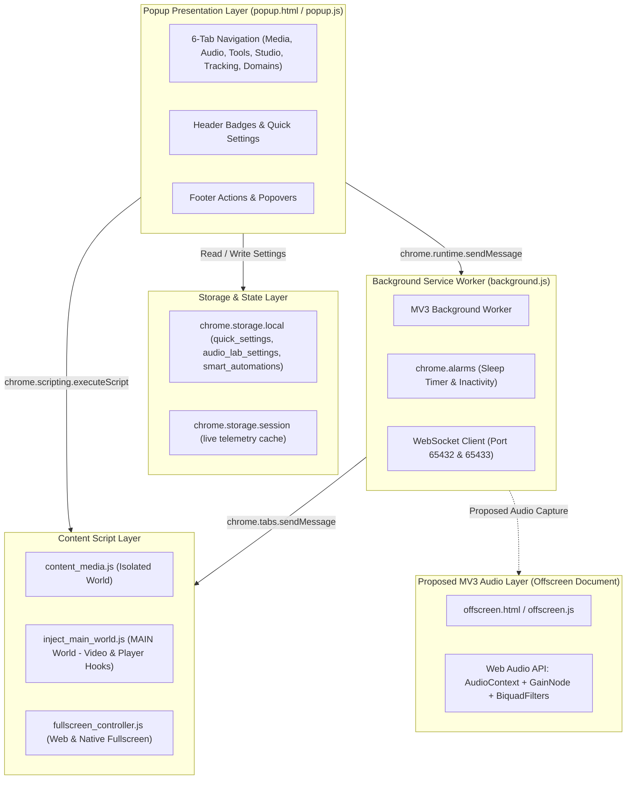

# Technical Requirements Document (TRD): Popup Mode Architecture & Defect Remediation

> **Technical Scope:** Chrome Extension Manifest V3 (Service Worker, Isolated & Main Content Scripts, Popup DOM, Offscreen Audio Pipeline)  
> **Workspace Container:** `temp_prompt/popup_audit_and_roadmap/`  
> **Author:** Level 3C Phase-wise Prompt Generation Specialist  

---

## 🏗️ 1. High-Level Design (HLD) & Architectural Subsystems

The Popup architecture operates across five distinct operational layers:



---

## 🔍 2. Low-Level Design (LLD): Detailed Defect Landscape

### 2.1 Subsystem A: Audio Lab (Tab 2)
- **Current State:**
  - `popup.js` binds input listeners to `#audioMasterBoostSlider`, `#audioEqPresetSelect`, `#eqBand60`...`#eqBand16000`, `#toggleAudioOnlyMode`, `#toggleVocalClarity`, and `#toggleNightShield`.
  - It writes the values to `audio_lab_settings` in `chrome.storage.local`.
  - **The Missing Link:** Neither `background.js`, `content_media.js`, nor `inject_main_world.js` listens to `audio_lab_settings`. There is zero connection to the media stream. HTML5 video elements cannot be amplified past 100% volume via `.volume = 2.0` (browser clamps to 1.0).
- **Remediation Architecture:**
  - Standard HTML5 Volume boost requires injecting a `MediaElementAudioSourceNode` into the page or using `chrome.tabCapture` in an MV3 offscreen document.
  - Video blanking (`toggleAudioOnlyMode`) can be achieved via `content_media.js` setting `video.style.opacity = '0'` or hiding video track while preserving audio playback.

### 2.2 Subsystem B: Smart Automations (Tab 3)
- **Current State:**
  - `toggleAutoPauseNewTab`: Sets `smart_automations.auto_pause_new_tab = true`.
  - `toggleAutoAdSilencer`: Sets `smart_automations.auto_ad_silencer = true`.
  - `toggleDomainSpeedMemory`: Sets `smart_automations.domain_speed_memory = true`.
  - **The Missing Link:**
    - `background.js` has no `chrome.tabs.onActivated` or `chrome.tabs.onCreated` listener to auto-pause media in background tabs.
    - `content_media.js` has no MutationObserver targeting YouTube ad containers (`.ad-showing`, `.video-ads`) to mute/unmute audio.
    - No speed persistence table indexed by hostname exists in `content_media.js`.

### 2.3 Subsystem C: Digital Wellness & Doomscroll Breaker (Tab 5)
- **Current State:**
  - `#toggleDoomscrollBreaker` and `#selectDoomscrollInterval` store values in `focus_settings`.
  - **The Missing Link:** `background.js` has no periodic alarm checking if active tab belongs to entertainment/social domains (`youtube.com`, `instagram.com`, `twitter.com`, `reddit.com`) exceeding the interval limit.

### 2.4 Subsystem D: Quick Settings & Studio Polish
- **Current State:**
  - `selectDefaultTab`: Dropdown changes value on popup load, but never invokes `switchTopTab()`.
  - `selectSyncInterval`: Updates storage, but `popup.js` has a hardcoded `setInterval(refreshDashboard, 1000)`.
  - `toggleNotificationSound`: Stored in settings, but no Audio chime plays on timer expiration.
  - `toggleHighContrast`: Toggles `.high-contrast-mode` on `<body>`, but `popup.css` has zero CSS rules for this selector.
  - `btnCardScreenshot`: Calls `chrome.tabs.captureVisibleTab(null)` which captures the current window instead of targeting the tab containing active media.
  - `btnStudioResumePlayback`: Card is hidden by default and only triggers seek on currently open media tabs; cannot revive closed video sessions.

---

## 📜 3. Data Contracts & State Schemas

### 3.1 Audio Lab Schema (`sentinel_audio_settings`)
```json
{
  "master_boost": 100,
  "audio_only": false,
  "eq_preset": "flat",
  "eq_bands": {
    "60": 0,
    "250": 0,
    "1000": 0,
    "4000": 0,
    "16000": 0
  },
  "vocal_clarity": false,
  "night_shield": false
}
```

### 3.2 Smart Automations Schema (`sentinel_smart_automations`)
```json
{
  "auto_pause_new_tab": false,
  "auto_ad_silencer": false,
  "domain_speed_memory": true,
  "domain_speeds": {
    "youtube.com": 1.25,
    "coursera.org": 1.5
  }
}
```

### 3.3 Quick Settings Schema (`sentinel_quick_settings`)
```json
{
  "default_tab": "media",
  "sync_interval": 2000,
  "notification_sound": true,
  "high_contrast": false
}
```

---

## 🔒 4. Security & Permissions Boundaries

- **Permissions in `manifest.json`:** `"storage"`, `"tabs"`, `"activeTab"`, `"scripting"`, `"alarms"`, `"idle"`, `"nativeMessaging"`.
- **W3C Trusted Types Compliance:** Any injected DOM elements (such as cinema dimmer, OSD, or video overlays) must strictly use `document.createElement`, `textContent`, and `classList` with ZERO assignments to `.innerHTML`.
- **Content Security Policy (CSP):** Manifest V3 disallows inline `eval` or remote script injection. All scripts must remain local to extension package.
