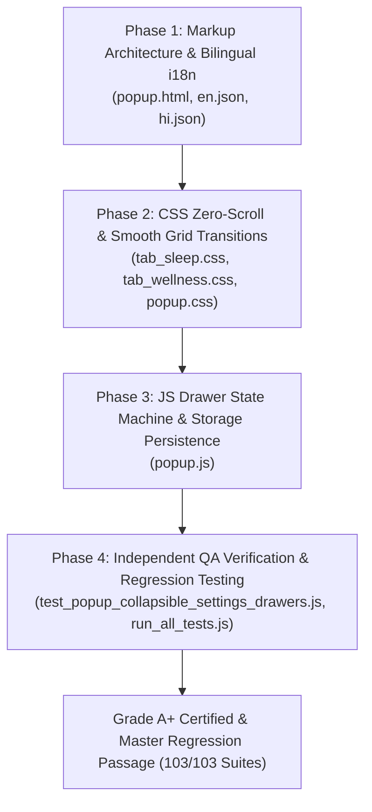

# Architectural Summary: Popup Collapsible Settings Drawers

> **Document Type:** Executive Architecture Summary  
> **Workspace Container:** `temp_prompt/popup_collapsible_settings_drawer/`  
> **Governing Architecture:** [`PHASE_WISE_PROMPT_GENERATION_ARCHITECTURE.md`](file:///C:/Users/Atul%20Verma/.gemini/config/rules/PHASE_WISE_PROMPT_GENERATION_ARCHITECTURE.md)  
> **Command Hierarchy Role:** Level 3C Phase-wise Prompt Generation Specialist (`prompt_generation_specialist`)  

---

## 🎯 1. High-Level Initiative Scope & Technical Objectives

The objective of this initiative is to eliminate popup window vertical scrolling in both the **Sleep Tab** (`#viewSleepPane`) and **Focus Tab** (`#viewFocusPane`) by introducing sleek, accessible, hardware-accelerated collapsible settings drawers. 

### Core Architectural Objectives:
1. **Zero-Scroll Default Viewport:** Ensure that upon opening the Sleep or Focus tabs, the user sees the primary circular countdown dial, status telemetry, and primary quick actions (Start/Pause, Extenders, Reset) fully framed without any vertical scrollbar.
2. **Smooth Collapsible Settings Drawers:** Encapsulate secondary configuration sections (Presets Grid, Custom Input, Automations, Ratio Bars, Doomscroll Breaker) within collapsible drawer containers powered by modern CSS Grid row transitions (`grid-template-rows: 0fr -> 1fr`).
3. **100% ID & Selector Preservation:** Strictly preserve all existing HTML element IDs, class hooks, and event listeners required by the extension runtime and 102 test suites.
4. **Bilingual Parity (i18n):** Synchronize all new drawer labels, ARIA titles, and tooltips across `locales/en.json` and `locales/hi.json` with zero missing keys.
5. **Stateful Persistence:** Save user expand/collapse preferences in `chrome.storage.local` to provide consistent ergonomics across popup sessions.
6. **W3C Trusted Types & Rule 28 Compliance:** Zero `innerHTML` operations; strictly modular JavaScript functions under 50 lines with nesting depth <= 3.

---

## 🗺️ 2. Architectural Blueprint & Component Topology

```
┌────────────────────────────────────────────────────────┐
│ Extension Popup Window (Max ~560px Height)             │
├────────────────────────────────────────────────────────┤
│ [Header: Brand + 2-Tier Navigation]                    │
├────────────────────────────────────────────────────────┤
│ TAB PANE (Sleep / Focus):                              │
│                                                        │
│ ┌────────────────────────────────────────────────────┐ │
│ │ PRIMARY HERO CARD (Always Visible, Zero-Scroll)    │ │
│ │  - Bedtime / Focus Radial Dial (r=54, C=339.292)   │ │
│ │  - Live Countdown & Target Finish Time Readout     │ │
│ │  - Quick Action Row (▶ Start, -5m/+5m/+15m, ✕ Reset)│ │
│ └────────────────────────────────────────────────────┘ │
│                                                        │
│ ┌────────────────────────────────────────────────────┐ │
│ │ COLLAPSIBLE SETTINGS DRAWER HEADER (Interactive)   │ │
│ │  - Title: "⚙️ Presets & Automations" / "⏱️ Presets" │ │
│ │  - Micro-badge / Active preset summary chip        │ │
│ │  - Animated Rotating Chevron Indicator (▼)         │ │
│ └────────────────────────────────────────────────────┘ │
│ ┌────────────────────────────────────────────────────┐ │
│ │ EXPANDABLE DRAWER BODY (grid-template-rows: 0fr/1fr)│ │
│ │  (Collapsed by default / expands smoothly on click)│ │
│ │                                                    │ │
│ │  [Sleep: cardSleepPresetsAndCustom]                │ │
│ │  [Sleep: cardSleepAutomations]                     │ │
│ │  -- OR --                                          │ │
│ │  [Focus: cardFocusPresetsAndCustom]                │ │
│ │  [Focus: focusRatioBarContainer]                   │ │
│ │  [Focus: doomscrollBreakerCard]                    │ │
│ └────────────────────────────────────────────────────┘ │
├────────────────────────────────────────────────────────┤
│ [Footer: Status Badges, Refresh Button, Options Link]  │
└────────────────────────────────────────────────────────┘
```

---

## 🧩 3. Phase Dependency Topology & Milestone Roadmap



---

## ⚖️ 4. Risk Analysis & Trade-Off Matrix

| Risk / Constraint | Potential Impact | Architectural Mitigation Strategy |
| :--- | :--- | :--- |
| **Breaking Existing Test Selectors** | Failure in `test_popup_sleep_tab.js` or `test_popup_focus_timer_sleep_parity.js`. | Retain all existing IDs (`cardSleepHeroRing`, `cardSleepPresetsAndCustom`, `cardSleepAutomations`, etc.) intact. Simply wrap secondary cards inside the drawer body. |
| **CSS Height Animation Jitter** | Clunky `max-height: 1000px` transition feels slow or jumpy. | Utilize modern CSS Grid row animation (`grid-template-rows: 0fr` to `1fr`) on the drawer inner wrapper for fluid, zero-jank 60fps expansion. |
| **Storage Sync Latency on Popup Open** | Drawer flashes open or closed while fetching storage. | Default to collapsed in CSS so initial render is instantly zero-scroll; asynchronously apply saved state class with smooth transition. |
| **W3C Trusted Types Invalidation** | Security scan error or CSP rejection if `innerHTML` is used. | Exclusively use `textContent`, `classList.toggle('open')`, and `setAttribute('aria-expanded', ...)` in `popup.js`. |
