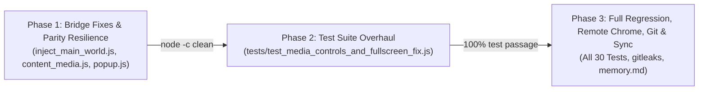

# Executive Architecture Summary: Parity Overhaul & Latent Bridge Fixes
## Media Controls Resilience Across Popup & Dashboard Modes

> **Initiative:** Parity Overhaul: Popup Mode & Dashboard Mode Media Controls Resilience & Fix Latent Bridge Bugs  
> **Workspace:** [`c:\Users\Atul Verma\Desktop\Win App Tracker\Browser Detection`](file:///c:/Users/Atul%20Verma/Desktop/Win%20App%20Tracker/Browser%20Detection)  
> **Lead Architect:** Level 3C Phase-wise Prompt Generation Specialist (`prompt_generation_specialist`)  
> **Governance:** Universal Rule 22 & [`PHASE_WISE_PROMPT_GENERATION_ARCHITECTURE.md`](file:///C:/Users/Atul%20Verma/.gemini/config/rules/PHASE_WISE_PROMPT_GENERATION_ARCHITECTURE.md)  
> **Target Autonomy:** `STRATEGY_A_AUTONOMOUS` (Score: 1.0)  

---

## 🏛️ 1. Initiative Scope & Technical Objectives

The objective of this engineering initiative is to eliminate latent bridge flaws, achieve complete architectural parity between Popup Mode (`popup/popup.js`) and Dashboard Mode (`dashboard/dashboard.js`), and establish robust fallback resilience in the extension's media control engine (`inject_main_world.js` and `content_media.js`).

### Core Technical Goals:
1. **Eliminate Self-Canceling `toggle_mute` Double Inversion in `inject_main_world.js`:**
   Ensure mute toggling on YouTube player does not execute both player API mute and direct HTML5 element mute inversion in sequence, which previously inverted the state twice and canceled the action.
2. **Resilient Fallback to `primaryMediaElement` in `content_media.js`:**
   Ensure that media commands (play, pause, seek, volume, speed) are never dropped when the main world bridge is delayed, throttled, or unready on YouTube or other domains, by falling back cleanly to direct `primaryMediaElement` execution.
3. **Parity Between Popup & Dashboard `targetTabId` Resolution:**
   Harmonize how `popup/popup.js` resolves the target media tab with `dashboard/dashboard.js`, ensuring every media button handler and the central `sendMediaControl` function reliably resolve `targetTabId` without relying on stale cache.
4. **Strict Architectural Invariant Preservation:**
   - Preserve all optimistic cooldown locks (`lastPlayToggleTime`, `lastMuteToggleTime`, `lastSpeedChangeTime`, `lastControlsRowActiveTime`).
   - Preserve `#btnGlobalMediaToggle` 100% untouched for multi-tab global control.
   - Maintain 0 conflicting `executeScript` calls from popup button handlers (single authoritative IPC dispatch).
   - Maintain 100% W3C Trusted Types compliance (zero `innerHTML` usage).

---

## 🔄 2. End-to-End System Architecture & Message Flow

```mermaid
flowchart TD
    subgraph UI_Surfaces ["User Interfaces"]
        PopupUI["Popup Mode (popup.js)"]
        DashUI["Dashboard Mode (dashboard.js)"]
    end

    subgraph ServiceWorker ["Background Service Worker (background.js)"]
        SWRouter["CONTROL_MEDIA IPC Listener"]
        GlobalMedia["synthesizeGlobalMediaState()"]
        TabTarget["Target Tab Resolution: tabId || primaryMedia.tabId || activeTabId"]
    end

    subgraph ContentScript ["Isolated Content Script (content_media.js)"]
        IPCRouter["browserAPI.runtime.onMessage Listener"]
        BridgeCheck{"isBridgeActive & isYouTube?"}
        FallbackCheck{"Bridge Ready?"}
        DirectHTML5["Direct primaryMediaElement Execution\n(play, pause, seek, volume, speed)"]
        ForwardMain["forwardActionToMainWorld(action, data)"]
    end

    subgraph MainWorld ["Main World Engine (inject_main_world.js)"]
        MainListener["__MEDIA_SENTINEL_ACTION__ Handler"]
        PlayerCheck{"moviePlayer Present & Functional?"}
        YTPlayerAPI["YouTube Native Player API\n(mute/unMute, setVolume, setPlaybackRate)"]
        VideoElementFallback["HTML5 video.muted Fallback\n(Mutually Exclusive - No Double Inversion)"]
        OSD["Visual HUD / OSD Overlay"]
    end

    PopupUI -->|sendMediaControl(action, data, tabId)| SWRouter
    DashUI -->|sendMediaControl(action, data, tabId)| SWRouter
    SWRouter --> GlobalMedia
    SWRouter --> TabTarget
    TabTarget -->|safeSendTabMessage(tabId, message)| IPCRouter
    IPCRouter --> BridgeCheck
    BridgeCheck -->|Yes| FallbackCheck
    FallbackCheck -->|Ready| ForwardMain
    FallbackCheck -->|Not Ready / Fails| DirectHTML5
    BridgeCheck -->|No| DirectHTML5
    ForwardMain --> MainListener
    MainListener --> PlayerCheck
    PlayerCheck -->|Yes| YTPlayerAPI
    PlayerCheck -->|No| VideoElementFallback
    YTPlayerAPI --> OSD
    VideoElementFallback --> OSD
```

---

## 🔍 3. Forensic Analysis of Latent Defects

### 3.1 Defect 1: Self-Canceling `toggle_mute` Double Inversion
- **Affected File:** `inject_main_world.js`
- **Line Anchor:** Lines ~636–659
- **Root Cause:**
  ```javascript
  case 'toggle_mute': {
    let isNowMuted = false;
    if (moviePlayer && typeof moviePlayer.isMuted === 'function') {
      try {
        if (moviePlayer.isMuted()) {
          if (typeof moviePlayer.unMute === 'function') moviePlayer.unMute();
          isNowMuted = false;
        } else {
          if (typeof moviePlayer.mute === 'function') moviePlayer.mute();
          isNowMuted = true;
        }
      } catch (_) {}
    }

    if (video) {
      try {
        video.muted = !video.muted; // <-- BUG: Always flips video.muted a second time!
        isNowMuted = video.muted;
      } catch (_) {}
    }

    showOSD(isNowMuted ? 'Muted' : 'Unmuted', isNowMuted ? '🔇' : '🔊');
    break;
  }
  ```
- **Rectification:**
  ```javascript
  case 'toggle_mute': {
    let isNowMuted = false;
    if (moviePlayer && typeof moviePlayer.isMuted === 'function') {
      try {
        if (moviePlayer.isMuted()) {
          if (typeof moviePlayer.unMute === 'function') moviePlayer.unMute();
          isNowMuted = false;
        } else {
          if (typeof moviePlayer.mute === 'function') moviePlayer.mute();
          isNowMuted = true;
        }
      } catch (_) {}
    } else if (video) {
      try {
        video.muted = !video.muted;
        isNowMuted = video.muted;
      } catch (_) {}
    }

    showOSD(isNowMuted ? 'Muted' : 'Unmuted', isNowMuted ? '🔇' : '🔊');
    break;
  }
  ```

### 3.2 Defect 2: Missing Bridge Fallback to `primaryMediaElement`
- **Affected File:** `content_media.js`
- **Line Anchor:** Lines ~1588–1602
- **Root Cause:**
  When `isYouTube` is true, `isMainWorldTarget` evaluates to true regardless of whether the bridge is actually ready or active. `handleMediaControl` then enters:
  ```javascript
  if (isMainWorldTarget && action !== 'toggle_fullscreen') {
    forwardActionToMainWorld(action, data);
  } else if (primaryMediaElement || action === 'toggle_fullscreen') { ... }
  ```
  If `inject_main_world.js` has not executed or is blocked by security boundaries, `forwardActionToMainWorld` posts messages that are never consumed, and the `else if (primaryMediaElement)` branch is never reached!
- **Rectification:**
  Ensure that if `!isBridgeActive && primaryMediaElement`, the action falls through or executes directly on `primaryMediaElement`, ensuring that playback controls remain functional under all edge conditions.

### 3.3 Defect 3: Target Tab Resolution Divergence
- **Affected Files:** `popup/popup.js` vs. `dashboard/dashboard.js`
- **Line Anchor:** `popup/popup.js` lines ~930–950, ~2010–2020, and ~3340–3520
- **Root Cause:**
  In `popup/popup.js`, button handlers independently construct expressions such as:
  `const targetTabId = (activeMediaCached && activeMediaCached.tabId) || (dashboardData && ...);`
  If `activeMediaCached` is not yet populated, these handlers pass `undefined` as `targetTabId`. Only the fullscreen button had an asynchronous query fallback.
- **Rectification:**
  Enhance `getActiveMediaTabId()` to check cached media, dashboard global media, and if necessary query active tabs. Update `sendMediaControl(action, data, tabId)` so that if `tabId` is not provided, it automatically calls `getActiveMediaTabId()`.

---

## 🗺️ 4. Cross-Phase Milestone Roadmap



1. **Phase 1: Latent Bridge Bug Fixes & Parity Resilience**
   - Surgical patch in `inject_main_world.js` eliminating double-inversion mute bug.
   - Resilient fallback in `content_media.js` targeting `primaryMediaElement`.
   - Unified `targetTabId` resolution and `sendMediaControl` integration in `popup/popup.js`.
2. **Phase 2: Test Suite Overhaul & Parity Verification**
   - Overhaul `tests/test_media_controls_and_fullscreen_fix.js` to assert single-inversion mute, fallback to `primaryMediaElement`, and unified `targetTabId` resolution.
3. **Phase 3: Full Regression, Remote Chrome Port 9222, Git & Sync**
   - Execute all 30 test suites across the repository.
   - Inspect remote Chrome debugging port 9222 if Chrome is active.
   - Run `gitleaks detect --redact` to certify zero leaks.
   - Update Section 0 and Diagnostic Matrix in `memory.md`.
   - Autonomous local micro-commit and GitHub push intelligence under Universal Rule 15.

---

## ⚠️ 5. Risk Assessment & Architectural Tradeoffs

| Risk | Likelihood | Impact | Mitigation Strategy |
| :--- | :---: | :---: | :--- |
| **Breaking YouTube Player Mute** | Low | High | Use strict `if (moviePlayer && typeof moviePlayer.isMuted === 'function') ... else if (video) ...`. Verified via YouTube API contract. |
| **Flicker / State Bounce-Back** | Low | High | Strictly preserve all optimistic state locks and cooldown timestamps (`lastMuteToggleTime`, `lastPlayToggleTime`, etc.) and the 800ms card render lock. |
| **Breaking Global Multi-Tab Toggle** | Very Low | Critical | Completely freeze `#btnGlobalMediaToggle` (lines ~3154-3168). Do not touch or modify. |
| **Content Script Main World Fallback Conflict** | Low | Medium | Check `isBridgeActive` attribute (`data-sentinel-bridge-ready === 'true'`). Only execute fallback when bridge is unready or unacknowledged. |
