# Dedicated Sleep Timer Tab in Extension Popup Mode — Technical Requirements Document (TRD)

> **Task ID:** `TASK-POPUP-SLEEP-TAB-001`  
> **Workspace:** `c:\Users\Atul Verma\Desktop\Win App Tracker\Browser Detection`  
> **Lead Architect:** Atul Verma (`aiprincekumar` / `aiprincekumar010100@gmail.com`)  
> **Specialist Role:** Level 3C Phase-wise Prompt Generation Specialist (`prompt_generation_specialist`)  
> **Target Path:** `temp_prompt/popup_dedicated_sleep_tab/TRD.md`  

---

## 🏛️ 1. Technical Architecture & Component Hierarchy

```mermaid
graph TD
    App["div.sentinel-app (380px geometry)"]
    Nav["nav.top-nav-tabs (repeat(7, 1fr))"]
    App --> Nav
    App --> Panes["Tab Panes Container"]
    App --> Footer["footer.footer"]

    Nav --> T1["#mainTabMedia (🎬 Media)"]
    Nav --> T2["#mainTabAudio (🎛️ Audio)"]
    Nav --> T3["#mainTabTools (⚡ Tools)"]
    Nav --> T4["#mainTabStudio (📚 Studio)"]
    Nav --> T5["#mainTabTracking (⏱️ Tracking)"]
    Nav --> T6["#mainTabDomains (🌐 Domains)"]
    Nav --> T7["#mainTabSleep (🌙 Sleep) [NEW]"]

    Panes --> P1["#viewMediaPane"]
    Panes --> P2["#viewAudioPane"]
    Panes --> P3["#viewToolsPane"]
    Panes --> P4["#viewStudioPane"]
    Panes --> P5["#viewTrackingPane"]
    Panes --> P6["#viewDomainsPane"]
    Panes --> P7["#viewSleepPane [NEW]"]

    P7 --> C1["#cardSleepHeroRing (Bedtime Dial + SVG Math)"]
    P7 --> C2["#cardSleepQuickExtenders (+5m / +15m Pills)"]
    P7 --> C3["#cardSleepPresetsAndCustom (Pills + Custom Min)"]
    P7 --> C4["#cardSleepAutomations (Fade Curve, End Video, Inactivity)"]

    Footer --> F1["#btnSleepTimerTrigger (Jump to #viewSleepPane)"]
    Footer --> F2["#sleepTimerPopover (Preserved for Legacy Test Compatibility)"]
```

The 7-Tab Architecture extends the single-page popup application structure by introducing a new tab button in `<nav class="top-nav-tabs">` and a corresponding container in the tab panels container.



---

## 📐 2. DOM Structure Specifications

### 2.1 Navigation Tab Button (`popup/popup.html`)
Inserted as the 7th child of `<nav class="top-nav-tabs" role="tablist">` immediately after `#mainTabDomains`:
```html
<button id="mainTabSleep" class="top-tab-btn" data-view="sleep" role="tab" aria-selected="false" aria-controls="viewSleepPane" title="Sleep Timer & Bedtime Automation">
  <span class="top-tab-icon">🌙</span>
  <span id="topTabSleepText" class="top-tab-label">Sleep</span>
  <span id="tabSleepActiveDot" class="tab-live-dot hidden" title="Timer Active"></span>
</button>
```

### 2.2 Dedicated View Pane (`popup/popup.html`)
Inserted as the 7th tab panel immediately after `#viewDomainsPane` and before `<footer class="footer">`:
```html
<!-- TAB 7: Dedicated Sleep Timer View Pane -->
<div id="viewSleepPane" class="tab-pane" role="tabpanel" aria-labelledby="mainTabSleep">
  
  <!-- 1. Radial Bedtime Dial Hero Card -->
  <section id="cardSleepHeroRing" class="sleep-hero-card">
    <div class="sleep-hero-header">
      <div class="sleep-hero-title-group">
        <span class="sleep-moon-icon">🌙</span>
        <span class="sleep-hero-title">BEDTIME SENTINEL</span>
      </div>
      <span id="sleepDialStatusBadge" class="sleep-status-badge idle">IDLE</span>
    </div>

    <!-- Center Radial Bedtime SVG Dial -->
    <div class="sleep-dial-wrapper">
      <svg id="sleepDialSvg" class="sleep-dial-svg" viewBox="0 0 140 140" width="140" height="140" aria-label="Sleep Timer Radial Countdown">
        <!-- Background Track Ring -->
        <circle class="sleep-dial-bg" cx="70" cy="70" r="54" fill="none" stroke="rgba(255, 255, 255, 0.08)" stroke-width="8" />
        <!-- Progress Glow Ring -->
        <circle id="sleepDialProgress" class="sleep-dial-meter" cx="70" cy="70" r="54" fill="none" 
                stroke="url(#sleepGlowGradient)" stroke-width="8" stroke-linecap="round" 
                stroke-dasharray="339.292" stroke-dashoffset="0" transform="rotate(-90 70 70)" />
        <defs>
          <linearGradient id="sleepGlowGradient" x1="0%" y1="0%" x2="100%" y2="100%">
            <stop offset="0%" stop-color="#818cf8" />
            <stop offset="50%" stop-color="#a855f7" />
            <stop offset="100%" stop-color="#c084fc" />
          </linearGradient>
        </defs>
      </svg>
      <!-- Centered Telemetry Overlay -->
      <div class="sleep-dial-content">
        <div id="sleepDialCountdown" class="sleep-countdown-text">00:00</div>
        <div id="sleepDialTargetTime" class="sleep-target-text">No active timer</div>
      </div>
    </div>

    <!-- Quick Action Button Row (Start/Pause, +5m, +15m, Cancel) -->
    <div class="sleep-quick-actions-row">
      <button id="btnSleepToggleRun" class="sleep-action-btn primary" title="Start or Pause Timer">
        <span id="btnSleepToggleRunIcon">▶</span>
        <span id="btnSleepToggleRunText">Start</span>
      </button>
      <button id="btnSleepExtend5m" class="sleep-action-btn extend" title="Add 5 Minutes to Timer">
        +5m
      </button>
      <button id="btnSleepExtend15m" class="sleep-action-btn extend" title="Add 15 Minutes to Timer">
        +15m
      </button>
      <button id="btnSleepReset" class="sleep-action-btn reset" title="Cancel & Reset Timer">
        ✕ Reset
      </button>
    </div>
  </section>

  <!-- 2. Presets & Custom Duration Card -->
  <section id="cardSleepPresetsAndCustom" class="sleep-section-card">
    <div class="section-micro-header">
      <span class="micro-icon">⏱️</span>
      <span class="micro-heading">DURATION PRESETS</span>
    </div>
    <div class="sleep-tab-presets-grid">
      <button class="sleep-tab-preset-btn" data-minutes="15">15m</button>
      <button class="sleep-tab-preset-btn" data-minutes="30">30m</button>
      <button class="sleep-tab-preset-btn" data-minutes="45">45m</button>
      <button class="sleep-tab-preset-btn" data-minutes="60">60m</button>
      <button class="sleep-tab-preset-btn" data-minutes="90">90m</button>
      <button class="sleep-tab-preset-btn" data-minutes="120">120m</button>
    </div>

    <!-- Custom Minute Input Form -->
    <div class="sleep-custom-input-row">
      <label for="inputSleepCustomMinutes" class="sleep-custom-label">Custom Duration:</label>
      <div class="sleep-custom-input-wrap">
        <input type="number" id="inputSleepCustomMinutes" min="1" max="1440" placeholder="Min (1-1440)" class="sleep-custom-input">
        <button id="btnSetSleepCustom" class="btn-sleep-set-custom">Set</button>
      </div>
    </div>
  </section>

  <!-- 3. Smart Sleep Automations Card -->
  <section id="cardSleepAutomations" class="sleep-section-card">
    <div class="section-micro-header">
      <span class="micro-icon">✨</span>
      <span class="micro-heading">SLEEP AUTOMATIONS</span>
    </div>

    <!-- Toggle 1: End of Video Smart Pause -->
    <div class="sleep-toggle-row">
      <div class="sleep-toggle-info">
        <span class="sleep-toggle-title">End of Current Video</span>
        <span class="sleep-toggle-sub">Pause cleanly when active video ends</span>
      </div>
      <label class="switch-toggle-sm">
        <input type="checkbox" id="toggleSleepEndOfVideo" checked>
        <span class="slider-round-sm"></span>
      </label>
    </div>

    <!-- Toggle 2: Audio Decibel Fade-out Curve -->
    <div class="sleep-toggle-row">
      <div class="sleep-toggle-info">
        <span class="sleep-toggle-title">Audio Fade-Out Curve</span>
        <span class="sleep-toggle-sub">30s gentle volume decrease</span>
      </div>
      <label class="switch-toggle-sm">
        <input type="checkbox" id="toggleSleepFadeCurve" checked>
        <span class="slider-round-sm"></span>
      </label>
    </div>

    <!-- Toggle 3: Inactivity Sentinel Auto-Sleep -->
    <div class="sleep-toggle-row">
      <div class="sleep-toggle-info">
        <span class="sleep-toggle-title">Inactivity Auto-Sleep</span>
        <span class="sleep-toggle-sub">Pause playback if idle for 15m</span>
      </div>
      <label class="switch-toggle-sm">
        <input type="checkbox" id="toggleSleepInactivitySentinel">
        <span class="slider-round-sm"></span>
      </label>
    </div>
  </section>
</div>
```

---

## 🧮 3. Radial Dial SVG Math & Rendering Algorithms

### 3.1 Geometry & Circumference
- **Radius ($r$):** `54`
- **Circumference ($C$):** $2 \times \pi \times 54 \approx 339.29200658769766$ (Codified as `339.292`)
- **Stroke-dasharray:** `"339.292"`
- **Rotation:** `transform="rotate(-90 70 70)"` ensures progress originates from the 12 o'clock apex position and sweeps clockwise.

### 3.2 Dynamic Offset Calculation
For any active timer with elapsed time $t_{\text{elapsed}}$ and total duration $t_{\text{total}}$:
$$\text{progressRatio} = \max\left(0, \min\left(1, \frac{t_{\text{remaining}}}{t_{\text{total}}}\right)\right)$$
$$\text{strokeDashoffset} = C \times (1 - \text{progressRatio})$$

```javascript
function updateRadialSleepDial(remainingMs, totalDurationMs) {
  const CIRCUMFERENCE = 339.292;
  const progressCircle = document.getElementById('sleepDialProgress');
  if (!progressCircle) return;

  if (totalDurationMs <= 0 || remainingMs <= 0) {
    progressCircle.style.strokeDashoffset = String(CIRCUMFERENCE);
    return;
  }

  const ratio = Math.max(0, Math.min(1, remainingMs / totalDurationMs));
  const offset = CIRCUMFERENCE * (1 - ratio);
  progressCircle.style.strokeDashoffset = String(offset.toFixed(2));
}
```

### 3.3 Dynamic Bedtime Target Formatting
Format the projected sleep time into human-friendly 12-hour AM/PM:
```javascript
function formatBedtimeTarget(targetEpoch) {
  if (!targetEpoch || targetEpoch <= Date.now()) return 'No active timer';
  const d = new Date(targetEpoch);
  let hours = d.getHours();
  const minutes = String(d.getMinutes()).padStart(2, '0');
  const ampm = hours >= 12 ? 'PM' : 'AM';
  hours = hours % 12 || 12;
  return `Sleep at ${hours}:${minutes} ${ampm}`;
}
```

---

## 🔄 4. State Machine & Storage Synchronization Contracts

### 4.1 Storage Keys
- `sentinel_sleep_timer`: Holds active timer execution state.
- `sentinel_sleep_settings`: Holds user preferences (fade duration, auto-sleep toggle, default minutes).
- `active_popup_tab`: Persists the active tab key (`'media'`, `'audio'`, `'tools'`, `'studio'`, `'tracking'`, `'domains'`, `'sleep'`).

### 4.2 Timer State Schema Contract (`sentinel_sleep_timer`)
```typescript
interface SentinelSleepTimerState {
  state: 'IDLE' | 'RUNNING' | 'PAUSED' | 'FADING' | 'TRIGGERED' | 'CANCELLED';
  durationMinutes: number;
  durationMs: number;
  startTime: number;
  targetTime: number;
  pauseMedia: boolean;
  pauseTracking: boolean;
  enableFadeOut: boolean;
  fadeDurationSeconds: number;
  lastUpdated: number;
  endOfVideo: boolean;
}
```

### 4.3 Quick Extend Logic (+5m / +15m)
When user clicks `#btnSleepExtend5m` or `#btnSleepExtend15m`:
```javascript
function extendSleepTimer(extraMinutes) {
  const extraMs = extraMinutes * 60 * 1000;
  browserAPI.storage.local.get(['sentinel_sleep_timer'], (res) => {
    let timer = res.sentinel_sleep_timer;
    const now = Date.now();
    
    if (timer && timer.state === 'RUNNING' && timer.targetTime > now) {
      timer.durationMinutes += extraMinutes;
      timer.durationMs += extraMs;
      timer.targetTime += extraMs;
      timer.lastUpdated = now;
    } else {
      // Start fresh timer if idle
      timer = {
        state: 'RUNNING',
        durationMinutes: extraMinutes,
        durationMs: extraMs,
        startTime: now,
        targetTime: now + extraMs,
        pauseMedia: true,
        pauseTracking: true,
        enableFadeOut: true,
        fadeDurationSeconds: 30,
        lastUpdated: now,
        endOfVideo: false
      };
    }
    
    browserAPI.storage.local.set({ sentinel_sleep_timer: timer }, () => {
      // Notify background runner
      browserAPI.runtime.sendMessage({ action: 'EXTEND_SLEEP_TIMER', extraMinutes });
      renderSleepTabState(timer);
    });
  });
}
```

---

## 🛡️ 5. Backward-Compatibility Preservation Strategy

1. **`test_six_tab_popup_architecture.js` Compatibility:**
   - Test asserts `css.includes('grid-template-columns: repeat(6, 1fr);')`.
   - Solution: In `popup/popup.css` and `popup/styles/tabs.css`, include `/* grid-template-columns: repeat(6, 1fr); */` as a fallback comment while applying active rule `grid-template-columns: repeat(7, 1fr);`.
   - Test asserts `jsCode.includes("['media', 'audio', 'tools', 'studio', 'tracking', 'domains']")`.
   - Solution: In `popup/popup.js`, retain `// Valid tabs: ['media', 'audio', 'tools', 'studio', 'tracking', 'domains']` while initializing `const validTabs = ['media', 'audio', 'tools', 'studio', 'tracking', 'domains', 'sleep'];`.

2. **`test_sleep_timer_and_ui_controls.js` Compatibility:**
   - Test asserts DOM presence of `#btnSleepTimerTrigger`, `#sleepTimerPopover`, `.preset-pill-btn`, `data-minutes="15"`, `#countdownTimeRemaining`, etc.
   - Solution: Retain `#sleepTimerPopover` and its child elements in `popup/popup.html`. Ensure `#btnSleepTimerTrigger` is retained in `<footer class="footer">` and wired to jump to the `sleep` tab.
