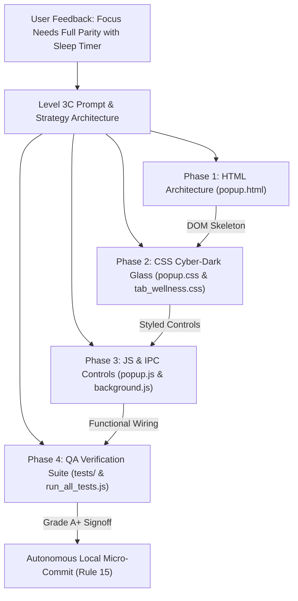
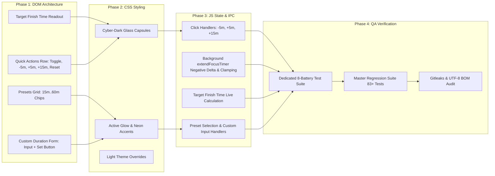

# TASK-POPUP-FOCUS-TIMER-SLEEP-PARITY-002: Executive Architecture Summary

> **Document Type:** Architectural Roadmap, Module Dependencies & File Manifest  
> **Directory Scope:** `temp_prompt/popup_focus_timer_sleep_parity/SUMMARY.md`  
> **Author:** Level 3C Phase-wise Prompt Generation Specialist (`prompt_generation_specialist`)  
> **Target Execution Workspace:** `c:\Users\Atul Verma\Desktop\Win App Tracker\Browser Detection`  

---

## 🏛️ 1. High-Level Initiative Scope & Technical Objectives

The objective of this initiative is to eliminate the feature disparity between the **Bedtime Sentinel (Sleep Timer)** and the **Focus Block (Focus Timer)** inside the Web Activity & Media Sentinel extension popup. While the recent revamp introduced a circular SVG radial dial to the Focus card, the interactive controls remained minimal (only Start/Pause and Reset), missing critical capabilities present in the Sleep Timer tab:
1. **Quick Extenders & Decrementers (`-5m`, `+5m`, `+15m`):** On-the-fly adjustment of active or paused focus blocks.
2. **Duration Preset Chips:** One-click presets (15m, 25m, 30m, 45m, 50m, 60m) with dynamic active state highlighting.
3. **Custom Duration Form:** Freeform minute configuration (1-720 min) with instant setting.
4. **Target Finish Time Readout:** Real-time projected completion timestamp ("Finish: 10:45 AM" / "No active timer").
5. **Bidirectional State & Alarm Rescheduling:** Safe delta arithmetic in `background.js` and dynamic DOM reflection in `popup.js`.

---

## 🗺️ 2. Cross-Phase Milestone Roadmap & Dependency Topology

---

## 📁 3. Deliverables & Modified Files Manifest

| Target File | Modifications & Architectural Impact |
| :--- | :--- |
| `popup/popup.html` | Restructure `#cardPopupFocusTimer` to include Target Finish Time span (`#popupFocusDialFinishTime`), Quick Actions row (`#btnPopupFocusReduce5m`, `#btnPopupFocusExtend5m`, `#btnPopupFocusExtend15m`), Duration Presets grid (`.focus-tab-presets-grid`), and Custom Input form (`#inputFocusCustomMinutes`, `#btnSetFocusCustom`). |
| `popup/popup.css` | Define cyber-dark glass styling for `.popup-focus-quick-actions-row`, action buttons with emerald/amber hover states, active preset chips, and responsive flex wrapping. |
| `popup/styles/tabs/tab_wellness.css` | Modular scoped rules for `.focus-section-card`, `.focus-tab-preset-btn`, `.focus-custom-input-row`, and active state styling. |
| `popup/popup.js` | Implement event handlers for `-5m`, `+5m`, `+15m`, presets, custom input; calculate and format target finish time; sync dynamic active preset highlighting; preserve W3C Trusted Types zero-innerHTML safety. |
| `background.js` | Refactor `extendFocusTimer(deltaMinutes)` to accept negative values with minimum clamping ($\ge 1\text{ min}$ / 60s); recalculate `targetTime`, reschedule alarms, update badge countdown, broadcast state. |
| `tests/test_popup_focus_timer_sleep_parity.js` | Brand-new comprehensive 8-battery automated test suite asserting DOM layout, event wiring, backend delta logic, target time formatting, and edge cases. |

---

## ⚖️ 4. Risk Mitigation & Architectural Tradeoffs

| Risk Identified | Severity | Mitigation Strategy |
| :--- | :---: | :--- |
| **Negative Timer Clamping:** Decrementing `-5m` when remaining time is $< 5\text{ min}$ could result in negative countdown or instant expiration. | High | In `background.js`, implement strict clamping: `remainingSeconds = Math.max(60, remainingSeconds - 300)`. If remaining is less than 60s, do not allow further decrement and notify via toast. |
| **Legacy ID Breaking Changes:** Existing tests check `#btnPopupFocusToggle`, `#btnPopupFocusReset`, `#popupFocusClock`. | High | Keep all original IDs intact. Enhance `#btnPopupFocusToggle` with internal icon and text spans while keeping the button ID unchanged. |
| **Popup Height Overflow:** Adding presets and custom input might expand the popup height excessively. | Medium | Use compact micro-padding (4px-6px) and sleek chip grids matching the compact layout of `#viewSleepPane`. |
| **innerHTML XSS Ingestion:** Inserting user input into the DOM. | Critical | Strict W3C Trusted Types zero-innerHTML compliance. Use `textContent` and `value` sanitization exclusively. |
