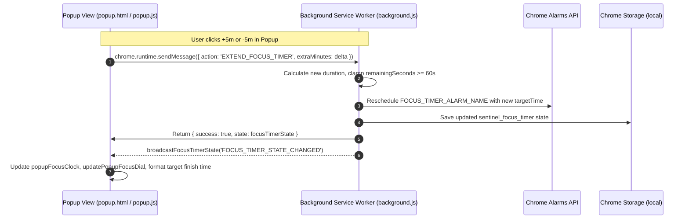

# TASK-POPUP-FOCUS-TIMER-SLEEP-PARITY-002: Technical Requirements Document (TRD)

> **Document Type:** Technical Architecture, Data Contracts & Interface Specification  
> **Task Identifier:** `TASK-POPUP-FOCUS-TIMER-SLEEP-PARITY-002`  
> **Directory Scope:** `temp_prompt/popup_focus_timer_sleep_parity/TRD.md`  
> **Target Execution Workspace:** `c:\Users\Atul Verma\Desktop\Win App Tracker\Browser Detection`  

---

## 🏛️ 1. High-Level Design (HLD) & Architecture

The Focus Block subsystem follows an event-driven architecture between the Extension Popup (`popup/popup.js`), the Extension Background Service Worker (`background.js`), and Chrome Extension APIs (`chrome.alarms`, `chrome.storage.local`, `chrome.runtime`).



---

## 🧱 2. DOM Component Hierarchy Specification (`popup/popup.html`)

```html
<!-- Inside #viewFocusPane -> #cardFocusWellness -->
<div id="cardPopupFocusTimer" class="popup-focus-card">
  <!-- 1. Header -->
  <div class="popup-focus-header">
    <div class="popup-focus-title-group">
      <span class="popup-focus-icon">🧘</span>
      <span class="popup-focus-title">Focus Block</span>
    </div>
    <span id="popupFocusBadge" class="popup-focus-badge idle">25m</span>
  </div>

  <!-- Active Goal Chip (Preserved) -->
  <div id="popupActiveGoalChip" class="popup-goal-chip hidden">
    <span class="popup-goal-icon">🎯</span>
    <span id="txtPopupActiveGoal" class="popup-goal-text">Deep Work</span>
  </div>

  <!-- 2. Radial SVG Dial & Target Time Overlay -->
  <div class="popup-focus-dial-wrapper">
    <svg id="popupFocusDialSvg" class="popup-focus-svg-dial" viewBox="0 0 140 140" width="130" height="130" role="img" aria-label="Focus Countdown Radial Dial">
      <defs>
        <linearGradient id="focusGlowGradient" x1="0%" y1="0%" x2="100%" y2="100%">
          <stop offset="0%" stop-color="#10b981" />
          <stop offset="50%" stop-color="#06b6d4" />
          <stop offset="100%" stop-color="#3b82f6" />
        </linearGradient>
        <linearGradient id="breakGlowGradient" x1="0%" y1="0%" x2="100%" y2="100%">
          <stop offset="0%" stop-color="#f59e0b" />
          <stop offset="100%" stop-color="#fbbf24" />
        </linearGradient>
      </defs>
      <circle class="popup-focus-dial-track" cx="70" cy="70" r="54" fill="none" stroke="rgba(255, 255, 255, 0.08)" stroke-width="7" />
      <circle id="popupFocusDialProgress" class="popup-focus-dial-progress" cx="70" cy="70" r="54" fill="none" 
              stroke="url(#focusGlowGradient)" stroke-width="7" stroke-linecap="round" 
              stroke-dasharray="339.292" stroke-dashoffset="0" transform="rotate(-90 70 70)" />
    </svg>
    <!-- Centered Telemetry Overlay -->
    <div class="popup-focus-dial-content">
      <span id="popupFocusClock" class="popup-focus-clock" aria-live="polite">25:00</span>
      <div id="popupFocusTargetTime" class="popup-focus-target-text">
        <span id="popupFocusDialFinishTime">No active timer</span>
      </div>
      <span id="popupFocusDialState" class="popup-focus-dial-state">Ready</span>
    </div>
  </div>

  <!-- 3. Quick Actions Control Row: Toggle, -5m, +5m, +15m, Reset -->
  <div class="popup-focus-quick-actions-row">
    <button type="button" id="btnPopupFocusToggle" class="popup-focus-action-btn primary" title="Start Focus" aria-label="Start Focus">
      <span id="btnPopupFocusToggleIcon">▶</span>
      <span id="btnPopupFocusToggleText">Start</span>
    </button>
    <button type="button" id="btnPopupFocusReduce5m" class="popup-focus-action-btn extend" title="Subtract 5 Minutes" aria-label="Subtract 5 Minutes">
      -5m
    </button>
    <button type="button" id="btnPopupFocusExtend5m" class="popup-focus-action-btn extend" title="Add 5 Minutes" aria-label="Add 5 Minutes">
      +5m
    </button>
    <button type="button" id="btnPopupFocusExtend15m" class="popup-focus-action-btn extend" title="Add 15 Minutes" aria-label="Add 15 Minutes">
      +15m
    </button>
    <button type="button" id="btnPopupFocusReset" class="popup-focus-action-btn reset" title="Reset Timer" aria-label="Reset Timer">
      ✕ Reset
    </button>
  </div>
</div>

<!-- 4. Duration Presets & Custom Duration Card -->
<section id="cardFocusPresetsAndCustom" class="focus-section-card">
  <div class="section-micro-header">
    <span class="micro-icon">⏱️</span>
    <span class="micro-heading">DURATION PRESETS</span>
  </div>
  <div class="focus-tab-presets-grid">
    <button type="button" class="focus-tab-preset-btn" data-minutes="15">15m</button>
    <button type="button" class="focus-tab-preset-btn active" data-minutes="25">25m</button>
    <button type="button" class="focus-tab-preset-btn" data-minutes="30">30m</button>
    <button type="button" class="focus-tab-preset-btn" data-minutes="45">45m</button>
    <button type="button" class="focus-tab-preset-btn" data-minutes="50">50m</button>
    <button type="button" class="focus-tab-preset-btn" data-minutes="60">60m</button>
  </div>

  <!-- Custom Minute Input Form -->
  <div class="focus-custom-input-row">
    <label for="inputFocusCustomMinutes" class="focus-custom-label">Custom Duration:</label>
    <div class="focus-custom-input-wrap">
      <input type="number" id="inputFocusCustomMinutes" min="1" max="720" placeholder="Min (1-720)" class="focus-custom-input">
      <button type="button" id="btnSetFocusCustom" class="btn-focus-set-custom">Set</button>
    </div>
  </div>
</section>
```

---

## 📡 3. IPC Message Schema Specifications

### `EXTEND_FOCUS_TIMER` (Supporting Positive & Negative Delta)
- **Sender:** `popup/popup.js`
- **Receiver:** `background.js`
- **Request Payload:**
```json
{
  "action": "EXTEND_FOCUS_TIMER",
  "extraMinutes": -5 // or 5, 15
}
```
- **Handler Logic (`background.js`):**
```javascript
async function extendFocusTimer(extraMinutes = 5) {
  await ensureStorageLoaded();
  const minsToAdd = parseInt(extraMinutes, 10);
  if (isNaN(minsToAdd) || minsToAdd === 0) {
    return { success: false, error: 'Invalid extraMinutes', state: focusTimerState };
  }

  const extraSec = minsToAdd * 60;
  const currentSec = focusTimerState.remainingSeconds || (focusTimerState.durationMinutes || 25) * 60;
  const newSec = Math.max(60, currentSec + extraSec); // Min floor clamp: 60s (1 min)
  
  focusTimerState.remainingSeconds = newSec;
  focusTimerState.durationMinutes = Math.max(1, Math.round(newSec / 60));

  const now = Date.now();
  if (focusTimerState.state === 'RUNNING_FOCUS' || focusTimerState.state === 'RUNNING_BREAK') {
    focusTimerState.targetTime = now + (newSec * 1000);
    try {
      await browserAPI.alarms.clear(FOCUS_TIMER_ALARM_NAME);
      await browserAPI.alarms.clear(FOCUS_BREAK_ALARM_NAME);
    } catch (_) {}
    try {
      browserAPI.alarms.create(
        focusTimerState.mode === 'focus' ? FOCUS_TIMER_ALARM_NAME : FOCUS_BREAK_ALARM_NAME,
        { when: focusTimerState.targetTime }
      );
    } catch (_) {}
    if (focusTimerSettings.showBadgeCountdown) {
      updateFocusActionBadge(focusTimerState.targetTime - now);
    }
  }

  await saveFocusTimerState();
  broadcastFocusTimerState('FOCUS_TIMER_STATE_CHANGED');
  return { success: true, state: focusTimerState };
}
```

---

## ⏰ 4. Target Finish Time Calculation Logic

```javascript
function formatFocusFinishTime(targetTime) {
  if (!targetTime || targetTime <= Date.now()) {
    return 'No active timer';
  }
  const date = new Date(targetTime);
  const hours = date.getHours();
  const minutes = date.getMinutes();
  const ampm = hours >= 12 ? 'PM' : 'AM';
  const formattedHours = hours % 12 || 12;
  const formattedMinutes = minutes < 10 ? '0' + minutes : minutes;
  return `Finish: ${formattedHours}:${formattedMinutes} ${ampm}`;
}
```

---

## 🔒 5. Backward Compatibility Guarantee

The following existing DOM elements and IDs are tested in legacy suites (`test_focus_time_phase1_uiux.js`, `test_focus_time_subsystem.js`, `test_focus_block_circular_dial.js`) and must be strictly preserved:
- `#cardPopupFocusTimer`
- `#popupFocusBadge`
- `#popupFocusClock`
- `#popupFocusDialSvg`
- `#popupFocusDialProgress`
- `#popupFocusDialState`
- `#btnPopupFocusToggle`
- `#btnPopupFocusReset`
- `#popupActiveGoalChip`
- `#txtPopupActiveGoal`
- `window.syncPopupFocusState`
