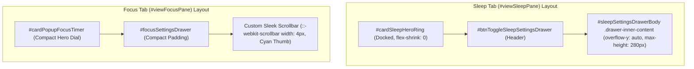

# Executive Architecture Summary: Settings Drawers Docking & Cyber Scrollbars

> **Document Type:** Ephemeral Executive Architecture Summary  
> **Workspace Container:** `temp_prompt/popup_settings_drawer_docking_and_scrollbar_fix/`  
> **Author:** Level 3C Phase-wise Prompt Generation Specialist (`prompt_generation_specialist`)  
> **Governing Standards:** Universal Rule 22 (Phased Prompts), Rule 28 (Modularity), Rule 5 & 8 (UTF-8 with BOM)  

---

## 🏛️ 1. Technical Scope & Executive Overview

This initiative resolves two critical UI/UX regressions discovered during user testing of the newly introduced collapsible settings drawers in the extension popup:

1. **Sleep Tab Docking & Bounded Scrolling:**
   In the Sleep Tab (`#viewSleepPane`), the primary countdown dial and hero controls (`#cardSleepHeroRing`) must remain permanently visible (docked) at the top of the pane. When the settings drawer is opened, scrolling must be restricted strictly to the contents of the drawer itself, preventing the hero dial from disappearing.

2. **Focus Tab Cyber-Dark Sleek Scrollbar & Compact Layout:**
   In the Focus Tab (`#viewFocusPane`), the native Windows scrollbar (wide, light gray, intrusive) must be completely eliminated and replaced with custom cyber-dark WebKit scrollbars (`width: 4px`, cyber-cyan/slate thumb, rounded corners, transparent track). Furthermore, card spacing and padding inside the drawer must be compressed to deliver a modern, ergonomic layout.

---

## 🗺️ 2. Architectural Blueprint & Layout Topology

---

## 🛡️ 3. Risk Mitigation & Regression Safeguards

| Identified Risk | Risk Severity | Architectural Mitigation Strategy |
| :--- | :---: | :--- |
| **Breaking Existing Test Assertions:** `test_popup_collapsible_settings_drawer.js` expects specific strings in CSS (`#viewSleepPane` / `#viewFocusPane` with `max-height: 540px` and `scrollbar-width: thin`). | HIGH | Strictly retain the exact expected string signatures in `popup.css` / tab stylesheets while augmenting them with targeted scroll-bounding and WebKit scrollbars. |
| **Drawer Animation Glitches:** Introducing `overflow-y: auto` on drawer contents during CSS Grid transition might cause scrollbars to flash while expanding from 0fr to 1fr. | MEDIUM | Apply `overflow: hidden` on `.drawer-inner-content` while collapsed; activate `overflow-y: auto` only when parent container has `.open` class. |
| **Popup Viewport Overflow:** Content exceeding 550px height causing outer popup scrollbar. | MEDIUM | Constrain drawer body max-height strictly to 280px, guaranteeing total pane height <= 540px. |

---

## 📦 4. Deliverables Manifest

1. **Stylesheet Modifications:**
   - `popup/styles/tabs/tab_sleep.css` (Hero docking, bounded drawer scroll, sleek scrollbar)
   - `popup/styles/tabs/tab_wellness.css` (WebKit custom scrollbar, cyber-cyan styling, compact spacing)
   - `popup/popup.css` (Universal drawer body overflow handling and theme overrides)
2. **QA Test Battery:**
   - `tests/test_popup_drawer_docking_and_scrollbar_fix.js` (Dedicated standalone verification suite)
   - All 102+ existing suites certified passing via `node run_all_tests.js`
3. **Forensic Audit & Encoding:**
   - 100% UTF-8 with BOM certified on touched files
   - 0 secret leaks verified via `gitleaks detect --redact`
