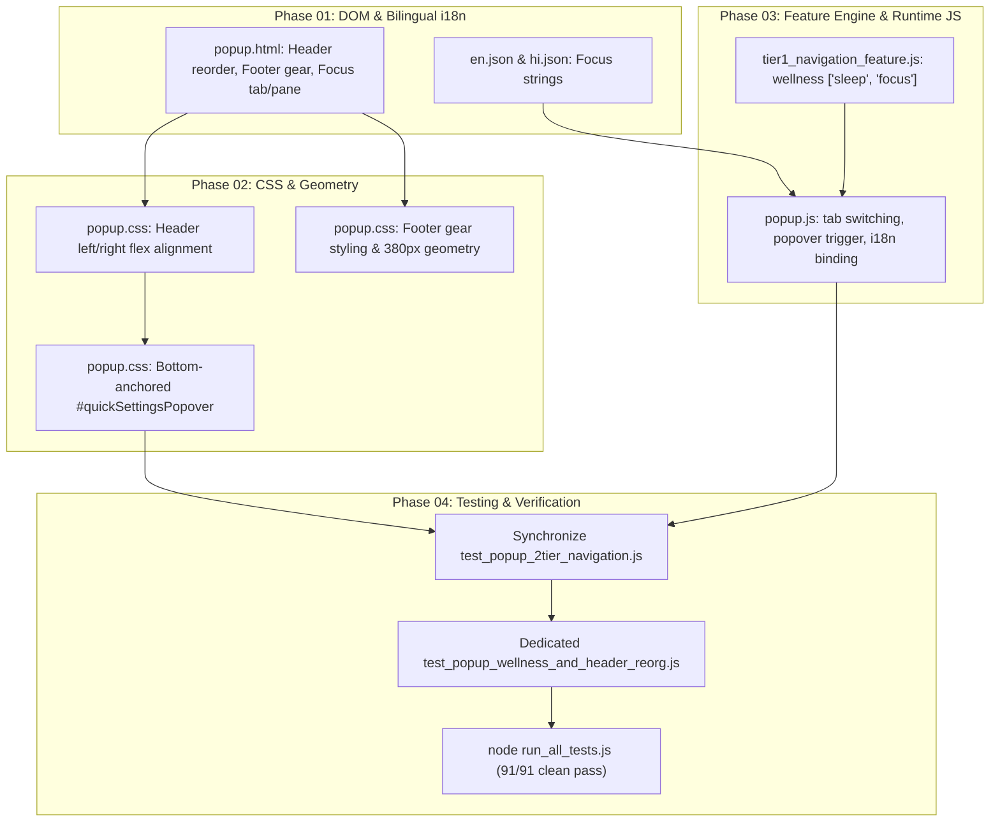

# Executive Architecture Summary — Popup Mode Wellness Sub-Tabs & Header/Footer Reorganization

> **Task ID:** `TASK-POPUP-WELLNESS-HEADER-001`  
> **Workspace:** `c:\Users\Atul Verma\Desktop\Win App Tracker\Browser Detection`  
> **Lead Architect / Specialist:** Level 3C Phase-wise Prompt Generation Specialist (`prompt_generation_specialist`)  
> **Target Path:** `temp_prompt/popup_wellness_header_reorg/SUMMARY.md`  
> **Recommended Strategy:** `STRATEGY_A_AUTONOMOUS` (Autonomy Score: 1.0)  

---

## 🎯 1. Initiative Scope & Technical Objectives

This initiative delivers a targeted visual and structural modernization of the Web Activity & Media Sentinel extension's Popup Mode (`popup/popup.html`, `popup/popup.css`, `popup/popup.js`, `src/popup/features/tier1_navigation_feature.js`).

### Core Objectives:
1. **Wellness Multi-Pillar Sub-Navigation:**
   - Expand the Tier 1 Wellness category from a single-tab view (`Sleep`) to a dual-pillar navigation hub (`Sleep` + `Focus`).
   - Add `#mainTabFocus` to `.top-nav-tabs` and provide `#viewFocusPane` with a high-fidelity placeholder interface.
   - Maintain seamless tab toggling between Focus and Sleep without breaking sleep timer countdowns, radial SVG state, or alarms.
2. **Ergonomic Header Realignment:**
   - Reorganize `.header-badges` inside `<header class="header">`:
     - **Left Side:** `#tier1SegmentedNav` (4 category buttons: Playback, Studio, Analytics, Wellness).
     - **Right Side:** Utility buttons (`#btnSwitchMediaTab` and `#btnOpenDashboard`).
   - Eliminate cognitive friction by clearly separating category exploration (left) from global utility actions (right).
3. **Footer Settings Dock & Bottom Popover Transition:**
   - Relocate the Quick Settings gear button (`#btnQuickSettings`) from the top header down into the `<footer>` toolbar, situated directly alongside the Theme Toggle button (`#btnThemeToggle`).
   - Update `#quickSettingsPopover` styling and coordinate positioning to open upward from the bottom (`bottom: 48px; right: 8px;`) rather than dropping down from the top header.
   - Preserve strict 380px fixed-width geometry with zero horizontal scrollbars.

---

## 🗺️ 2. Cross-Phase Dependency Topology

---

## ⚖️ 3. Risk Mitigation & Architectural Tradeoffs

| Risk Factor | Severity | Mitigation Strategy |
| :--- | :--- | :--- |
| **Breaking Existing 2-Tier Navigation Tests** | High | `test_popup_2tier_navigation.js` contains index-based DOM assertions (`assert(dashIdx < tier1Idx)` and `assert(tier1Idx < qsIdx)`). Phase 4 will explicitly synchronize these assertions to reflect the new DOM order while strictly preserving all 6 test batteries. |
| **Footer Toolbar Crowding & Horizontal Overflow** | Medium | Adding a 7th button to the footer toolbar could cause horizontal scrollbars in a 380px popup. Mitigation: adjust toolbar button padding (`padding: 4px 6px; gap: 3px;`), set flexible button basis (`flex: 1 1 auto; min-width: 0;`), and verify `overflow-x: hidden` on both `body` and `.sentinel-app`. |
| **Popover Viewport Clipping** | Medium | Previously, `#quickSettingsPopover` anchored from top (`top: 48px; right: 12px;`). Opening from the footer requires `bottom: 48px; right: 8px; max-height: 400px; overflow-y: auto;` to prevent rendering off-screen. |
| **Sleep Timer Background Interruption** | Critical | Adding `#mainTabFocus` must not mutate `#mainTabSleep` click listeners, `chrome.alarms`, or background timer state. Focus tab acts as an independent sub-pane within the wellness category. |

---

## ⚡ 4. Implementation Strategy & Autonomy Score

- **Selected Strategy:** `STRATEGY_A_AUTONOMOUS`
- **Calculated Autonomy Score:** `1.0`
- **Justification:**
  - Scope and constraints are 100% specified without architectural ambiguities.
  - No external service integrations, breaking schema changes, or user prompts are required.
  - Phase 1 through Phase 4 execute sequentially under dedicated Level 4 subagents with deterministic test gates.
