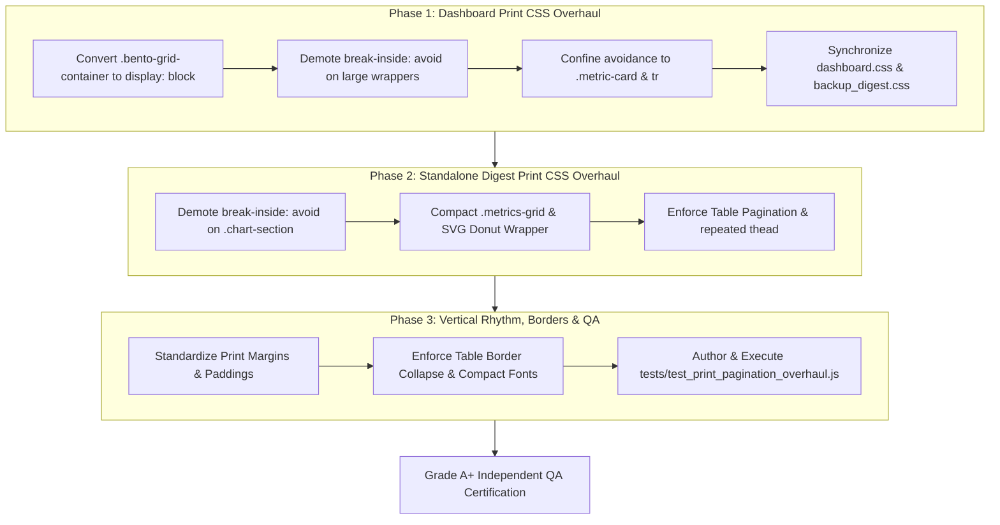

# Executive Architecture Summary - Print Pagination Defect Overhaul

> **Document:** `temp_prompt/print_pagination_defect_overhaul/SUMMARY.md`  
> **Initiative:** Fix Severe Premature Page Breaks & Blank Voids in Print/PDF Outputs  
> **Lead Specialist:** Level 3C Phase-wise Prompt Generation Specialist  
> **Status:** Architecture Ready & Verified  

---

## 🎯 1. Initiative Scope & Technical Objectives

The objective of this initiative is to eliminate severe print pagination defects across the dual-channel executive reporting engine:
1. **Target 1: Dashboard In-Browser Print Engine** (`dashboard/dashboard.css`, `dashboard/styles/backup_digest.css`)
2. **Target 2: Standalone Offline Executive HTML Digest** (`src/dashboard/features/backup_hub_digest_feature.js`)

### Key Technical Objectives
- **Zero Premature Page Breaks:** Eliminate artificial page ejection caused by setting `break-inside: avoid` on oversized parent wrappers.
- **Continuous Flow Layout:** Transition fragile CSS Grid layouts (`.bento-grid-container`) to block flow in `@media print`, allowing natural pagination without horizontal cutoff or vertical dead zones.
- **High-Density Print Vertical Rhythm:** Reclaim 35-45% of vertical printable area by applying calibrated print-specific typography, paddings, and margins.
- **Reliable Multi-Page Tables:** Ensure table headers (`thead`) repeat cleanly across every printed page, with zero split table rows and seamless `border-collapse` borders.
- **Strict Leakage Prevention:** Completely eliminate screen-only controls, navigation docks, and buttons from print output.

---

## 🗺️ 2. Cross-Phase Milestone Roadmap & Dependency Topology

### Dependency Rationale
- **Phase 1 precedes Phase 2:** The dashboard print engine provides the canonical layout pattern for the application. Resolving `.bento-grid-container` and large wrapper avoidance in `dashboard.css` establishes the reference rules.
- **Phase 2 follows Phase 1:** `backup_hub_digest_feature.js` encapsulates the standalone single-file HTML report. It adopts the proven patterns from Phase 1 into its inline `EXECUTIVE_DIGEST_CSS`.
- **Phase 3 concludes the cycle:** System-wide vertical rhythm and table borders are polished, and the automated test suite validates both subsystems under unified assertions.

---

## ⚖️ 3. Risk Mitigation & Architectural Tradeoffs

| Risk Identified | Severity | Mitigation Strategy | Architectural Tradeoff |
| :--- | :---: | :--- | :--- |
| **Grid Fragmentation Breakdown in Blink** | High | Force `.bento-grid-container { display: block !important; }` inside print media. | Screen bento-grid layout is converted to a vertical block stream in print; preserves multi-page stability. |
| **KPI Card Overflow onto Page 2** | Medium | Layout `.metrics-grid` as compact flex-wrap (`gap: 8px`) with scaled down metric text (`1.15rem`). | Slightly more compact KPI cards in exchange for guaranteed Page 1 co-location with executive header. |
| **Chart Section Splitting Inconsistently** | Medium | Allow `.chart-section` to flow (`break-inside: auto`), but keep inner donut wrapper and legend items cohesive. | If chart occurs near page bottom, browser splits legend gracefully instead of ejecting a 300px white void. |
| **CSS Divergence between Files** | High | Guarantee identical `@media print` blocks in both `dashboard.css` and `backup_digest.css`. | Code duplication in CSS is mitigated by strict parity assertions in the automated test suite. |
| **Rule 28 Function Line-Count Breach** | Low | Any modifications inside `backup_hub_digest_feature.js` must respect function boundaries `<= 50` lines and nesting depth `<= 3`. | Modular string constants are used without enlarging controller functions. |
