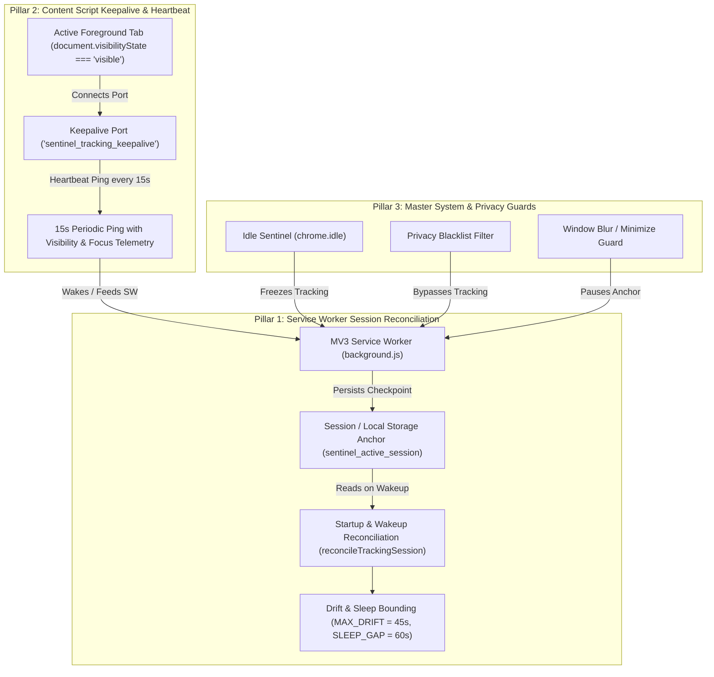

# Robust Timestamp-Based Reconciliation & Keepalive Heartbeat - Tracking Index & Diagnostic Dossier

> **Task Container:** `temp_prompt/robust_time_tracking_reconciliation/`  
> **Task ID:** `TASK-MV3-RECONCILIATION-KEEPALIVE-001`  
> **Governance:** Level 3C Phase-wise Prompt Generation Specialist (`prompt_generation_specialist`)  
> **Target Subsystems:**  
> 1. Service Worker Persistent Session & Reconciliation Engine (`background.js`, `src/background/state/state_manager.js`, `src/background/storage/storage_manager.js`)  
> 2. Content Script Keepalive Port & Foreground Heartbeat Engine (`content_media.js`, `src/content/`)  
> 3. Master Integration, Blacklist Enforcement, Idle State & Doomscroll Guards (`background.js`)  
> 4. Test Automation & Independent QA Verification (`tests/test_time_tracking_reconciliation_and_keepalive.js`, `run_all_tests.js`)  
> **Execution Strategy:** `STRATEGY_A_AUTONOMOUS` (Autonomy Score: 1.0; Strategy B available if upfront consultation requested)  
> **Prompt Requirement:** `PROMPT_FILES_REQUIRED = YES`  

---

## 📋 1. Executive Problem & Solution Summary

### Problem Dossier
In Manifest V3 (MV3), Chrome deprecated persistent background pages in favor of ephemeral Service Workers (`service_worker`). This fundamental platform change introduces severe accuracy vulnerabilities into active web time tracking:

1. **Service Worker Premature Termination & Time Loss:**  
   Chromium aggressively terminates idle service workers after approximately 30 seconds of inactivity. If a user remains on a single active webpage (e.g., reading an article, writing documentation, coding in a web IDE, or analyzing data) without triggering browser events (like tab switching, window focus changes, or navigation), the Service Worker suspends.
2. **State Amnesia on Wakeup:**  
   When an event subsequently wakes the Service Worker, in-memory variables (`intervalStartTime`, `activeDomain`, `activeTabId`) are either reset or set to `Date.now()`. Consequently, all browsing time elapsed during worker suspension is completely dropped, leading to massive undercounting (e.g., 45 minutes of active research recorded as 30 seconds).
3. **Naive Delta Flaws & Sleep Drift:**  
   If an extension naively calculates `now - lastSavedTime` across worker activations without validation, any period where the computer went to sleep, the user walked away, or the browser was minimized would be mistakenly credited as active browsing time, causing catastrophic overcounting.

### Architectural Solution: Dual-Pillar Reconciliation & Keepalive Engine
To achieve 100% accurate, drift-free, and tamper-resistant active time tracking within MV3 constraints, the system implements a dual-pillar architecture:

1. **Pillar 1: Storage Session Schema & SW Lifecycle Reconciliation:**
   - Anchor active session telemetry in `chrome.storage.session` (fast, memory-backed, auto-clears on browser close, fallback to `chrome.storage.local`).
   - Store: `{ domain, url, tabId, windowId, sessionStartTime, lastHeartbeatTime, lastCommittedTime, isForeground, isUserActive }`.
   - On SW top-level initialization / wakeup, execute `reconcileTrackingSessionOnStartup()`: calculate bounded elapsed delta (`min(now - lastHeartbeatTime, MAX_RECONCILE_DRIFT_MS)`). If a machine sleep gap is detected (`> SLEEP_THRESHOLD_MS`), finalize prior session without overcounting.
   - On `runtime.onSuspend`, flush interval and commit pending seconds to persistent storage.
2. **Pillar 2: Content Script Keepalive Port & Foreground Heartbeat:**
   - Active foreground tab content script creates a long-lived port (`chrome.runtime.connect({ name: 'sentinel_tracking_keepalive' })`).
   - Content script transmits heartbeat telemetry every 15s when `document.visibilityState === 'visible'` and window is active.
   - Port connection naturally keeps the Service Worker alive during active foreground interaction, preventing arbitrary suspension while user is engaged.
   - On tab switch, hide, or navigation, port cleanly disconnects, signaling immediate interval finalization in background.
3. **Pillar 3: Master System Integration & Privacy Guards:**
   - Integrate with `chrome.idle.onStateChanged`: freeze accumulation upon idle/locked state.
   - Integrate with `matchesTrackingBlacklist`: blacklisted URLs never create keepalive ports and never accumulate seconds.
   - Integrate with `chrome.windows.onFocusChanged`: pause accumulation when browser loses OS focus.
4. **Pillar 4: Independent QA Verification & Test Automation:**
   - Standalone 7-battery test suite certifying all lifecycle transitions, drift limits, port disconnects, and blacklist guarantees.

---

## 🚦 2. Phase Execution Status Checklist

| Phase # | Phase Name | Target Scope | Assigned Agent | Status | QA Signoff |
| :---: | :--- | :--- | :--- | :---: | :---: |
| **01** | Storage Session Schema & SW Lifecycle Reconciliation | `src/background/telemetry/timestamp_reconciliation.js`, `background.js` | Level 4 Backend Subagent | `COMPLETED` | ✅ Gate 1 Passed |
| **02** | Content Script Keepalive Port & Tab Heartbeat Engine | `content_media.js`, `src/background/telemetry/timestamp_reconciliation.js`, `background.js` | Level 4 Fullstack Subagent | `COMPLETED` | ✅ Gate 2 Passed |
| **03** | Master Integration, Blacklist & Idle System Guards | `background.js`, `content_media.js` | Level 4 Fullstack Subagent | `COMPLETED` | ✅ Gate 3 Passed |
| **04** | Independent QA Verification & Master Regression | `tests/test_time_tracking_reconciliation_and_keepalive.js`, `run_all_tests.js` | Level 4 QA Subagent | `COMPLETED` | ✅ Grade A+ Certified |

---

## 🔍 3. Universal 7-Column Diagnostic Impact Matrix

| S.No | File | Root Cause | Proposed Fix | Post-Fix Impact | Phase # | Test Gate |
| :---: | :--- | :--- | :--- | :--- | :---: | :--- |
| **1** | `background.js` & `src/background/state/` | In-memory active tracking anchors (`intervalStartTime`, `activeDomain`) vanish upon MV3 Service Worker suspension, causing dropped time when waking up without immediate tab events. | Implement persistent session schema `sentinel_active_session` in `storage.session` / `storage.local` and add `reconcileTrackingSessionOnStartup()` with mathematical drift cap (`MAX_RECONCILE_DRIFT_MS = 45s`). | Service Worker wakeups cleanly recover uninterrupted tracking delta without losing browsing minutes. | Phase 1 | `node tests/test_time_tracking_reconciliation_and_keepalive.js` |
| **2** | `background.js` | `runtime.onSuspend` handles media session durations but does not reliably persist live active domain tracking session checkpoints. | Enhance `onSuspend` listener to execute `commitActiveInterval()`, update `sentinel_active_session.lastHeartbeatTime = Date.now()`, and await synchronous storage sync. | Clean, zero-loss state persistence during scheduled or unscheduled worker termination. | Phase 1 | `node tests/test_time_tracking_reconciliation_and_keepalive.js` |
| **3** | `content_media.js` | Foreground content script does not maintain an active connection port for web time tracking, allowing the Service Worker to terminate while user is actively reading. | Author `initTrackingKeepalivePort()` establishing `chrome.runtime.connect({ name: 'sentinel_tracking_keepalive' })` emitting 15s heartbeats only while `visibilityState === 'visible'`. | Prevents premature worker death during active reading/browsing sessions; keeps SW alive deterministically. | Phase 2 | `node tests/test_time_tracking_reconciliation_and_keepalive.js` |
| **4** | `background.js` | Background script lacks a dedicated port listener for time tracking keepalives, treating all tracking as event-driven polling. | Implement `runtime.onConnect` listener for `sentinel_tracking_keepalive`, tracking active port map, handling periodic heartbeats, and committing interval on `onDisconnect`. | Robust bidirectional channel between foreground tab and Service Worker with deterministic disconnection handling. | Phase 2 | `node tests/test_time_tracking_reconciliation_and_keepalive.js` |
| **5** | `background.js` & `content_media.js` | If user leaves computer (idle) or visits blacklisted host (`localhost`, IP, user patterns), keepalive heartbeats might spuriously credit time if not strictly gated. | Enforce strict guards: suppress keepalive connection on blacklisted domains; reject heartbeat commits in `background.js` when `!isUserActive`, `isTrackingPaused`, or `matchesTrackingBlacklist(domain)`. | 100% privacy compliance and zero idle inflation; blacklisted sites never accumulate tracking seconds. | Phase 3 | `node tests/test_time_tracking_reconciliation_and_keepalive.js` |
| **6** | `background.js` | OS sleep or hibernation (e.g. laptop closed for 8 hours) could cause massive overcounting if `Date.now() - lastHeartbeatTime` is naively applied on resume. | Implement sleep gap heuristic (`SLEEP_THRESHOLD_MS = 60s`): if elapsed gap exceeds 60s without heartbeat, finalize session at `lastHeartbeatTime + 15s` and mark boundary. | Complete immunity against sleep/wake time warping and machine hibernation drift. | Phase 3 | `node tests/test_time_tracking_reconciliation_and_keepalive.js` |
| **7** | `tests/test_time_tracking_reconciliation_and_keepalive.js` | No existing automated test suite specifically asserts SW session reconciliation, heartbeat port lifecycles, sleep drift bounding, and blacklist keepalive suppression. | Author comprehensive 7-battery standalone verification suite covering schema serialization, drift caps, port lifecycles, idle transitions, and regression compatibility. | Guarantees 100% test coverage, verifiable proof of bug resolution, and zero regressions across master test runner. | Phase 4 | `node run_all_tests.js` |

---
