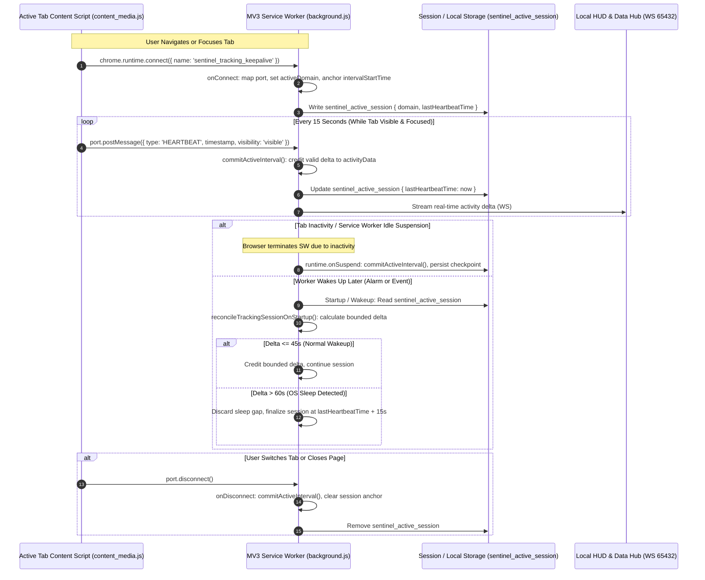
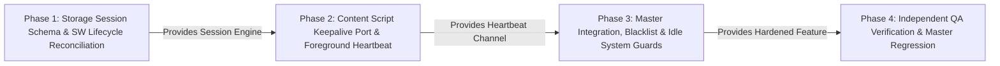

# Executive Architecture Summary: MV3 Robust Time Tracking Reconciliation & Keepalive

> **Task Container:** `temp_prompt/robust_time_tracking_reconciliation/`  
> **Document Type:** Executive Summary & Architectural Topology  
> **Lead Architecture Department:** Dept 02 Solution Architecture (`departments_archive/02_solution_architecture_dept.md`)  
> **Governing Specialist:** Level 3C Phase-wise Prompt Generation Specialist (`prompt_generation_specialist`)  

---

## 🏛️ 1. Technical Context & High-Level Scope

### The Manifest V3 Background Paradigm Shift
In Chrome Manifest V2 (MV2), extension background pages were long-lived persistent execution environments (`"persistent": true`). Timers (`setInterval`, `setTimeout`) ran continuously in memory, and variables tracking the current active tab and start timestamp remained intact indefinitely.

In Manifest V3 (MV3), persistent background pages were eliminated in favor of ephemeral **Service Workers** (`"service_worker": "background.js"`). The browser manages the Service Worker's lifecycle aggressively:
- The worker is spun down after ~30 seconds of event inactivity.
- Any top-level JavaScript state or in-memory variables (`intervalStartTime`, `activeDomain`, `activeTabId`) are wiped when the worker terminates.
- Standard DOM APIs (`window`, `document`) and background audio tricks are inaccessible in service workers.
- The Service Worker wakes up ONLY upon registered extension events: `chrome.tabs.*`, `chrome.windows.*`, `chrome.alarms.*`, `chrome.webNavigation.*`, and `chrome.runtime.onConnect` / `onMessage`.

### The Core Defect
Because active reading or browsing on a static or media-free webpage generates NO native browser events while the user scrolls or reads:
1. The Service Worker terminates 30 seconds into the session.
2. In-memory counters freeze.
3. When the user eventually switches tabs 20 minutes later, the Service Worker restarts from scratch, re-initializing `intervalStartTime = Date.now()`.
4. As a result, the 19.5 minutes of active reading are lost forever.

### Strategic Objective
Implement a robust, battery-efficient, tamper-proof, and privacy-preserving active web time tracking architecture that guarantees:
- **Zero Time Loss:** 100% of legitimate user browsing time is captured accurately.
- **Sleep & Hibernation Immunity:** Mathematical bounding guarantees that computer sleep or hibernation is never counted as browsing time.
- **Port Keepalive Resilience:** A dedicated content script channel keeps the Service Worker active during foreground reading without draining battery or CPU.
- **Modular Compliance:** Strict adherence to Universal Rule 28 (< 50 lines per function, max nesting depth <= 3) and W3C Trusted Types zero-innerHTML safety.

---

## 🔄 2. End-to-End Architectural Sequence Diagram

---

## 🗺️ 3. Milestone Roadmap & Dependency Topology

### Phase Breakdown
1. **Phase 1: Storage Session Schema & SW Lifecycle Reconciliation Engine**  
   - Implements persistent session data contract `sentinel_active_session` in `storage.session` with fallback to `storage.local`.  
   - Authors `reconcileTrackingSessionOnStartup()` in `background.js` / `src/background/state/state_manager.js`.  
   - Implements drift bounding logic: `Math.min(now - lastHeartbeatTime, MAX_RECONCILE_DRIFT_MS)`.  
   - Enhances `runtime.onSuspend` to flush intervals and sync storage cleanly.
2. **Phase 2: Content Script Keepalive Port & Foreground Heartbeat Engine**  
   - Authors `initTrackingKeepalivePort()` in `content_media.js` with 15s cadence, active visibility check (`document.visibilityState === 'visible'`), and focus check.  
   - Authors background `runtime.onConnect` port listener for `'sentinel_tracking_keepalive'`.  
   - Implements deterministic `onDisconnect` teardown handling and exponential backoff reconnection guard.
3. **Phase 3: Master Integration, Blacklist Enforcement, Idle State & Doomscroll Guards**  
   - Integrates `chrome.idle.onStateChanged`: freezes tracking on `'idle'` and `'locked'`.  
   - Integrates `matchesTrackingBlacklist()`: prevents keepalive creation and rejects heartbeats on blacklisted hosts.  
   - Integrates `chrome.windows.onFocusChanged`: pauses interval when window is minimized or blurred.  
   - Hardens sleep gap detection (`SLEEP_THRESHOLD_MS = 60s`) preventing sleep time inflation.
4. **Phase 4: Independent QA Verification & Master Regression Testing**  
   - Authors dedicated 7-battery standalone test suite `tests/test_time_tracking_reconciliation_and_keepalive.js`.  
   - Executes full regression suite `node run_all_tests.js` certifying 100% pass across all test suites.  
   - Executes `gitleaks detect --redact` certifying 0 secret leaks.  
   - Verifies UTF-8 with BOM on all touched files.

---

## ⚖️ 4. Risk Mitigation & Architectural Tradeoffs

| Risk / Tradeoff | Impact | Architectural Mitigation |
| :--- | :--- | :--- |
| **Excessive Battery / CPU Drain from Heartbeats** | Users could experience battery drain if content scripts ping background too frequently. | 1. 15-second ping interval (very low frequency). 2. Strictly gated on `document.visibilityState === 'visible'`. Hidden tabs NEVER emit heartbeats. 3. Heartbeat payload is micro-sized (< 100 bytes). |
| **OS Sleep / Hibernation Time Warping** | When a laptop lid closes for 12 hours, a naive delta would credit 12 hours of browsing to the last active tab. | Explicit sleep threshold: if `now - lastHeartbeatTime > SLEEP_THRESHOLD_MS (60s)`, the reconciliation engine recognizes an external sleep event, caps credited duration to `lastHeartbeatTime + 15s`, and marks a clean session break. |
| **Multiple Active Windows / Monitors** | User might have two visible browser windows on different monitors. | Chrome only assigns active focus to one window at a time (`lastFocusedWindow: true`). Keepalive heartbeat validates window focus state; only the active focused window accumulates active foreground web time. |
| **Privacy Blacklist Leakage** | Local development (`localhost`, `127.0.0.1`) or private domains could be tracked or kept alive. | Multi-tier filtering: content script checks domain against blacklist before establishing port; background double-checks blacklist on port connection and rejects any incoming heartbeat from blacklisted hosts. |
| **Context Invalidation on Extension Reload** | If extension updates or reloads, content script ports might throw errors. | Wrapped in `try-catch` with `isExtensionContextValid()` check and auto-teardown, preventing uncaught runtime exceptions in the browser console. |

---
