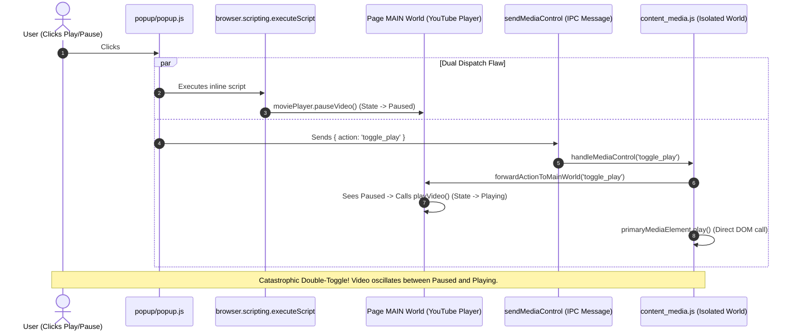
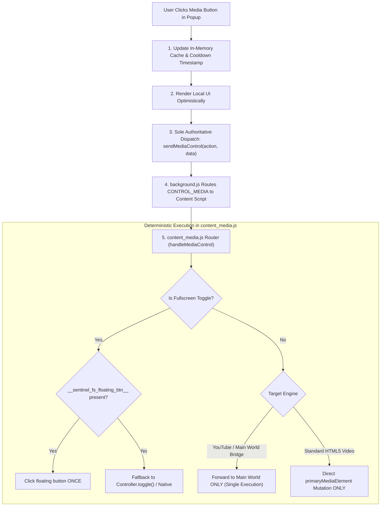
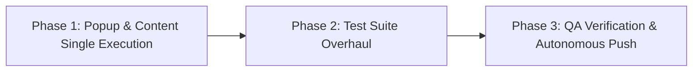

# Executive Architecture Summary
## Single-Execution Determinism & Double-Toggle Elimination

> **System Component:** Browser Media Telemetry & Live HUD Extension  
> **Architectural Paradigm:** Single Authoritative IPC Pipeline with Zero Concurrent DOM Mutation  
> **Target Files:** `popup/popup.js`, `content_media.js`, `tests/test_media_controls_and_fullscreen_fix.js`  
> **Governance:** Universal Rule 22 & [`PHASE_WISE_PROMPT_GENERATION_ARCHITECTURE.md`](file:///C:/Users/Atul%20Verma/.gemini/config/rules/PHASE_WISE_PROMPT_GENERATION_ARCHITECTURE.md)  

---

## 1. Architectural Problem Analysis

The previous refactoring aimed to ensure that background workers always receive media control commands by combining direct scripting (`executeScript`) and IPC (`sendMediaControl`). However, in asynchronous web extension architectures, firing two separate control mechanisms for the same user interaction introduces severe non-deterministic race conditions:

### Key Symptoms & Root Causes:
1. **Play/Pause Oscillation:** User clicks Play/Pause once, but the video pauses for a split second and instantly unpauses (or vice-versa).
2. **Mute/Unmute Glitches:** Mute action fires twice, resulting in no audible change or fluctuating volume.
3. **Double Fullscreen Jump:** Fullscreen enters and immediately exits because the floating button is clicked twice in under 50ms.
4. **Speed Stepping Drift:** Speed step increments by 0.50x instead of 0.25x because both Main World and element handlers increment the playback rate.

---

## 2. The Single-Execution Determinism Doctrine

To permanently resolve all race conditions, the extension architecture enforces the **Single-Execution Determinism Doctrine**:

### Core Tenets:
1. **Popup is a Pure Controller & Dispatcher:**
   The popup dashboard never directly mutates page DOM for playback controls. It records the interaction timestamp for cooldown, updates its UI cache optimistically, and dispatches a single authoritative IPC message via `sendMediaControl`.
2. **Content Script is the Sole Execution Authority:**
   `content_media.js` receives the IPC command and routes it through a single execution branch:
   - For YouTube/Main World pages: forwards to Main World engine via `forwardActionToMainWorld`. Does NOT perform conflicting DOM mutations in the isolated world.
   - For standard HTML5 pages: directly mutates `primaryMediaElement`.
   - For fullscreen: clicks the on-video overlay button (`__sentinel_fs_floating_btn__`) exactly once.
3. **Cooldown & Optimistic Locks Preserved:**
   All timestamp declarations (`lastPlayToggleTime`, `lastMuteToggleTime`, etc.) and the 800ms cooldown guards in `renderMediaCard` remain fully active to suppress telemetry bounce-back flicker while the media state stabilizes.
4. **Universal Global Media Toggle Strictly Preserved:**
   `#btnGlobalMediaToggle` remains isolated and untouched (bound to `TOGGLE_GLOBAL_MEDIA`), ensuring multi-tab pause/resume functions seamlessly without single-tab interference.

---

## 3. Milestone Roadmap & Implementation Topology

1. **Phase 1: Popup & Content Script Rectification**
   - Clean `popup/popup.js`: remove `executeScript` from all control button handlers.
   - Clean `content_media.js`: eliminate simultaneous Main World and Isolated World execution; single-click fullscreen guarantee.
2. **Phase 2: Test Suite Overhaul**
   - Update `tests/test_media_controls_and_fullscreen_fix.js`: assert 0 conflicting `executeScript`, verify single `sendMediaControl`, simulated single-execution mock harness.
3. **Phase 3: Independent QA, Gitleaks & Autonomous Push**
   - Verify all 28+ test suites pass clean (exit code 0).
   - Verify `gitleaks detect --redact` clean (0 secrets).
   - Sync `memory.md` and push to GitHub repository.
