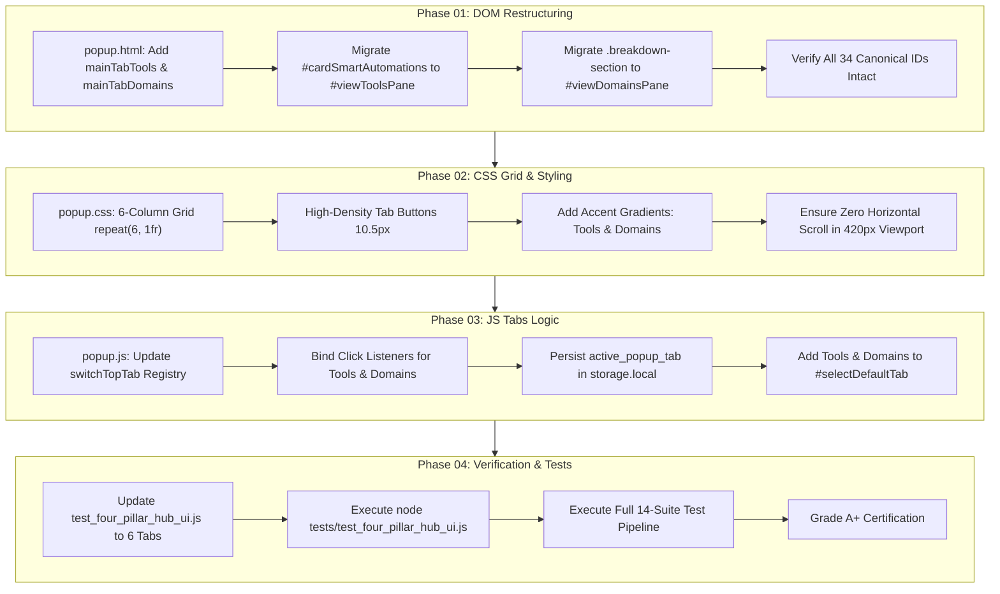

# 6-Tab Single-Word Architecture UI/UX Refinement — Executive Summary

> **Task ID:** `TASK-POPUP-6TAB-UIUX-001`  
> **Workspace:** `c:\Users\Atul Verma\Desktop\Win App Tracker\Browser Detection`  
> **Target Path:** `temp_prompt/six_tab_popup_architecture/SUMMARY.md`  
> **Lead Architect:** Atul Verma (`aiprincekumar` / `aiprincekumar010100@gmail.com`)  
> **Implementation Strategy:** Strategy A (Fully Autonomous Phase-wise Execution)  

---

## 🎯 1. Initiative Scope & Technical Objectives

This initiative delivers a major frontend UI/UX architectural evolution for the **Web Activity & Media Sentinel** Chrome extension popup. By restructuring the current 4-pillar navigation into a symmetrical, single-word 6-tab architecture, the popup achieves optimal visual balance, reduces cognitive load, and eliminates vertical scrolling in cluttered panes.

### The 6 Single-Word Navigation Tabs:
1. `🎬 Media`: Dedicated live video/audio playback telemetry, scrubber, volume bar, and in-card player micro-actions.
2. `🎛️ Audio`: Dedicated sound lab containing 0-200% master volume boost, audio-only battery saver mode, 5-band graphic EQ, and sound enhancement toggles.
3. `⚡ Tools`: Dedicated automation & utility hub hosting background smart automations (Auto-Pause on new tab, Auto Ad Silencer, Domain Speed Memory), Cinema Dimmer, and quick utilities.
4. `📚 Studio`: Timestamp annotation, bookmark moments, screenshots gallery, and resume playback card.
5. `⏱️ Tracking`: Time tracking analytics hub with interactive donut chart, stats pills, Focus Ratio Balance Bar, and Doomscroll Breaker.
6. `🌐 Domains`: Dedicated full-height browsing domain history directory, category filter, search bar, and scrollable domain records.

### Non-Negotiable Operational Guardrails:
- **Zero Backend Changes:** Strict constraint from the developer ("बैकएंड में अभी कोई भी चेंजिंग नहीं करना है"). No alterations to service workers, WebSocket bridge, native Daemons, or IPC protocols.
- **Full DOM Element Preservation:** Zero deletion of canonical IDs. All 34 primary interactive elements must remain in the DOM tree.
- **Viewport Constraints:** Strict 420px max-width popup geometry. No horizontal scrollbars or element clipping permitted.
- **100% Automated Test Integrity:** All 14 test suites in `tests/` must execute with 0 errors and 100% success.

---

## 🗺️ 2. Milestone Roadmap & Dependency Topology

---

## ⚖️ 3. Risk Mitigation & Architectural Tradeoffs

| Risk / Challenge | Probability | Impact | Mitigation Strategy |
| :--- | :--- | :--- | :--- |
| **Grid Button Squeeze in 420px Viewport** | Medium | Medium | Use single-word labels (`Media`, `Audio`, `Tools`, `Studio`, `Tracking`, `Domains`), reduce tab padding to `6px 1px`, set font size to `10.5px`, and apply `min-width: 0` with `white-space: nowrap`. |
| **Accidental DOM ID Omission Breaking Tests** | Low | Critical | Strict 34-ID checklist enforced in Phase 01. Rather than removing elements, elements are safely relocated into their designated pane (`#cardSmartAutomations` into `#viewToolsPane`, `.breakdown-section` into `#viewDomainsPane`). |
| **Test Suite Assertion Breakage** | Medium | High | `test_four_pillar_hub_ui.js` asserts 4-pillar tabs and 4-column CSS grid. Phase 04 updates the test suite to validate all 6 tabs while asserting backwards compatibility. |
| **Active Tab State Inconsistency** | Low | Low | `switchTopTab` in `popup.js` validates tab key against a canonical 6-item dictionary. If an invalid or legacy tab key is stored, fallback defaults gracefully to `media`. |
