# 6-Tab Single-Word Architecture UI/UX Refinement — TRD

> **Document Type:** Technical Requirements Document (TRD)  
> **Task ID:** `TASK-POPUP-6TAB-UIUX-001`  
> **Workspace:** `c:\Users\Atul Verma\Desktop\Win App Tracker\Browser Detection`  
> **Target Path:** `temp_prompt/six_tab_popup_architecture/TRD.md`  
> **Author & Lead Architect:** Atul Verma (`aiprincekumar` / `aiprincekumar010100@gmail.com`)  
> **Status:** APPROVED / READY FOR EXECUTION  

---

## 🏛️ 1. High-Level Design (HLD) & Architectural Topology

The 6-Tab architecture refactors the Chrome extension popup's presentation layer from a 4-pillar structure into 6 decoupled single-word views while maintaining strict isolation from the background worker and native daemons.

```mermaid
flowchart TD
    PopupRoot["popup.html (420px Fixed Container)"] --> Header["Header (Title + Status Badges + Quick Settings Popover)"]
    PopupRoot --> NavTabs["Navigation Bar (<nav class='top-nav-tabs'> - 6-Column Grid)"]
    PopupRoot --> PanesContainer["Panes Container (<main>)"]
    PopupRoot --> Footer["Invariant Single-Row Footer Toolbar (7 Buttons)"]

    NavTabs --> Tab1["#mainTabMedia (🎬 Media)"]
    NavTabs --> Tab2["#mainTabAudio (🎛️ Audio)"]
    NavTabs --> Tab3["#mainTabTools (⚡ Tools)"]
    NavTabs --> Tab4["#mainTabStudio (📚 Studio)"]
    NavTabs --> Tab5["#mainTabTracking (⏱️ Tracking)"]
    NavTabs --> Tab6["#mainTabDomains (🌐 Domains)"]

    PanesContainer --> Pane1["#viewMediaPane (Player Telemetry & Micro-Actions)"]
    PanesContainer --> Pane2["#viewAudioPane (Master Boost & 5-Band EQ)"]
    PanesContainer --> Pane3["#viewToolsPane (Smart Automations Card)"]
    PanesContainer --> Pane4["#viewStudioPane (Notes, Clips, Screenshots, Resume)"]
    PanesContainer --> Pane5["#viewTrackingPane (Donut Chart, Stats Pills, Wellness)"]
    PanesContainer --> Pane6["#viewDomainsPane (Domain Breakdown & Filter Search)"]
```



---

## 🔧 2. Low-Level Design (LLD) & DOM Specifications

### 2.1 Navigation Bar Specification (`popup/popup.html`)
```html
<nav class="top-nav-tabs" role="tablist">
  <button id="mainTabMedia" class="top-tab-btn active" data-view="media" role="tab" aria-selected="true" aria-controls="viewMediaPane">
    <span class="top-tab-icon">🎬</span>
    <span id="topTabMediaText" class="top-tab-label">Media</span>
    <span id="tabMediaLiveDot" class="tab-live-dot hidden" title="Media Active"></span>
  </button>
  <button id="mainTabAudio" class="top-tab-btn" data-view="audio" role="tab" aria-selected="false" aria-controls="viewAudioPane">
    <span class="top-tab-icon">🎛️</span>
    <span id="topTabAudioText" class="top-tab-label">Audio</span>
  </button>
  <button id="mainTabTools" class="top-tab-btn" data-view="tools" role="tab" aria-selected="false" aria-controls="viewToolsPane">
    <span class="top-tab-icon">⚡</span>
    <span id="topTabToolsText" class="top-tab-label">Tools</span>
  </button>
  <button id="mainTabStudio" class="top-tab-btn" data-view="studio" role="tab" aria-selected="false" aria-controls="viewStudioPane">
    <span class="top-tab-icon">📚</span>
    <span id="topTabStudioText" class="top-tab-label">Studio</span>
  </button>
  <button id="mainTabTracking" class="top-tab-btn" data-view="tracking" role="tab" aria-selected="false" aria-controls="viewTrackingPane">
    <span class="top-tab-icon">⏱️</span>
    <span id="topTabTrackingText" class="top-tab-label">Tracking</span>
  </button>
  <button id="mainTabDomains" class="top-tab-btn" data-view="domains" role="tab" aria-selected="false" aria-controls="viewDomainsPane">
    <span class="top-tab-icon">🌐</span>
    <span id="topTabDomainsText" class="top-tab-label">Domains</span>
  </button>
</nav>
```

### 2.2 Canonical 34-DOM Element Inventory Check
All 34 canonical DOM element IDs must be preserved in the DOM structure with 100% fidelity:
1. `mainTabMedia` (Media Tab Button)
2. `mainTabAudio` (Audio Tab Button)
3. `mainTabTools` (Tools Tab Button)
4. `mainTabStudio` (Studio Tab Button)
5. `mainTabTracking` (Tracking Tab Button)
6. `mainTabDomains` (Domains Tab Button)
7. `viewMediaPane` (Media View Panel)
8. `viewAudioPane` (Audio View Panel)
9. `viewToolsPane` (Tools View Panel)
10. `viewStudioPane` (Studio View Panel)
11. `viewTrackingPane` (Tracking View Panel)
12. `viewDomainsPane` (Domains View Panel)
13. `mediaSentinelCard` (Player Card)
14. `dynamicStatusBtn` (Dynamic Status Action Button)
15. `progressBarContainer` (Video Seek Timeline Bar)
16. `volumeBarContainer` (Master Volume Bar)
17. `playerMicroActionsRow` (Player Micro-Actions Bar)
18. `cardSmartAutomations` (Smart Automations Card)
19. `toggleAutoPauseNewTab` (Auto-Pause Toggle)
20. `toggleAutoAdSilence` (Auto Ad Silencer Toggle)
21. `toggleDomainSpeedMemory` (Speed Memory Toggle)
22. `audioEqCard` (5-Band Graphic EQ Card)
23. `audioMasterBoostSlider` (Volume Boost 0-200% Slider)
24. `studioNoteCard` (Timestamp Note-taking Card)
25. `studioBookmarksCard` (Clips & Bookmarks Container)
26. `studioScreenshotsCard` (Screenshot Gallery Container)
27. `studioResumePlaybackCard` (Pick Up Where You Left Off Card)
28. `donutChartContainer` (Donut Time Breakdown Chart)
29. `cardFocusWellness` (Focus Ratio Bar & Doomscroll Breaker Card)
30. `domainSearchInput` (Domain Search Input)
31. `domainCategorySelect` (Domain Category Dropdown)
32. `domainsListContainer` (Domain Breakdown Items List)
33. `btnQuickSettings` (Header Quick Settings Button)
34. `quickSettingsPopover` (Quick Settings Dialog Popover)

---

## 🎨 3. CSS Grid & Geometry Specification (`popup/popup.css`)

### 3.1 6-Column High-Density Grid
```css
/* Top Primary Multi-Tabs Navigation (6-Tab Single-Word Architecture) */
.top-nav-tabs {
  display: grid;
  /* Legacy 4-column fallback for backwards compatibility */
  /* grid-template-columns: repeat(4, 1fr); */
  grid-template-columns: repeat(6, 1fr);
  gap: 3px;
  background: rgba(255, 255, 255, 0.035);
  padding: 3px;
  border-radius: 10px;
  border: 1px solid var(--border-dim);
  box-shadow: inset 0 1px 3px rgba(0, 0, 0, 0.4);
  width: 100%;
  box-sizing: border-box;
}

.top-tab-btn {
  display: flex;
  align-items: center;
  justify-content: center;
  gap: 3px;
  background: transparent;
  border: 1px solid transparent;
  border-radius: 7px;
  color: var(--text-secondary);
  font-size: 10.5px;
  font-weight: 600;
  padding: 6px 1px;
  cursor: pointer;
  transition: all 0.18s ease;
  position: relative;
  min-width: 0;
  white-space: nowrap;
}
```

### 3.2 Tailored Active Tab Gradients
```css
/* Tab 1: Media (Cyan-Blue) */
.top-tab-btn[data-view="media"].active {
  background: linear-gradient(135deg, rgba(59, 130, 246, 0.22) 0%, rgba(6, 182, 212, 0.18) 100%);
  border-color: rgba(59, 130, 246, 0.5);
  box-shadow: 0 2px 10px rgba(59, 130, 246, 0.25);
  color: #ffffff;
}

/* Tab 2: Audio (Purple-Violet) */
.top-tab-btn[data-view="audio"].active {
  background: linear-gradient(135deg, rgba(139, 92, 246, 0.22) 0%, rgba(217, 70, 239, 0.18) 100%);
  border-color: rgba(139, 92, 246, 0.5);
  box-shadow: 0 2px 10px rgba(139, 92, 246, 0.25);
  color: #ffffff;
}

/* Tab 3: Tools (Amber-Gold) */
.top-tab-btn[data-view="tools"].active {
  background: linear-gradient(135deg, rgba(245, 158, 11, 0.22) 0%, rgba(251, 191, 36, 0.18) 100%);
  border-color: rgba(245, 158, 11, 0.5);
  box-shadow: 0 2px 10px rgba(245, 158, 11, 0.25);
  color: #ffffff;
}

/* Tab 4: Studio (Emerald-Teal) */
.top-tab-btn[data-view="studio"].active {
  background: linear-gradient(135deg, rgba(6, 182, 212, 0.22) 0%, rgba(16, 185, 129, 0.18) 100%);
  border-color: rgba(6, 182, 212, 0.5);
  box-shadow: 0 2px 10px rgba(6, 182, 212, 0.25);
  color: #ffffff;
}

/* Tab 5: Tracking (Rose-Pink) */
.top-tab-btn[data-view="tracking"].active {
  background: linear-gradient(135deg, rgba(244, 63, 94, 0.22) 0%, rgba(236, 72, 153, 0.18) 100%);
  border-color: rgba(244, 63, 94, 0.5);
  box-shadow: 0 2px 10px rgba(244, 63, 94, 0.25);
  color: #ffffff;
}

/* Tab 6: Domains (Green-Emerald) */
.top-tab-btn[data-view="domains"].active {
  background: linear-gradient(135deg, rgba(16, 185, 129, 0.22) 0%, rgba(59, 130, 246, 0.18) 100%);
  border-color: rgba(16, 185, 129, 0.5);
  box-shadow: 0 2px 10px rgba(16, 185, 129, 0.25);
  color: #ffffff;
}
```

---

## ⚡ 4. JavaScript Logic & Tab Switching Specification (`popup/popup.js`)

### 4.1 Canonical `switchTopTab` Registry Expansion
```javascript
function switchTopTab(tabName, isManual = false) {
  if (isManual) {
    userManualOverride = true;
  }
  const normalized = (tabName === 'focus') ? 'tracking' : tabName;
  activeTopTab = normalized;

  const tabs = [
    { id: 'mainTabMedia', paneId: 'viewMediaPane', key: 'media' },
    { id: 'mainTabAudio', paneId: 'viewAudioPane', key: 'audio' },
    { id: 'mainTabTools', paneId: 'viewToolsPane', key: 'tools' },
    { id: 'mainTabStudio', paneId: 'viewStudioPane', key: 'studio' },
    { id: 'mainTabTracking', paneId: 'viewTrackingPane', key: 'tracking' },
    { id: 'mainTabDomains', paneId: 'viewDomainsPane', key: 'domains' }
  ];

  tabs.forEach(t => {
    const btn = document.getElementById(t.id);
    const pane = document.getElementById(t.paneId);
    if (!btn || !pane) return;
    if (t.key === normalized) {
      btn.classList.add('active');
      btn.setAttribute('aria-selected', 'true');
      pane.classList.add('active');
    } else {
      btn.classList.remove('active');
      btn.setAttribute('aria-selected', 'false');
      pane.classList.remove('active');
    }
  });

  try {
    browserAPI.storage.local.set({ active_popup_tab: normalized });
  } catch (_) {}
}
```

### 4.2 Event Listeners Wiring in `setupEventListeners()`
```javascript
  const tabMediaBtn = document.getElementById('mainTabMedia');
  const tabAudioBtn = document.getElementById('mainTabAudio');
  const tabToolsBtn = document.getElementById('mainTabTools');
  const tabStudioBtn = document.getElementById('mainTabStudio');
  const tabTrackingBtn = document.getElementById('mainTabTracking');
  const tabDomainsBtn = document.getElementById('mainTabDomains');

  if (tabMediaBtn) tabMediaBtn.addEventListener('click', () => switchTopTab('media', true));
  if (tabAudioBtn) tabAudioBtn.addEventListener('click', () => switchTopTab('audio', true));
  if (tabToolsBtn) tabToolsBtn.addEventListener('click', () => switchTopTab('tools', true));
  if (tabStudioBtn) tabStudioBtn.addEventListener('click', () => switchTopTab('studio', true));
  if (tabTrackingBtn) tabTrackingBtn.addEventListener('click', () => switchTopTab('tracking', true));
  if (tabDomainsBtn) tabDomainsBtn.addEventListener('click', () => switchTopTab('domains', true));
```
