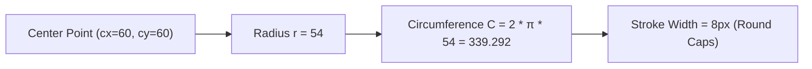

# 🎨 Design System & UI Specifications: Sleep Sentinel Hub

> **Document Type:** Visual Design System, Tokens & UI Component Specification  
> **Initiative:** Sleep Timer Subsystem Backend Engine & Dashboard Hub  
> **Container Directory:** [`temp_prompt/sleep_backend_and_dashboard_hub/`](.)  
> **Governing Architecture:** [`PHASE_WISE_PROMPT_GENERATION_ARCHITECTURE.md`](file:///C:/Users/Atul%20Verma/.gemini/config/rules/PHASE_WISE_PROMPT_GENERATION_ARCHITECTURE.md)  
> **Design Department:** [`departments_archive/05_frontend_engineering_dept.md`](file:///C:/Users/Atul%20Verma/.gemini/config/rules/departments_archive/05_frontend_engineering_dept.md)  
> **Author:** Level 3C Phase-wise Prompt Generation Specialist (`prompt_generation_specialist`)  

---

## 🌌 1. Cyber-Dark Glassmorphism Design Tokens

The Sleep Sentinel Hub adheres strictly to the existing **Cyber-Dark Liquid Glass** design philosophy of Web Activity & Media Sentinel.

### 1.1 Color Palette & Variables
```css
:root {
  /* Surface & Glass Backgrounds */
  --sleep-hub-bg: rgba(18, 22, 34, 0.72);
  --sleep-hub-border: rgba(99, 102, 241, 0.22);
  --sleep-hub-border-glow: rgba(99, 102, 241, 0.45);
  --sleep-hub-shadow: 0 12px 36px -8px rgba(0, 0, 0, 0.65), 0 0 24px -4px rgba(99, 102, 241, 0.15);

  /* Primary Neon Accent Colors */
  --sleep-accent-primary: #818cf8;        /* Soft Indigo */
  --sleep-accent-cyan: #38bdf8;           /* Vivid Neon Cyan */
  --sleep-accent-purple: #c084fc;         /* Ethereal Violet */
  --sleep-accent-amber: #fbbf24;          /* Warm Warning Amber */
  --sleep-accent-emerald: #34d399;        /* Active Running Emerald */
  --sleep-accent-rose: #f43f5e;           /* Stop / Cutoff Rose */

  /* Radial Dial Tokens */
  --sleep-dial-track: rgba(255, 255, 255, 0.06);
  --sleep-dial-fill-running: #38bdf8;
  --sleep-dial-fill-paused: #fbbf24;
  --sleep-dial-fill-fading: #c084fc;
  --sleep-dial-fill-triggered: #f43f5e;

  /* Typography Colors */
  --sleep-text-primary: #f8fafc;
  --sleep-text-secondary: #94a3b8;
  --sleep-text-muted: #64748b;

  /* Interactive Elements */
  --sleep-btn-bg: rgba(255, 255, 255, 0.05);
  --sleep-btn-border: rgba(255, 255, 255, 0.12);
  --sleep-btn-hover-bg: rgba(99, 102, 241, 0.20);
  --sleep-btn-active-bg: rgba(99, 102, 241, 0.35);
}
```

---

## 📐 2. SVG Radial Countdown Dial Geometry

To guarantee exact visual and mathematical parity with the popup's proven radial dial, the dashboard radial dial uses identical geometric constants:



### 2.1 SVG Markup Blueprint
```html
<div class="dash-sleep-dial-wrapper">
  <svg class="dash-sleep-svg-dial" width="140" height="140" viewBox="0 0 120 120" role="img" aria-label="Sleep Timer Countdown Dial">
    <!-- Background Track Circle -->
    <circle
      class="dash-sleep-dial-track"
      cx="60"
      cy="60"
      r="54"
      fill="none"
      stroke="currentColor"
      stroke-width="8"
    />
    <!-- Active Progress Circle -->
    <circle
      id="dashSleepDialProgress"
      class="dash-sleep-dial-progress"
      cx="60"
      cy="60"
      r="54"
      fill="none"
      stroke="currentColor"
      stroke-width="8"
      stroke-linecap="round"
      stroke-dasharray="339.292"
      stroke-dashoffset="0"
      transform="rotate(-90 60 60)"
    />
  </svg>
  <!-- Digital Countdown Inset -->
  <div class="dash-sleep-dial-content">
    <div id="dashSleepCountdownDisplay" class="dash-sleep-big-time" aria-live="polite">00:00</div>
    <div id="dashSleepStatusBadge" class="dash-sleep-badge idle">IDLE</div>
    <div id="dashSleepFinishTime" class="dash-sleep-finish-time">No active timer</div>
  </div>
</div>
```

### 2.2 Mathematical Offset Computation
$$\text{Circumference } C = 2 \times \pi \times 54 \approx 339.292$$
$$\text{ratio} = \max\left(0, \min\left(1, \frac{\text{remainingMs}}{\text{totalDurationMs}}\right)\right)$$
$$\text{strokeDashoffset} = C \times (1 - \text{ratio})$$

When remaining is $100\%$, $\text{offset} = 0$ (full circle stroke visible).  
When remaining is $0\%$, $\text{offset} = 339.292$ (circle completely cleared).

---

## 🍱 3. Bento Card Layout: `#cardSleepSentinelHub`

### 3.1 Positioning within `#paneWellbeing`
`#cardSleepSentinelHub` is positioned as a peer to `#widgetPomodoroSentinel` inside `#tabContentWellbeing`:
- Grid Span: `bento-span-6` (50% desktop width, 100% on tablet/mobile).
- Card Structure:
  1. **Header Row (`.card-header-row`):** Icon (`🌙`), Title (`Sleep Sentinel Hub`), Subtitle (`Automated media shutdown, audio fade-out, and bedtime recovery`), and Status Dot (`#dashSleepActiveDot`).
  2. **Hero Dial Section (`.dash-sleep-hero-section`):** Centered SVG radial dial with embedded digital clock readout, state badge, and estimated bedtime target.
  3. **Duration Preset Buttons Row (`.dash-sleep-presets-row`):** Six quick preset pills: `15m`, `30m`, `45m`, `60m`, `90m`, `120m` (active pill highlighted with cyan glow border).
  4. **Extender Buttons Row (`.dash-sleep-extender-row`):** Quick extension pills: `+5m`, `+15m` with subtle plus icons.
  5. **Action Controls Bar (`.dash-sleep-actions-row`):**
     - Primary Button (`#btnDashSleepToggle`): "▶️ Start" / "⏸️ Pause" / "▶️ Resume".
     - Danger/Secondary Button (`#btnDashSleepReset`): "🔄 Reset" / "Cancel".
  6. **Feature Toggle Bar (`.dash-sleep-toggles-row`):**
     - Checkbox `#toggleDashSleepFade`: "Gradual Audio Fade-out (30s)"
     - Checkbox `#toggleDashSleepEndOfVideo`: "Stop at End of Video"

---

## ♿ 4. Accessibility (WCAG 2.1 AA) & Interactive States

1. **Contrast Standards:**
   - Text color `#f8fafc` against dark card background (`rgba(18, 22, 34, 0.72)`) achieves a contrast ratio $> 12:1$ (exceeds WCAG AAA requirement of $7:1$).
   - Muted secondary text `#94a3b8` achieves $> 5.8:1$ contrast against the card background (exceeds WCAG AA requirement of $4.5:1$).
2. **Keyboard Focus & Navigation:**
   - All interactive buttons (`button`, `input[type="checkbox"]`) have a 2px neon cyan focus outline with 2px offset (`outline: 2px solid var(--sleep-accent-cyan); outline-offset: 2px;`).
3. **Screen Reader Support:**
   - SVG dial includes `role="img"` and `aria-label="Sleep Timer Countdown Dial"`.
   - The countdown clock features `aria-live="polite"` so screen readers can annunciate updates without conversational interruption.
4. **Motion & Reduced Motion:**
   - All dial animations utilize `@media (prefers-reduced-motion: reduce)` fallbacks:
     ```css
     @media (prefers-reduced-motion: reduce) {
       .dash-sleep-dial-progress {
         transition: none !important;
       }
     }
     ```
