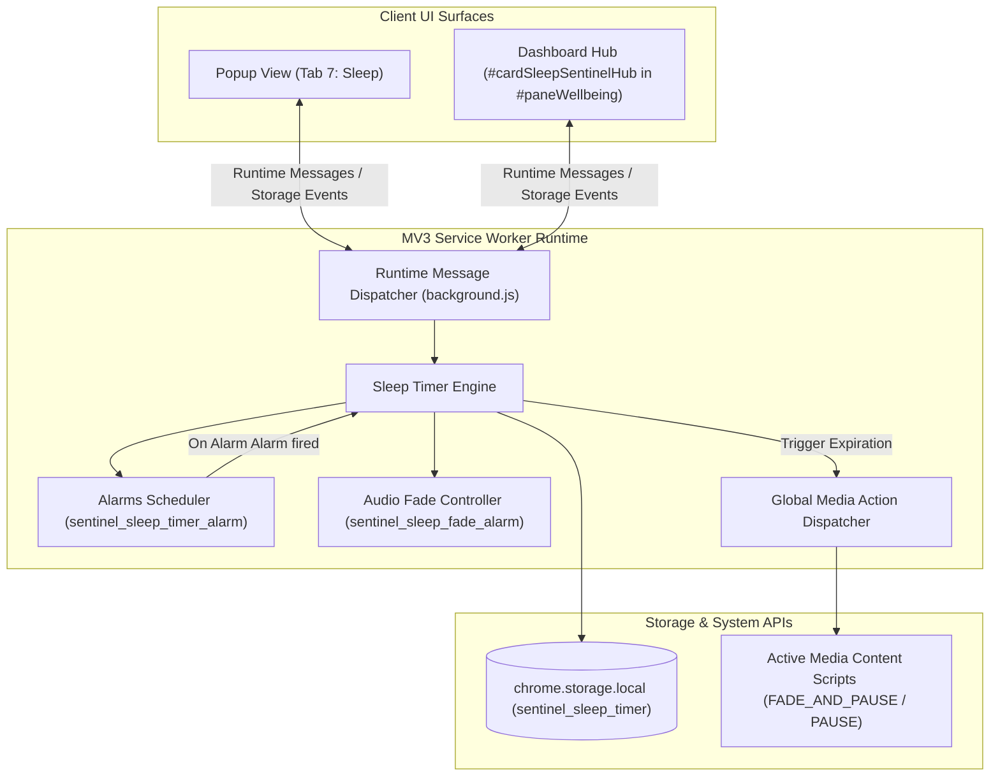

# 📑 Executive Architecture Summary & Milestone Roadmap

> **Document Type:** Executive Architecture Summary & Strategic Roadmap  
> **Initiative:** Sleep Timer Subsystem Backend Engine & Dashboard Hub  
> **Container Directory:** [`temp_prompt/sleep_backend_and_dashboard_hub/`](.)  
> **Governing Architecture:** [`PHASE_WISE_PROMPT_GENERATION_ARCHITECTURE.md`](file:///C:/Users/Atul%20Verma/.gemini/config/rules/PHASE_WISE_PROMPT_GENERATION_ARCHITECTURE.md)  
> **Specialist Role:** Level 3C Phase-wise Prompt Generation Specialist (`prompt_generation_specialist`)  

---

## 🏛️ 1. Executive Summary

The **Sleep Timer Subsystem Backend Engine & Dashboard Hub** initiative closes the gap between the extension's background service worker and its primary user interfaces (Popup and Dashboard). By completing the background IPC protocol with deterministic alarm rescheduling and elevating the Sleep Timer from a secondary popup tab to a primary **Sleep Sentinel Hub** inside the Dashboard's **Wellbeing Pane** (`#paneWellbeing`), users gain unified control over nighttime media playback, automated sleep volume fading, and screen-time wellness across desktop and popup environments.

---

## 🎯 2. High-Level Technical Objectives

1. **Protocol Completeness & Robustness:**
   - Elevate `background.js` to handle all standard sleep lifecycle messages: `EXTEND_SLEEP_TIMER`, `PAUSE_SLEEP_TIMER`, `RESUME_SLEEP_TIMER`, and `END_OF_VIDEO`.
   - Ensure mathematical accuracy in duration adjustments, target time recalculations, and remaining time persistence across service worker sleep/wake cycles.
2. **Deterministic MV3 Alarm Management:**
   - On `PAUSE_SLEEP_TIMER`: Instantly cancel all pending alarms (`sentinel_sleep_timer_alarm`, `sentinel_sleep_fade_alarm`), freeze elapsed time, and record exact `remainingMs`.
   - On `RESUME_SLEEP_TIMER` / `EXTEND_SLEEP_TIMER`: Dynamically recalculate target epoch (`targetTime = Date.now() + remainingMs`) and recreate alarms with exact target timestamps.
3. **Immersive Dashboard Hub (`#cardSleepSentinelHub`):**
   - Provide a large-format bento card inside `#paneWellbeing` on the dashboard.
   - Include an SVG radial progress dial ($r=54$, circumference $C = 339.292$), big digital countdown display, dynamic status badge (`IDLE`, `RUNNING`, `PAUSED`, `FADING`, `TRIGGERED`), quick preset buttons (15m, 30m, 45m, 60m, 90m, 120m), extender buttons (+5m, +15m), and primary controls (Start, Pause, Resume, Reset).
   - Deliver toggle controls for "Audio Fade Out" and "Stop at End of Video".
4. **Bidirectional Reactivity & Sync:**
   - When a timer is started, paused, resumed, or extended from either the popup or dashboard, all open views must immediately reflect the updated state, countdown, badge, and radial dial without page reloads.
5. **Zero-Defect Quality Gates:**
   - Enforce zero insecure `innerHTML` assignments (100% W3C Trusted Types compliant).
   - Ensure all 68 test suites pass cleanly with exit code 0.

---

## 🗺️ 3. Cross-Phase Milestone Roadmap

```mermaid
gantt
    title Sleep Timer Subsystem Implementation Roadmap
    dateFormat  X
    axisFormat %d
    section Phase 1
    Backend Engine & IPC Protocol        :active, 0, 1
    section Phase 2
    Dashboard Markup & CSS Styling       :active, 1, 2
    section Phase 3
    Dashboard Hub Logic & Reactive Sync  :active, 2, 3
    section Phase 4
    Full QA Verification & Git Push      :active, 3, 4
```

### Milestone Details
- **Milestone 1 (Phase 1): Backend Protocol Certification**
  - All 4 new message types (`EXTEND_SLEEP_TIMER`, `PAUSE_SLEEP_TIMER`, `RESUME_SLEEP_TIMER`, `END_OF_VIDEO`) implemented and verified in `background.js`.
  - Alarms verified to clear on pause and reschedule on resume/extend.
- **Milestone 2 (Phase 2): Dashboard DOM & CSS Certification**
  - `#cardSleepSentinelHub` markup appended to `#tabContentWellbeing` in `dashboard/dashboard.html`.
  - Cyber-dark glassmorphism styling, radial dial SVG styling, button hover/active states, and responsiveness certified in `dashboard/dashboard.css`.
- **Milestone 3 (Phase 3): Dynamic Reactivity Certification**
  - `dashboard/dashboard.js` initialized with full event handling, SVG progress calculation, 1-second interval ticker, and `chrome.storage.onChanged` listener.
  - Bidirectional synchronization between dashboard and popup verified.
- **Milestone 4 (Phase 4): System-Wide QA Grade A+ Certification**
  - Integration test suite `tests/test_sleep_backend_and_dashboard_hub.js` created and passing.
  - All 68 workspace test suites passing (Exit code 0).
  - Gitleaks scan certifying 0 leaks, followed by local micro-commit.

---

## ⚖️ 4. Architectural Tradeoff Analysis

| Decision Point | Option A (Selected) | Option B (Alternative) | Tradeoff Rationale |
| :--- | :--- | :--- | :--- |
| **Alarm Architecture** | **MV3 `chrome.alarms` with `when: targetTime`** | JavaScript `setTimeout` / `setInterval` in background | Chrome service workers terminate after ~30 seconds of inactivity. `setTimeout` dies when the service worker becomes idle. `chrome.alarms` persists across service worker lifecycle suspensions, guaranteeing accurate execution. |
| **Countdown Rendering** | **1-second local client ticker with storage anchor** | Repeated background messaging every second | Background messaging every second would prevent the service worker from sleeping, drastically increasing memory and CPU overhead. Local tickers in active UI views reading from stored `targetTime` maintain token and battery efficiency. |
| **UI Placement** | **Pillar 0 inside `#paneWellbeing`** | Separate standalone tab or sub-panel in Settings | The Sleep Timer is inherently a digital wellness / recovery sentinel. Placing it inside the Wellbeing pane alongside Focus Pomodoro creates a unified holistic wellbeing and rest dashboard. |
| **SVG Dial Dimensions** | **Standardized $r=54$, $C = 339.292$ (Identical to Popup)** | New custom geometry ($r=75$) | Reusing the exact mathematical geometry from `popup.js` ensures code parity, shared mathematical constants, and visual consistency across the entire extension ecosystem. |

---

## 🛡️ 5. Risk Mitigation Strategy

| Risk Category | Potential Failure Mode | Prevention & Mitigation Protocol |
| :--- | :--- | :--- |
| **Service Worker Inactivity** | Worker goes idle while timer is RUNNING; timer doesn't fire. | Alarms scheduled via `chrome.alarms.create` with absolute timestamp `when: state.targetTime`. On wake or browser restart, storage hydration checks `if (targetTime <= now)` and immediately triggers expiration. |
| **Clock Drift on Pause/Resume** | Repeated pause and resume accumulates calculation drift. | When pausing, store exact `remainingMs = Math.max(0, targetTime - now)`. When resuming, set `targetTime = Date.now() + remainingMs`. Alarms are cleanly cleared on pause and recreated with fresh target on resume. |
| **DOM XSS & Trusted Types** | Dynamic text or status badge injection triggers CSP violation. | Strict prohibition of `innerHTML`. All text updates use `.textContent`; SVG circle attributes use `.setAttribute('stroke-dashoffset', ...)`; CSS classes toggled via `.classList`. |
| **Cross-View Desynchronization** | Dashboard and popup display different countdowns or states. | Single Source of Truth anchored to `chrome.storage.local` key `sentinel_sleep_timer`. Both views register `chrome.storage.onChanged` listeners and broadcast/receive runtime messages. |
