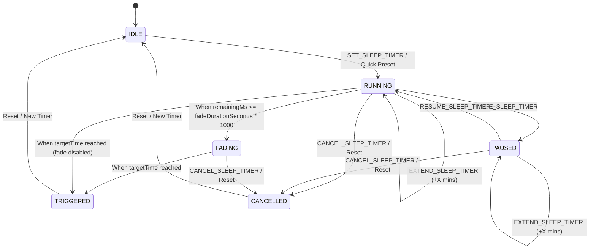

# 🛠️ Technical Requirements Document (TRD): Sleep Timer Subsystem & Dashboard Hub

> **Document Type:** Technical Requirements Document (TRD) & Low-Level Design (LLD)  
> **Initiative:** Sleep Timer Subsystem Backend Engine & Dashboard Hub  
> **Container Directory:** [`temp_prompt/sleep_backend_and_dashboard_hub/`](.)  
> **Governing Architecture:** [`PHASE_WISE_PROMPT_GENERATION_ARCHITECTURE.md`](file:///C:/Users/Atul%20Verma/.gemini/config/rules/PHASE_WISE_PROMPT_GENERATION_ARCHITECTURE.md)  
> **Lead Department:** [`departments_archive/02_architecture_system_design_dept.md`](file:///C:/Users/Atul%20Verma/.gemini/config/rules/departments_archive/02_architecture_system_design_dept.md)  
> **Author:** Level 3C Phase-wise Prompt Generation Specialist (`prompt_generation_specialist`)  

---

## 🏗️ 1. Architecture & Low-Level Design (LLD)

### 1.1 Finite State Machine (FSM)
The Sleep Timer Subsystem operates under a deterministic 6-state finite state machine:



### 1.2 State Transition Table

| Source State | Trigger / Event | Action Taken | Target State | Alarm Action |
| :--- | :--- | :--- | :--- | :--- |
| `IDLE` | `SET_SLEEP_TIMER(mins)` | Calculate `targetTime = now + mins*60000`, set `state = 'RUNNING'` | `RUNNING` | Create `sentinel_sleep_timer_alarm` & fade alarm |
| `RUNNING` | `PAUSE_SLEEP_TIMER` | Save `remainingMs = targetTime - now`, set `pausedAt = now` | `PAUSED` | Clear all sleep alarms |
| `PAUSED` | `RESUME_SLEEP_TIMER` | Recompute `targetTime = now + remainingMs`, clear `pausedAt` | `RUNNING` | Re-create `sentinel_sleep_timer_alarm` & fade alarm |
| `RUNNING` | `EXTEND_SLEEP_TIMER(extra)` | Add `extra` mins to `durationMinutes` and `targetTime` | `RUNNING` | Reschedule alarms with new `targetTime` |
| `PAUSED` | `EXTEND_SLEEP_TIMER(extra)` | Add `extra` mins to `durationMinutes` and `remainingMs` | `PAUSED` | Alarms remain cleared |
| `RUNNING` | Fade Alarm Fired | Set `state = 'FADING'`, send `FADE_AND_PAUSE` to tabs | `FADING` | Cutoff alarm remains active |
| `RUNNING` / `FADING` | Cutoff Alarm Fired | Pause all media, commit tracking, set `state = 'TRIGGERED'` | `TRIGGERED` | Clear alarms and badge |
| Any | `CANCEL_SLEEP_TIMER` | Clear timer fields, set `state = 'CANCELLED'` | `CANCELLED` | Clear all alarms and badge |

---

## 📡 2. IPC Message Contracts & Schemas

### 2.1 `EXTEND_SLEEP_TIMER`
- **Direction:** Frontend (Popup / Dashboard) $\to$ Background Service Worker
- **Payload Schema:**
```json
{
  "type": "EXTEND_SLEEP_TIMER",
  "action": "EXTEND_SLEEP_TIMER",
  "extraMinutes": 15
}
```
- **Response Schema:**
```json
{
  "success": true,
  "state": {
    "state": "RUNNING",
    "durationMinutes": 45,
    "durationMs": 2700000,
    "startTime": 1731900000000,
    "targetTime": 1731902700000,
    "pauseMedia": true,
    "pauseTracking": true,
    "enableFadeOut": true,
    "fadeDurationSeconds": 30,
    "lastUpdated": 1731900900000
  }
}
```

### 2.2 `PAUSE_SLEEP_TIMER`
- **Direction:** Frontend (Popup / Dashboard) $\to$ Background Service Worker
- **Payload Schema:**
```json
{
  "type": "PAUSE_SLEEP_TIMER",
  "action": "PAUSE_SLEEP_TIMER"
}
```
- **Response Schema:**
```json
{
  "success": true,
  "state": {
    "state": "PAUSED",
    "durationMinutes": 30,
    "durationMs": 1800000,
    "startTime": 1731900000000,
    "targetTime": 1731901800000,
    "remainingMs": 720000,
    "pausedAt": 1731901080000,
    "lastUpdated": 1731901080000
  }
}
```

### 2.3 `RESUME_SLEEP_TIMER`
- **Direction:** Frontend (Popup / Dashboard) $\to$ Background Service Worker
- **Payload Schema:**
```json
{
  "type": "RESUME_SLEEP_TIMER",
  "action": "RESUME_SLEEP_TIMER"
}
```
- **Response Schema:**
```json
{
  "success": true,
  "state": {
    "state": "RUNNING",
    "durationMinutes": 30,
    "durationMs": 1800000,
    "startTime": 1731900000000,
    "targetTime": 1731901800000,
    "lastUpdated": 1731901085000
  }
}
```

### 2.4 `END_OF_VIDEO`
- **Direction:** Frontend $\leftrightarrow$ Background Service Worker
- **Trigger:** When "Stop at End of Video" is checked, content script monitors HTML5 video element. Upon `ended` event on primary active video, sends message to background.
- **Payload Schema:**
```json
{
  "type": "END_OF_VIDEO",
  "action": "END_OF_VIDEO",
  "tabId": 1234,
  "domain": "youtube.com"
}
```
- **Response Schema:**
```json
{
  "success": true,
  "triggered": true,
  "state": "TRIGGERED"
}
```

### 2.5 Broadcast Message: `SLEEP_TIMER_STATE_CHANGED`
- **Direction:** Background Service Worker $\to$ All Extension Views (Popup & Dashboard)
- **Payload Schema:**
```json
{
  "type": "SLEEP_TIMER_STATE_CHANGED",
  "action": "SLEEP_TIMER_STATE_CHANGED",
  "state": { /* Current sleep timer state */ }
}
```

---

## 💾 3. Persistent Storage Schema Contracts

Storage key: `sentinel_sleep_timer` in `chrome.storage.local`.

```typescript
interface SentinelSleepTimer {
  state: 'IDLE' | 'RUNNING' | 'PAUSED' | 'FADING' | 'TRIGGERED' | 'CANCELLED';
  durationMinutes: number;         // Total configured duration in minutes (e.g. 30)
  durationMs: number;              // Total configured duration in milliseconds (e.g. 1800000)
  startTime: number;               // Epoch timestamp (ms) when timer started
  targetTime: number;              // Epoch timestamp (ms) when timer is scheduled to expire
  remainingMs?: number;            // Preserved remaining milliseconds when state is 'PAUSED'
  pausedAt?: number;               // Epoch timestamp (ms) when timer was paused
  triggeredAt?: number;            // Epoch timestamp (ms) when timer fired expiration
  pauseMedia: boolean;             // Whether to pause active media tabs on expiration (default: true)
  pauseTracking: boolean;          // Whether to pause domain time tracking on expiration (default: true)
  enableFadeOut: boolean;          // Whether to perform linear audio volume step-down before cutoff
  fadeDurationSeconds: number;     // Duration in seconds for volume step-down (default: 30)
  endOfVideo?: boolean;            // Whether to trigger sleep cutoff when primary video ends
  lastUpdated: number;             // Epoch timestamp (ms) of latest state mutation
}
```

Storage key: `sentinel_sleep_settings` in `chrome.storage.local`.

```typescript
interface SentinelSleepSettings {
  defaultDurationMinutes: number;       // Default preset for quick start (default: 30)
  enableAudioFadeOut: boolean;          // Default toggle for fade out (default: true)
  fadeDurationSeconds: number;          // Default fade interval in seconds (default: 30)
  enableInactivityAutoSleep: boolean;   // Auto-sleep when system is AFK (default: false)
  inactivityThresholdMinutes: number;   // Minutes of AFK required for auto-sleep (default: 15)
  showBadgeCountdown: boolean;          // Show minutes/seconds on toolbar action badge (default: true)
  pulseOnCritical: boolean;             // Critical pulse badge styling when < 15% remaining
  endOfVideo?: boolean;                 // Default toggle for stop at end of video
}
```

---

## ⏰ 4. MV3 Alarms Scheduling & Invariants

1. **Alarm Identifiers:**
   - Cutoff Alarm: `sentinel_sleep_timer_alarm`
   - Pre-cutoff Audio Fade Alarm: `sentinel_sleep_fade_alarm`
2. **Scheduling Formulas:**
   - Cutoff Alarm:
     ```javascript
     chrome.alarms.create('sentinel_sleep_timer_alarm', { when: state.targetTime });
     ```
   - Audio Fade Alarm:
     ```javascript
     const fadeDurationMs = (state.fadeDurationSeconds || 30) * 1000;
     const fadeTarget = state.targetTime - fadeDurationMs;
     if (fadeTarget > Date.now()) {
       chrome.alarms.create('sentinel_sleep_fade_alarm', { when: fadeTarget });
     }
     ```
3. **Alarm Cancellation Rule:**
   - In `cancelSleepTimer()` and `pauseSleepTimer()`:
     ```javascript
     await chrome.alarms.clear('sentinel_sleep_timer_alarm');
     await chrome.alarms.clear('sentinel_sleep_fade_alarm');
     ```

---

## 🔒 5. Security & Trusted Types Controls

1. **CSP Strict Prohibition:** No direct or indirect assignment to `innerHTML`, `outerHTML`, or `document.write`.
2. **Safe Text Updating:** All timer displays, countdown strings, and badges must strictly use:
   ```javascript
   element.textContent = formattedTimeStr;
   ```
3. **Safe SVG Mutation:** SVG progress dial updates must use standard DOM attribute manipulation:
   ```javascript
   dialCircle.setAttribute('stroke-dashoffset', offsetString);
   ```
4. **Input Sanitization:** Numeric duration and extender inputs must be clamped using:
   ```javascript
   const mins = Math.max(1, Math.min(1440, parseInt(input, 10) || 30));
   ```
