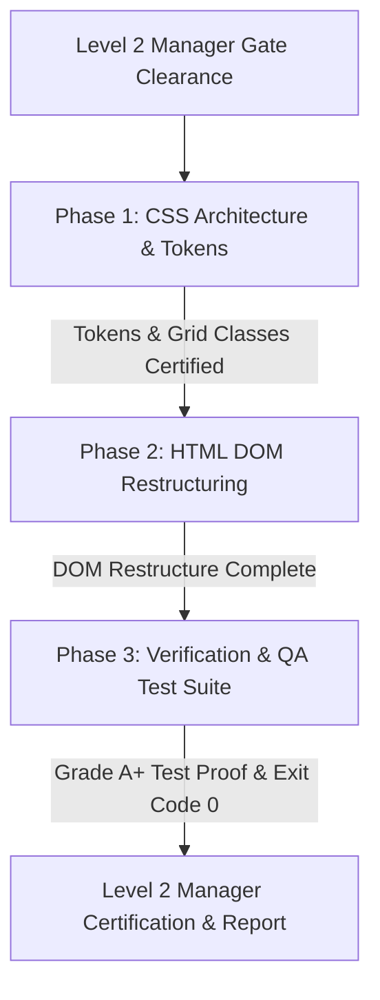

# Executive Architecture Summary: Sleep Cutoff Sentinel & Power Automation Redesign

> **Document Type:** Executive Architecture Summary (`SUMMARY.md`)  
> **Initiative:** Sleep Cutoff Sentinel & Power Automation Redesign (Visual & Ergonomic Parity with Focus Settings)  
> **Target Container:** `temp_prompt/sleep_cutoff_power_automation_redesign/`  
> **Author:** Level 3C Phase-wise Prompt Generation Specialist (`prompt_generation_specialist`)  
> **Governance:** [`PHASE_WISE_PROMPT_GENERATION_ARCHITECTURE.md`](file:///C:/Users/Atul%20Verma/.gemini/config/rules/PHASE_WISE_PROMPT_GENERATION_ARCHITECTURE.md)

---

## 🎯 1. Initiative Scope & Technical Objectives

### 1.1 Context
In the Browser Detection & Time Tracking extension, the Focus & Sleep Hub (`#paneWellbeing`) contains the primary wellbeing, focus, and circadian control panels. While the Focus Settings card (`#widgetFocusAdvanced`) was previously redesigned with a balanced 2-column grid (`.dash-focus-toggles-container`), cyber-dark glass styling, modern switch toggles, and compact card ergonomics, the "Sleep Cutoff Sentinel & Power Automation" card (`#widgetSleepAdvancedAutomation`) continues to use an older, asymmetric layout structure with uneven column heights and scattered full-span toggle groups.

### 1.2 Core Objectives
1. **Design System Consistency:** Align the Sleep Automation controls with the Focus Settings design system:
   - Modern switch toggles (`<label class="switch-toggle">` + `<input type="checkbox" role="switch" class="switch-input">` + ``).
   - Balanced 2-column grid layout (2 toggle cards per row).
   - Medium-compact card ergonomics (`min-height: 52px; padding: 9px 12px; border-radius: 10px`).
   - Cyber-dark glass styling (`background: rgba(15, 23, 42, 0.45); border: 1px solid rgba(255, 255, 255, 0.07)`).
   - Subtle hover elevation (`transform: translateY(-1px)`).
2. **Seamless Control Integration:** Accommodate all 10 controls without visual distortion, including the `selectDashSleepTimeoutAction` dropdown within a dedicated select card matching toggle card dimensions.
3. **Preservation of Core Contracts:**
   - 100% preservation of element IDs, event handlers, storage synchronization, and default values.
   - Preserved `role="switch"` and `aria-label` accessibility attributes.
   - Preserved bilingual `data-i18n` tags for seamless English/Hindi localization.
   - Preserved container ID `#widgetSleepAdvancedAutomation` and classes `bento-card liquid-glass-card bento-span-6 sleep-advanced-card`.
4. **Zero Regression Assurance:** Ensure all existing test suites pass with 100% exit code 0.

---

## 🗺️ 2. Milestone Roadmap & Dependency Topology

### 2.1 Phase Breakdown
- **Phase 1: CSS Architecture & Design Tokens:**
  Author `.dash-sleep-toggles-container`, `.dash-sleep-toggle-row`, `.dash-sleep-select-row`, and responsive media queries in `dashboard/styles/wellbeing_blacklist.css`, `dashboard/styles/focus_sleep_advanced.css`, and `dashboard/dashboard.css`.
- **Phase 2: HTML DOM Restructuring:**
  Update `#widgetSleepAdvancedAutomation` in `dashboard/dashboard.html` to adopt the clean 2-column grid with 10 cards (5 balanced rows of 2 cards), preserving all IDs, attributes, and bindings.
- **Phase 3: Verification, Test Suite & QA Signoff:**
  Author `tests/test_sleep_cutoff_power_automation_redesign.js`, execute regression suites (`test_ui_container_split_focus_sleep.js`, `test_dashboard_sleep_pause_and_parity.js`, `test_advanced_features_focus_sleep.js`), and obtain Grade A+ certification.

---

## ⚖️ 3. Execution Strategy Assessment & Autonomy Score

### 3.1 Recommended Strategy: Strategy A (`STRATEGY_A_AUTONOMOUS`)
- **Justification:** The task scope, DOM targets, CSS contracts, and control IDs are fully defined with zero requirement ambiguities. There are no competing architectural forks or third-party dependencies requiring user intervention.
- **Calculated Autonomy Score:** `1.0` (Fully Autonomous Phase-wise Execution).
- **Execution Rule:** Level 2 Manager delegates Phase 1 through Phase 3 sequentially to dedicated Level 4 Execution Sub-Agents. Transitions occur autonomously upon local verification passage.

---

## 🛡️ 4. Risk Analysis & Mitigation

| Risk Vector | Likelihood | Impact | Mitigation Strategy |
| :--- | :--- | :--- | :--- |
| **Breaking Test Suite Assertions** | Low | High | Pre-audit of test suites (`test_ui_container_split_focus_sleep.js` and `test_dashboard_sleep_pause_and_parity.js`) confirms tests verify container classes, IDs, and select options, all of which are strictly preserved. |
| **Select Dropdown Misalignment** | Medium | Low | Create `.dash-sleep-select-row` with flex alignment and `dash-sleep-select-sm` styling matching the height and baseline of switch toggles. |
| **Responsive Grid Overflow on Mobile** | Low | Medium | Enforce `@media (max-width: 768px) { .dash-sleep-toggles-container { grid-template-columns: 1fr; } }` ensuring cards stack cleanly on narrow viewports. |
| **Encoding Degradation** | Low | High | Enforce UTF-8 with BOM (`0xEF, 0xBB, 0xBF`) on all edited HTML, CSS, and JS files per Universal Rules 5 & 8. |
