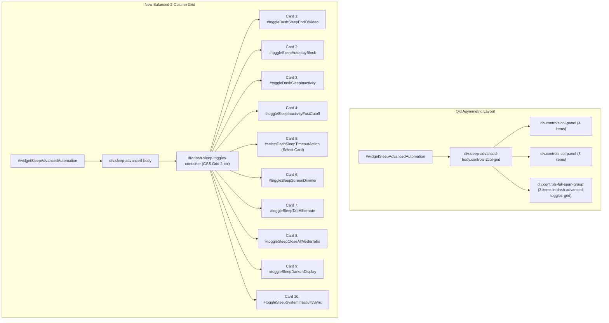

# Technical Requirements Document (TRD): Sleep Cutoff Sentinel & Power Automation Redesign

> **Document Type:** Technical Requirements Document (`TRD.md`)  
> **Initiative:** Sleep Cutoff Sentinel & Power Automation Redesign  
> **Target Container:** `temp_prompt/sleep_cutoff_power_automation_redesign/`  
> **Author:** Level 3C Phase-wise Prompt Generation Specialist (`prompt_generation_specialist`)  

---

## 🏛️ 1. Architecture & DOM Hierarchy

### 1.1 Existing vs Redesigned DOM Architecture



---

## 📑 2. Complete Control Inventory & Data Contracts

| Card # | Element ID | Tag / Type | Label / Title (`data-i18n`) | Description (`data-i18n`) | Default State | Role / Class |
| :--- | :--- | :--- | :--- | :--- | :--- | :--- |
| **1** | `toggleDashSleepEndOfVideo` | `input[checkbox]` | Stop at End of Video (`lbl_sleep_end_of_video`) | Trigger cutoff as soon as current video finishes (`desc_sleep_end_of_video`) | Unchecked | `role="switch"` `class="switch-input dash-sleep-switch-input"` |
| **2** | `toggleSleepAutoplayBlock` | `input[checkbox]` | Auto-Disable Video Autoplay (`toggle_sleep_autoplay_block`) | Block next video autoplay during bedtime (`desc_sleep_autoplay_block`) | Unchecked | `role="switch"` `class="switch-input dash-sleep-switch-input"` |
| **3** | `toggleDashSleepInactivity` | `input[checkbox]` | Pause if idle 15m (`lbl_inactivity_auto_sleep`) | Trigger cutoff when idle for 15 minutes (`desc_inactivity_auto_sleep`) | Unchecked | `role="switch"` `class="switch-input dash-sleep-switch-input"` |
| **4** | `toggleSleepInactivityFastCutoff` | `input[checkbox]` | Inactivity Fast-Cutoff (5m) (`toggle_sleep_inactivity_cutoff`) | Cut off media if idle for 5m during countdown (`desc_sleep_inactivity_cutoff`) | Unchecked | `role="switch"` `class="switch-input dash-sleep-switch-input"` |
| **5** | `selectDashSleepTimeoutAction` | `select` | On Timeout Action (`lbl_timeout_action`) | Action to dispatch when sleep countdown reaches zero (`desc_timeout_action`) | `value="pause"` | `class="styled-select dash-sleep-select-sm"` Options: pause, mute, close_tab |
| **6** | `toggleSleepScreenDimmer` | `input[checkbox]` | Progressive Screen Dimmer (`toggle_sleep_screen_dimmer`) | Circadian screen dimming during final countdown (`desc_sleep_screen_dimmer`) | Unchecked | `role="switch"` `class="switch-input dash-sleep-switch-input"` |
| **7** | `toggleSleepTabHibernate` | `input[checkbox]` | Memory-Saver Tab Hibernation (`toggle_sleep_tab_hibernate`) | Suspend idle tabs on timeout to quiet cooling fans (`desc_sleep_tab_hibernate`) | Unchecked | `role="switch"` `class="switch-input dash-sleep-switch-input"` |
| **8** | `toggleSleepCloseAllMediaTabs` | `input[checkbox]` | Close All Media Tabs (`toggle_sleep_close_all_media_tabs`) | Safely close all inactive media tabs across browser windows (`desc_sleep_close_all_media_tabs`) | Unchecked | `role="switch"` `class="switch-input dash-sleep-switch-input"` |
| **9** | `toggleSleepDarkenDisplay` | `input[checkbox]` | OLED Full Blackout (`toggle_sleep_darken_display`) | Render pure 100% black overlay on cutoff to eliminate night glow (`desc_sleep_darken_display`) | Unchecked | `role="switch"` `class="switch-input dash-sleep-switch-input"` |
| **10** | `toggleSleepSystemInactivitySync` | `input[checkbox]` | System Inactivity Sync (`toggle_sleep_system_inactivity_sync`) | Bridge OS-level sleep state to sync countdown timer (`desc_sleep_system_inactivity_sync`) | Unchecked | `role="switch"` `class="switch-input dash-sleep-switch-input"` |

---

## 🎨 3. CSS Component Specifications

### 3.1 `.dash-sleep-toggles-container`
```css
.dash-sleep-toggles-container {
  display: grid;
  grid-template-columns: repeat(2, minmax(0, 1fr));
  gap: 10px;
  width: 100%;
  box-sizing: border-box;
}

@media (max-width: 768px) {
  .dash-sleep-toggles-container {
    grid-template-columns: 1fr;
  }
}
```

### 3.2 `.dash-sleep-toggle-row`
```css
.dash-sleep-toggle-row {
  display: flex;
  align-items: center;
  justify-content: space-between;
  gap: 12px;
  padding: 9px 12px;
  border-radius: 10px;
  background: rgba(15, 23, 42, 0.45);
  border: 1px solid rgba(255, 255, 255, 0.07);
  box-shadow: 0 1px 3px rgba(0, 0, 0, 0.2);
  transition: all 0.2s cubic-bezier(0.16, 1, 0.3, 1);
  min-height: 52px;
  box-sizing: border-box;
}

.dash-sleep-toggle-row:hover {
  background: rgba(30, 41, 59, 0.65);
  border-color: rgba(255, 255, 255, 0.15);
  transform: translateY(-1px);
  box-shadow: 0 4px 12px rgba(0, 0, 0, 0.3);
}
```

### 3.3 `.dash-sleep-select-row` (Timeout Action Card)
```css
.dash-sleep-select-row {
  display: flex;
  align-items: center;
  justify-content: space-between;
  gap: 12px;
  padding: 9px 12px;
  border-radius: 10px;
  background: rgba(15, 23, 42, 0.45);
  border: 1px solid rgba(255, 255, 255, 0.07);
  box-shadow: 0 1px 3px rgba(0, 0, 0, 0.2);
  transition: all 0.2s cubic-bezier(0.16, 1, 0.3, 1);
  min-height: 52px;
  box-sizing: border-box;
}

.dash-sleep-select-row:hover {
  background: rgba(30, 41, 59, 0.65);
  border-color: rgba(255, 255, 255, 0.15);
  transform: translateY(-1px);
  box-shadow: 0 4px 12px rgba(0, 0, 0, 0.3);
}

.dash-sleep-select-row select.dash-sleep-select-sm {
  max-width: 150px;
  flex-shrink: 0;
}
```

---

## 🔒 4. Security & Quality Gates
1. **Zero innerHTML:** The redesign is strictly structural HTML and CSS. No dynamic injection or template strings.
2. **UTF-8 with BOM:** Preservation of byte order mark across touched files (`dashboard/dashboard.html`, `dashboard/styles/wellbeing_blacklist.css`, `dashboard/styles/focus_sleep_advanced.css`, `dashboard/dashboard.css`).
3. **Regression Tests:** All 10 controls must continue to be accessible via `document.getElementById` and retain their persistent storage synchronization in `dashboard.js`.
