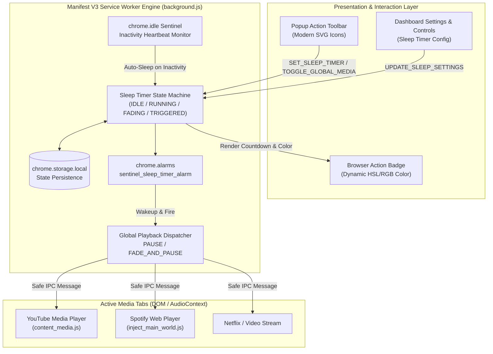
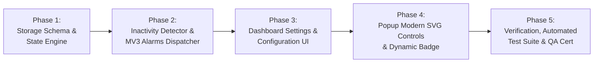

# Executive Architecture Summary: Sleep Timer and UI Controls

> **Specification Reference:** `temp_prompt/sleep_timer_and_ui_controls/SUMMARY.md`  
> **Workspace:** `c:\Users\Atul Verma\Desktop\Win App Tracker\Browser Detection`  
> **Architecture Standard:** Manifest V3 Non-Persistent Service Worker Architecture  
> **Target Release:** Media Sentinel v2.5.0 Production Edition  

---

## 🎯 1. High-Level Initiative Scope & Objectives

The goal of this initiative is to elevate **Web Activity & Media Sentinel** from a passive telemetry recorder into an active, intelligent media companion. By introducing an enterprise-grade **Sleep Timer**, **Inactivity Auto-Sleep Sentinel**, and a **Modern SVG UI Control Suite**, users gain effortless control over ambient media playback, conserve system battery and network resources, and prevent distorted activity metrics.

---

## 🛣️ 2. Cross-Phase Milestone Roadmap & Dependency Topology

Execution proceeds strictly across 5 sequential phases. No phase may commence until its upstream prerequisite deliverables pass verification.

### Milestone Specifications:
- **Milestone 1 (Phase 1): Core State & Storage Stability:** Define canonical sleep timer storage contracts, state transitions (`IDLE` -> `RUNNING` -> `PAUSED` -> `FADING` -> `TRIGGERED` -> `CANCELLED`), and message dispatch protocols.
- **Milestone 2 (Phase 2): MV3 Alarms & Multi-Tab Playback Dispatch:** Implement service worker alarm wakeups, smooth volume attenuation ladder, and global media pause dispatcher with IPC error suppression.
- **Milestone 3 (Phase 3): Enterprise Configuration Surface:** Build the Dashboard settings panel allowing users to configure presets, auto-sleep idle thresholds, fade durations, and notification toasts.
- **Milestone 4 (Phase 4): High-DPI Popup Controls & Dynamic Badge:** Deliver crisp vector SVG buttons, sleep timer flyout popover, active countdown chip, and real-time color interpolation on the extension badge icon.
- **Milestone 5 (Phase 5): End-to-End Test Suite & Grade A+ Certification:** Implement automated unit/integration tests verifying syntax, AST integrity, storage schema, timer math, color interpolation, and DOM structure.

---

## ⚖️ 3. Risk Mitigation & Architectural Tradeoffs

| Challenge / Risk | Architectural Risk Profile | Strategic Mitigation Strategy |
| :--- | :--- | :--- |
| **MV3 Service Worker Suspension** | Chrome terminates inactive service workers after ~30 seconds. In-memory `setInterval` counters will freeze, causing sleep timer failure. | **Storage-Backed Alarms:** The timer calculates an absolute epoch target (`targetTime = Date.now() + durationMs`) and registers a `chrome.alarms` entry. When the alarm fires, the SW awakens, reads `targetTime` from `chrome.storage.local`, and executes immediately regardless of suspension history. |
| **Minimum Alarm Granularity (1 Minute)** | In production Chromium, `chrome.alarms` has a minimum period of 1 minute. Sub-minute countdowns or 30-second volume fades cannot rely purely on alarms. | **Hybrid Countdown Architecture:** The primary cutoff is scheduled via `chrome.alarms`. If the popup is open, high-resolution 1-second ticks update the popup UI in real-time. For volume fade-out, an alarm awakens the SW 1 minute before cutoff, triggering a transient high-precision content-script fade loop. |
| **Abrupt Media Cutoff vs. Gentle Fade** | Cutting audio instantly when a user is drifting to sleep can startle them awake. | **Linear Volume Fade Attenuation:** Content scripts (`content_media.js`) intercept audio elements and gradually ramp volume from `currentVolume` to `0.0` in 10 discrete steps over the final 30 seconds prior to issuing `pause()`. |
| **Popup Layout Shifts (CLS)** | Adding controls to the popup footer can cause cramped buttons, text overflow, or vertical layout popping. | **Ergonomic Flex Toolbar & Flyout Modal:** Replace wide text buttons with an icon-first flexbox toolbar (`btn-icon-group`). The sleep timer duration selector opens in a sleek floating popover anchored above the footer, preserving zero cumulative layout shift. |
| **Restricted Tabs & Dead Port Exceptions** | Broadcasting pause commands to closed, crashed, or restricted tabs (`chrome://`, `edge://`) causes uncaught promise rejections. | **Sanitized IPC Wrapper (`safeSendTabMessage`):** Validate tab URLs against `isRestrictedTabUrl()` before messaging and attach silent catch handlers for `Receiving end does not exist`. |
