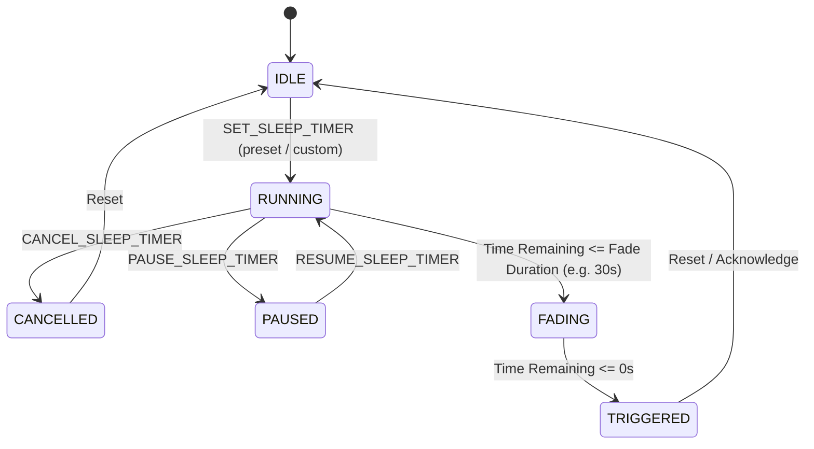

# Technical Requirements Document (TRD): Sleep Timer & UI Controls

> **Specification Reference:** `temp_prompt/sleep_timer_and_ui_controls/TRD.md`  
> **Target System:** Web Activity & Media Sentinel MV3 Extension  
> **Core Technologies:** JavaScript (ES6+), Chrome Extensions MV3 Alarms & Storage API, CSS3 Glassmorphism  
> **Status:** APPROVED FOR IMPLEMENTATION  

---

## 🏗️ 1. Low-Level & High-Level System Architecture

### 1.1 Architectural Constraints in Manifest V3
Chrome Manifest V3 enforces a non-persistent background execution environment:
1. **Service Worker Termination:** The background service worker (`background.js`) enters an idle state and terminates approximately 30 seconds after completing active event listeners.
2. **Timer Volatility:** Standard JavaScript `setTimeout` and `setInterval` are destroyed when the service worker unloads.
3. **Alarm Minimum Granularity:** `chrome.alarms.create` enforces a minimum interval of 1 minute in production extension packages (unpacked extensions during development allow sub-minute testing).

### 1.2 State Machine Definition
The Sleep Timer Subsystem operates under a strict deterministic finite state machine (FSM):



### 1.3 State Transitions & Actions Table

| Current State | Event Trigger | Next State | System Actions Executed |
| :--- | :--- | :--- | :--- |
| `IDLE` | `SET_SLEEP_TIMER` | `RUNNING` | Calculate `targetTime`; write state to storage; create `chrome.alarms` entry; set badge text & color. |
| `RUNNING` | `CANCEL_SLEEP_TIMER` | `CANCELLED` | Clear `chrome.alarms`; clear badge text; update storage state; toast notification. |
| `RUNNING` | Remaining <= Fade Threshold | `FADING` | Broadcast `START_VOLUME_FADE` IPC to registered media tabs; start step-down audio attenuation. |
| `FADING` / `RUNNING` | Timer Expired (Alarm fired) | `TRIGGERED` | Broadcast `PAUSE_MEDIA` to all active media tabs; commit active tracking intervals; clear badge; mark state `TRIGGERED`. |
| `TRIGGERED` | User interaction / New timer | `IDLE` | Clear timer state; restore default action title and icon. |

---

## 💾 2. Data Contracts & Storage Schemas

All sleep timer state and user preferences are persisted in `chrome.storage.local` under two canonical root keys:

### 2.1 Active State Schema: `sentinel_sleep_timer`
```typescript
interface SleepTimerState {
  state: 'IDLE' | 'RUNNING' | 'PAUSED' | 'FADING' | 'TRIGGERED' | 'CANCELLED';
  durationMinutes: number;         // e.g. 30
  durationMs: number;              // durationMinutes * 60 * 1000
  startTime: number;               // Epoch timestamp (Date.now()) when started
  targetTime: number;              // Epoch timestamp (startTime + durationMs)
  pauseMedia: boolean;             // Default true: pause video/audio elements
  pauseTracking: boolean;          // Default true: pause active domain tracking
  enableFadeOut: boolean;          // Default true: enable 30s volume fade
  fadeDurationSeconds: number;     // Default 30
  lastUpdated: number;             // Epoch timestamp of last state modification
  triggeredAt?: number;            // Epoch timestamp when timer fired
}
```

### 2.2 User Configuration Schema: `sentinel_sleep_settings`
```typescript
interface SleepTimerSettings {
  defaultDurationMinutes: number;  // Default: 30
  enableAudioFadeOut: boolean;     // Default: true
  fadeDurationSeconds: number;     // Default: 30
  enableInactivityAutoSleep: boolean; // Default: false
  inactivityThresholdMinutes: number; // Default: 15
  showBadgeCountdown: boolean;     // Default: true
  pulseOnCritical: boolean;        // Default: true (<60s pulse)
}
```

---

## ⏰ 3. Alarms Architecture & Service Worker Lifecycle

### 3.1 Alarm Registration
When a timer is set:
```javascript
const ALARM_NAME = 'sentinel_sleep_timer_alarm';
const FADE_ALARM_NAME = 'sentinel_sleep_fade_alarm';

async function scheduleSleepTimerAlarms(state) {
  // Clear any existing alarms
  await browserAPI.alarms.clear(ALARM_NAME);
  await browserAPI.alarms.clear(FADE_ALARM_NAME);

  const now = Date.now();
  const timeUntilTargetMs = state.targetTime - now;

  if (timeUntilTargetMs <= 0) {
    executeSleepTrigger(state);
    return;
  }

  // Schedule final cutoff alarm
  browserAPI.alarms.create(ALARM_NAME, {
    when: state.targetTime
  });

  // Schedule fade alarm if enabled and duration allows
  if (state.enableFadeOut && timeUntilTargetMs > (state.fadeDurationSeconds * 1000)) {
    const fadeTarget = state.targetTime - (state.fadeDurationSeconds * 1000);
    browserAPI.alarms.create(FADE_ALARM_NAME, {
      when: fadeTarget
    });
  }
}
```

### 3.2 Alarm Wakeup Dispatcher
In `background.js`, `browserAPI.alarms.onAlarm.addListener` is updated to inspect sleep timer alarms:
```javascript
browserAPI.alarms.onAlarm.addListener(async (alarm) => {
  if (alarm.name === 'sentinel_sleep_timer_alarm') {
    await handleSleepTimerExpiration();
  } else if (alarm.name === 'sentinel_sleep_fade_alarm') {
    await handleSleepTimerFadeStart();
  }
  // Existing sentinel_flush_alarm continues unaffected
});
```

---

## 🎨 4. Dynamic Color Interpolation Engine

### 4.1 Mathematical Model
The countdown badge background color interpolates linearly according to the remaining fraction $R$:
$$R = \frac{\max(0, \text{targetTime} - \text{now})}{\text{durationMs}}$$

Three color anchors define the gradient spectrum:
- **Green Anchor (100% to 50%):** `#22c55e` $\rightarrow$ RGB(34, 197, 94)
- **Yellow Anchor (50% to 20%):** `#eab308` $\rightarrow$ RGB(234, 179, 8)
- **Red Anchor (20% to 0%):** `#ef4444` $\rightarrow$ RGB(239, 68, 68)

### 4.2 Interpolation Function
```javascript
function calculateTimerColor(remainingMs, totalDurationMs) {
  if (totalDurationMs <= 0) return '#ef4444';
  const ratio = Math.max(0, Math.min(1, remainingMs / totalDurationMs));

  // RGB definition constants
  const green = [34, 197, 94];
  const yellow = [234, 179, 8];
  const red = [239, 68, 68];

  let r, g, b;
  if (ratio > 0.5) {
    // Interpolate from Yellow (0.5) to Green (1.0)
    const factor = (ratio - 0.5) / 0.5;
    r = Math.round(yellow[0] + factor * (green[0] - yellow[0]));
    g = Math.round(yellow[1] + factor * (green[1] - yellow[1]));
    b = Math.round(yellow[2] + factor * (green[2] - yellow[2]));
  } else if (ratio > 0.2) {
    // Interpolate from Red (0.2) to Yellow (0.5)
    const factor = (ratio - 0.2) / 0.3;
    r = Math.round(red[0] + factor * (yellow[0] - red[0]));
    g = Math.round(red[1] + factor * (yellow[1] - red[1]));
    b = Math.round(red[2] + factor * (yellow[2] - red[2]));
  } else {
    // Under 20%: Solid critical red
    return '#ef4444';
  }

  return `#${r.toString(16).padStart(2, '0')}${g.toString(16).padStart(2, '0')}${b.toString(16).padStart(2, '0')}`;
}
```

### 4.3 Badge Text Formatting
- Remaining $\ge 60$ seconds: Display `${Math.ceil(remainingSec / 60)}m` (e.g. `30m`, `1m`).
- Remaining $< 60$ seconds: Display `${remainingSec}s` (e.g. `45s`, `10s`).
- When timer is inactive or expired: Set badge text to empty string `""`.

---

## 📡 5. IPC Message Protocol Specification

Communication between `popup.js`, `dashboard.js`, `background.js`, and `content_media.js` follows standardized action envelopes:

| Message Action | Source | Target | Payload Schema | Expected Response |
| :--- | :--- | :--- | :--- | :--- |
| `SET_SLEEP_TIMER` | Popup / Dash | Background | `{ durationMinutes: number, enableFade?: boolean }` | `{ success: true, state: SleepTimerState }` |
| `CANCEL_SLEEP_TIMER` | Popup / Dash | Background | `{}` | `{ success: true }` |
| `GET_SLEEP_TIMER_STATE` | Popup / Dash | Background | `{}` | `{ success: true, state: SleepTimerState, settings: SleepTimerSettings }` |
| `TOGGLE_GLOBAL_MEDIA` | Popup | Background | `{ command: 'TOGGLE' | 'PAUSE_ALL' | 'RESUME' }` | `{ success: true, activeCount: number, isPlaying: boolean }` |
| `FADE_AND_PAUSE` | Background | Content Tabs | `{ fadeDurationSeconds: number }` | `{ received: true }` |
| `PAUSE_MEDIA` | Background | Content Tabs | `{}` | `{ paused: true }` |

---

## 🛡️ 6. Security, Trusted Types & Error Suppression Standards

1. **W3C Trusted Types Compliance:** Zero assignments to `element.innerHTML` anywhere in `popup.js` or `dashboard.js`. All SVG icons, flyouts, and list nodes are created via `document.createElementNS('http://www.w3.org/2000/svg', ...)` or `document.createElement('div')` with attributes set via `setAttribute()`.
2. **Tab Messaging Protection:** Calls to `browserAPI.tabs.sendMessage` must be routed through `safeSendTabMessage()`, which immediately returns if URL matches `chrome://`, `edge://`, `about:`, or Web Store schemes, and attaches `.catch(() => {})` to absorb closed tab promise rejections.
3. **Storage Concurrency Locks:** Write operations to `sentinel_sleep_timer` use read-modify-write patterns with optimistic timestamp checking to eliminate state stomping between background alarms and popup clicks.
