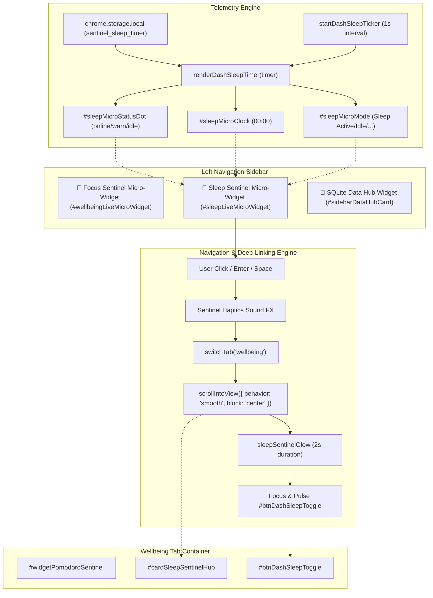

# 🌙 Executive Architecture Summary: Sleep Timer Live Micro-Widget

> **Document Type:** Executive Architecture Summary  
> **Container Directory:** [`temp_prompt/sleep_timer_live_micro_widget/`](.)  
> **Initiative:** Sleep Timer Live Micro-Widget in Left Navigation Panel Matching Focus Sentinel  
> **Governing Architecture:** [`PHASE_WISE_PROMPT_GENERATION_ARCHITECTURE.md`](file:///C:/Users/Atul%20Verma/.gemini/config/rules/PHASE_WISE_PROMPT_GENERATION_ARCHITECTURE.md)  
> **Specialist Role:** Level 3C Phase-wise Prompt Generation Specialist (`prompt_generation_specialist`)  

---

## 🏛️ 1. Technical Scope & Objectives

The primary objective of this initiative is to eliminate telemetry asymmetry in the Web Activity & Media Sentinel dashboard by adding a persistent, interactive **Sleep Timer Live Micro-Widget** in the left navigation sidebar matching the design, interactions, and telemetry behaviors of the existing **Focus Sentinel Micro-Widget**.

### Key Deliverables:
1. **Interactive Sidebar Presence:**
   - Embed a compact telemetry card (`#sleepLiveMicroWidget`) in the `.sidebar-hud-group` alongside `#wellbeingLiveMicroWidget`.
   - Provide real-time glanceable feedback: dynamic mode indicator (`Sleep Idle`, `Sleep Active`, `Sleep Fading`, `Sleep Paused`), formatted countdown clock (`MM:SS` or `HH:MM:SS`), and status indicator dot (`idle`, `online`, `warn`).
2. **Deep-Linking & Visual Teleportation:**
   - Implement `navigateToSleepSentinel()` in `dashboard/dashboard.js`.
   - Switch active dashboard tab to `'wellbeing'`.
   - Smoothly scroll `#cardSleepSentinelHub` into the center of the viewport.
   - Fire a cyber-indigo glowing pulse (`@keyframes sleepSentinelGlow`) on the card.
   - Fire an attention-grabbing pulse (`@keyframes sleepStartBtnPulse`) on the primary CTA button (`#btnDashSleepToggle`) and set keyboard focus to it.
3. **Live Bidirectional Telemetry Synchronization:**
   - Synchronize `#sleepMicroClock`, `#sleepMicroMode`, and `#sleepMicroStatusDot` on every 1-second ticker interval, background alarm trigger, and storage update event.
4. **Deterministic Quality & Accessibility:**
   - Complete keyboard accessibility (Tab navigation, Enter, Space activation).
   - Full reduced motion support for accessibility users (`prefers-reduced-motion: reduce`).
   - 100% W3C Trusted Types zero-innerHTML compliance.
   - 100% pass rate across all test batteries.

---

## 🗺️ 2. Architectural Roadmap & Module Dependencies

---

## ⚠️ 3. Risk Mitigation & Tradeoff Analysis

| Risk / Tradeoff | Impact | Mitigation Strategy |
| :--- | :--- | :--- |
| **Motion Sickness / Accessibility Violations** | Flashing glows or rapid scaling causing disorientation | Strictly wrap all keyframes in `@media (prefers-reduced-motion: reduce)` fallbacks with non-animated static outlines. |
| **Stale Highlight Timers** | Rapid consecutive clicks leaving orphaned setTimeout instances | Track `sleepHighlightTimerId` globally, clearing prior timeout on re-entry before scheduling a new 2000ms removal. |
| **DOM Element Missing Fallbacks** | Calling `.focus()` or `.scrollIntoView()` on null elements | Guard all DOM element lookups with null checks and optional chaining (`card && typeof card.scrollIntoView === 'function'`). |
| **Code Bloat / Rule 28 Violations** | Adding new functions to `dashboard.js` exceeding function or file limits | Keep helper functions concise (<= 50 lines), modular, and single-purpose per Universal Rule 28. |
| **DOM XSS / InnerHTML Injections** | Vulnerabilities from template string injections | Mandate 100% `textContent` and `classList` assignments; strictly forbid `innerHTML`. |

---

## 📁 4. File Manifest

1. `dashboard/dashboard.html`: Sidebar HUD group markup incorporating `#sleepLiveMicroWidget`.
2. `dashboard/styles/components.css`: CSS keyframes `@keyframes sleepSentinelGlow`, `@keyframes sleepStartBtnPulse`, and classes `.sleep-card-highlight`, `.highlight-pulse`.
3. `dashboard/styles/layout.css`: Micro-widget card styling `.sleep-micro-hud` and interactive hover transitions.
4. `dashboard/dashboard.js`: Navigation controller `navigateToSleepSentinel()`, event bindings, exports, and `renderDashSleepTimer()` telemetry sync.
5. `tests/test_sleep_timer_live_micro_widget.js`: Comprehensive 7-battery automated unit and integration test suite.
