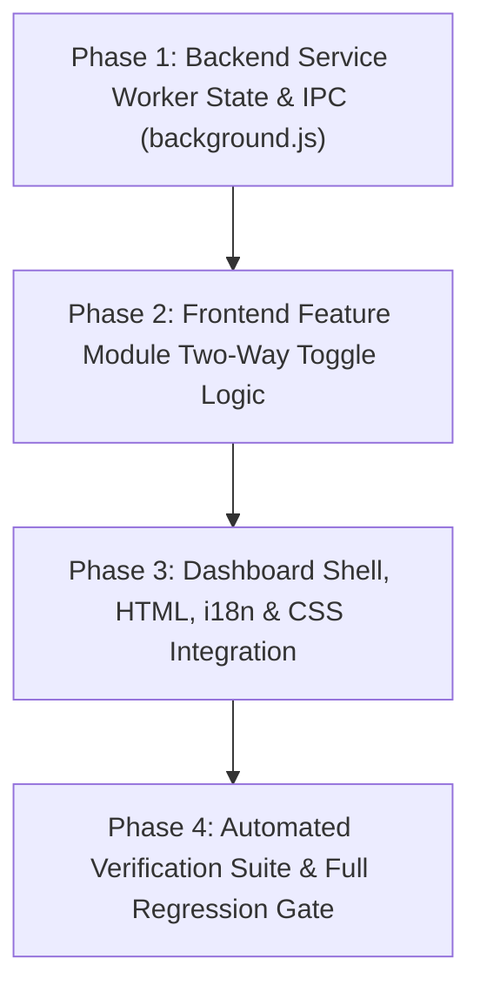

# Executive Architecture Summary
# Task: Bidirectional Toggle Logic for Tab Audio Mute/Unmute Buttons
# Task ID: TASK-BIDIRECTIONAL-MUTE-TOGGLE-001

> **Document Type:** Executive Architecture Summary  
> **Specialist:** Level 3C Phase-wise Prompt Generation Specialist  
> **Target Scope:** MV3 Service Worker (`background.js`), Feature Module (`media_deck_visualizer_feature.js`), Dashboard UI/CSS (`dashboard/`), and Automated Test Suite (`tests/`)

---

## 🏛️ 1. Initiative Scope & Technical Objectives

The objective of this initiative is to eliminate one-way mute deadlocks and implement complete two-way bidirectional toggle logic for all audio mute/unmute buttons across the extension's Multi-Tab Live Media Deck:
1. **Solo Tab Button (🎧 in card controls):** 1st click solos current tab and mutes all other tabs; 2nd click reverts all other tabs back to their original/unmuted state.
2. **Mute All Others Button (`#btnMuteAllOthers` in header):** 1st click mutes all non-primary tabs; 2nd click restores tabs back to their pre-muted states.
3. **Mute All Button (`#btnMuteAll` in header):** Master 1-click control to mute all active media tabs on 1st click, and cleanly unmute all tabs on 2nd click.
4. **Bidirectional SW & GUI State Synchronization:** Live state synchronization via IPC between the background service worker (`tabMediaMap`, `browserAPI.tabs.update`) and the dashboard GUI.

---

## 🗺️ 2. Cross-Phase Milestone Roadmap

---

## ⚖️ 3. Risk Mitigation & Architectural Tradeoffs

| Risk Identified | Mitigation Strategy | Architectural Tradeoff |
| :--- | :--- | :--- |
| **State Desync on Rapid Clicks:** Rapid double-clicking could cause race conditions between optimistic local cache updates and asynchronous `tabs.update` calls. | Use asynchronous mutex / in-flight request guards and ensure background responds with canonical state in `LIVE_MEDIA_UPDATE`. | Small optimistic debounce (<50ms) to ensure smooth animations. |
| **Stale Tabs in Snapshots:** A tab closed while muted under Solo mode could throw an error when attempting to restore state on Solo exit. | Safe optional chaining and error catching (`catch(() => {})`) on `browserAPI.tabs.update`; verify tab existence via `browserAPI.tabs.get` before applying updates. | Fault-tolerant tab state recovery; silently discard closed tabs. |
| **W3C Trusted Types Violation:** Dynamic button label updates must not assign `innerHTML` or `outerHTML`. | Strictly use `textContent` or `replaceChildren()` for all text and icon mutations. | 100% compliance with strict CSP MV3 guidelines. |
| **Encoding Mojibake:** Hindi translations for new mute buttons could suffer corruption in Windows terminals. | Enforce Universal Rule 5 & 8: UTF-8 with BOM (`0xEF, 0xBB, 0xBF`) on all touched source files. | Absolute zero mojibake guarantee across all Windows environments. |
