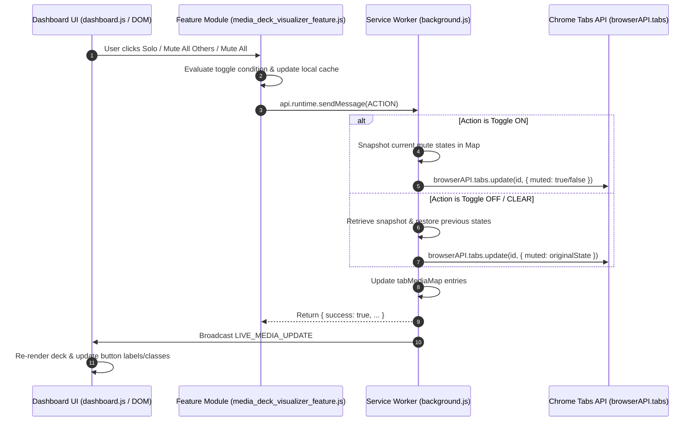

# Technical Requirements Document (TRD)
# Task: Bidirectional Toggle Logic for Tab Audio Mute/Unmute Buttons
# Task ID: TASK-BIDIRECTIONAL-MUTE-TOGGLE-001

> **Document Type:** Technical Requirements Document (TRD)  
> **Lead Departments:** Dept 02 Solution Architecture, Dept 06 Backend & API Engineering

---

## 🏛️ 1. Architecture & Component Interaction



---

## 📡 2. IPC Message Protocol Schema

| Message Action | Payload Schema | Handler in background.js | Return Contract |
| :--- | :--- | :--- | :--- |
| `MEDIA_STREAM_SOLO` | `{ action: 'MEDIA_STREAM_SOLO', soloTabId: number }` | `handleSoloTabExecution(targetId)` | `{ success: true, soloTabId: number, mutedCount: number }` |
| `MEDIA_STREAM_SOLO_CLEAR` | `{ action: 'MEDIA_STREAM_SOLO_CLEAR', soloTabId: null }` | `handleSoloTabClearExecution()` | `{ success: true, cleared: true, soloTabId: null, unmutedCount: number }` |
| `MEDIA_STREAM_MUTE_ALL_OTHERS` | `{ action: 'MEDIA_STREAM_MUTE_ALL_OTHERS', primaryTabId: number|null }` | `handleMuteAllOthersExecution(primaryTabId)` | `{ success: true, active: true, mutedCount: number }` |
| `MEDIA_STREAM_MUTE_ALL_OTHERS_CLEAR` | `{ action: 'MEDIA_STREAM_MUTE_ALL_OTHERS_CLEAR' }` | `handleMuteAllOthersClearExecution()` | `{ success: true, active: false, restoredCount: number }` |
| `MEDIA_STREAM_MUTE_ALL` | `{ action: 'MEDIA_STREAM_MUTE_ALL' }` | `handleMuteAllExecution()` | `{ success: true, active: true, mutedCount: number }` |
| `MEDIA_STREAM_MUTE_ALL_CLEAR` | `{ action: 'MEDIA_STREAM_MUTE_ALL_CLEAR' }` | `handleMuteAllClearExecution()` | `{ success: true, active: false, unmutedCount: number }` |

---

## 💾 3. State Models & Data Structures

### Background Service Worker (`background.js`)
```javascript
// Snapshot cache maps for stateful restorations
const soloPreviousMuteStates = new Map(); // tabId -> boolean (wasMuted)
const muteOthersPreviousMuteStates = new Map(); // tabId -> boolean (wasMuted)
const muteAllPreviousMuteStates = new Map(); // tabId -> boolean (wasMuted)
```

### Feature Module (`media_deck_visualizer_feature.js`)
```javascript
let currentSoloTabId = null;
let isMuteAllOthersActive = false;
let isMuteAllActive = false;
```
