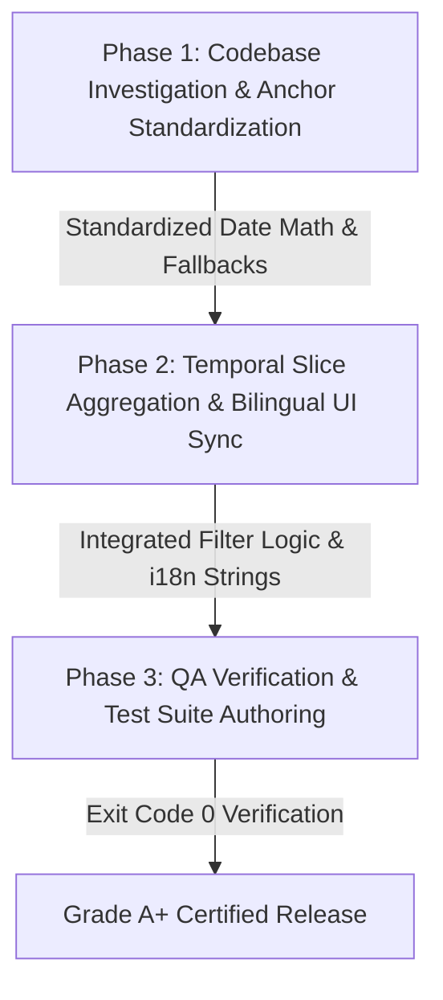

# Architecture Summary: Time Tracking Date Filter Fixes

> **Workspace Container:** `temp_prompt/time_tracking_date_filter_fixes/`  
> **Document:** `SUMMARY.md`  
> **Role:** Level 3C Phase-wise Prompt Generation Specialist  
> **Target Autonomy Strategy:** Strategy A (Fully Autonomous Phase-wise Execution, Score: 1.0)  

---

## 🎯 1. Initiative Scope & Objectives
The goal of this initiative is to eliminate defects and temporal inconsistencies in the **Time Tracking Date Filter Subsystem** (`Tab A - Time Tracking & Charts`) across the Web Activity & Media Sentinel dashboard:
1. **Support All Temporal Ranges:** Fully support `today`, `yesterday`, `7d` (Last 7 Days), `30d` (Last 30 Days), and `custom` date ranges across data processing, KPI cards, SVG donut chart, and domain breakdown table.
2. **Anchor Date Arithmetic to Reference Date:** Remove volatile unanchored `new Date()` calls that ignore `todayStr`, and enforce deterministic date offsets relative to the given reference date.
3. **True Temporal Slice Metrics:** Ensure foreground seconds, background media seconds, and combined seconds are aggregated exclusively over the selected date range rather than falling back to all-time totals.
4. **Data Hub & Local Storage Parity:** Provide unified filtering semantics regardless of whether the SQLite Data Hub bridge is active or inactive.
5. **Full Bilingual Completeness:** Add complete English and Hindi translations for donut center labels and captions.
6. **Zero-Regression & Modularity:** Retain 100% compliance with Universal Rule 28 (<= 50 lines per function, nesting <= 3) and W3C Trusted Types zero-innerHTML safety.

---

## 🗺️ 2. Cross-Phase Milestone Roadmap & Topology

### Milestone Breakdown:
- **Phase 1 (Core Logic & Date Anchoring):** Standardize relative date generation in `dashboard/dashboard.js` and `temporal_productivity_feature.js`. Implement deterministic parsing of `todayStr` and safe fallback date range generators.
- **Phase 2 (Implementation & UI Alignment):** Update `processTimeTrackingData`, `renderTimeTrackingTab`, and `renderDonutChart`. Wire range-filtered metrics into domain items. Synchronize `DASHBOARD_I18N` dictionaries in English and Hindi.
- **Phase 3 (QA & Testing):** Author dedicated automated test suite `tests/test_time_tracking_date_filter_logic.js` asserting all 5 temporal ranges, date math edge cases, and UI synchronization.

---

## 🛡️ 3. Risk Mitigation & Tradeoff Analysis
- **Risk:** Timezone offset issues causing off-by-one errors across midnight boundaries.  
  **Mitigation:** Parse date strings (`YYYY-MM-DD`) into local components (`year`, `month - 1`, `day`) directly before instantiating `Date` objects, avoiding UTC-to-local timezone shifting.
- **Risk:** Missing dates in sparse historical activity objects (`domainObj.days`).  
  **Mitigation:** Safely check `domainObj.days[dateStr]` before reading seconds, defaulting missing dates to 0 without throwing `TypeError`.
- **Risk:** Performance degradation on 30-day range aggregation.  
  **Mitigation:** `datesList` iteration is strictly bounded (O(D * N) where D <= 30 and N <= domain count); pre-indexed object lookups guarantee sub-millisecond execution.
