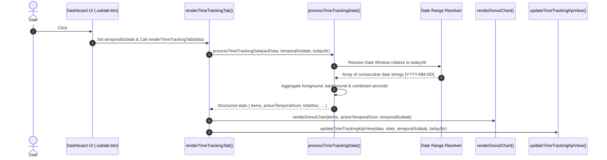

# Technical Requirements Document (TRD): Time Tracking Date Filter Fixes

> **Workspace Container:** `temp_prompt/time_tracking_date_filter_fixes/`  
> **Document:** `TRD.md`  
> **Lead Department:** Dept 04 (Core Logic / Backend & Algorithmic Design)  
> **Target Subsystems:** `dashboard/dashboard.js`, `src/dashboard/features/temporal_productivity_feature.js`, `src/dashboard/features/time_tracking_kpi_feature.js`  

---

## 🛠️ 1. Technical Architecture & Component Interaction



---

## 📐 2. Low-Level Design (LLD) Specifications

### 2.1 Deterministic Date Range Arithmetic
All temporal calculations must derive from `todayStr` (`YYYY-MM-DD`):
```javascript
function parseYMD(dateStr) {
  if (!dateStr || typeof dateStr !== 'string') return new Date();
  const parts = dateStr.split('-').map(n => parseInt(n, 10));
  return new Date(parts[0], parts[1] - 1, parts[2]);
}

function formatYMD(d) {
  return `${d.getFullYear()}-${String(d.getMonth() + 1).padStart(2, '0')}-${String(d.getDate()).padStart(2, '0')}`;
}

function resolveTemporalDateRange(temporalMode, todayStr, customStart, customEnd) {
  const anchor = parseYMD(todayStr);
  let startStr = todayStr;
  let endStr = todayStr;

  if (temporalMode === 'yesterday') {
    const y = new Date(anchor);
    y.setDate(y.getDate() - 1);
    startStr = formatYMD(y);
    endStr = startStr;
  } else if (temporalMode === '7d') {
    const s = new Date(anchor);
    s.setDate(s.getDate() - 6);
    startStr = formatYMD(s);
    endStr = todayStr;
  } else if (temporalMode === '30d') {
    const s = new Date(anchor);
    s.setDate(s.getDate() - 29);
    startStr = formatYMD(s);
    endStr = todayStr;
  } else if (temporalMode === 'custom') {
    startStr = customStart || todayStr;
    endStr = customEnd || todayStr;
  }

  const helper = (_TemporalProductivity && typeof _TemporalProductivity.getDatesInRange === 'function')
    ? _TemporalProductivity.getDatesInRange
    : getDatesInRangeFallback;

  return helper(startStr, endStr);
}
```

### 2.2 Robust Fallback for `getDatesInRangeFallback`
```javascript
function getDatesInRangeFallback(startStr, endStr) {
  const dates = [];
  if (!startStr || !endStr) return [startStr || endStr];
  const curr = parseYMD(startStr);
  const end = parseYMD(endStr);
  if (isNaN(curr.getTime()) || isNaN(end.getTime()) || curr > end) {
    return [startStr];
  }
  while (curr <= end) {
    dates.push(formatYMD(curr));
    curr.setDate(curr.getDate() + 1);
  }
  return dates;
}
```

### 2.3 True Range Aggregation in `processTimeTrackingData`
For every domain during `temporalMode !== 'daily' && temporalMode !== 'total'`:
- For `yesterday`, `7d`, `30d`, and `custom`:
  Iterate `datesList`:
  - `rangeFgSec += dItem.foregroundSeconds || dItem.seconds || 0`
  - `rangeBgSec += dItem.backgroundMediaSeconds || 0`
  - `rangeCombinedSec += dItem.seconds || dItem.totalSeconds || 0`
- Assign:
  - `computedSeconds`: based on `selectedTrackingMode` (foreground, background_media, or combined).
  - `foregroundSeconds`: `rangeFgSec`.
  - `backgroundMediaSeconds`: `rangeBgSec`.
  - `combinedSeconds`: `rangeCombinedSec`.

### 2.4 Donut Chart Center Label Mapping
In `renderDonutChart(items, totalSeconds, subtab)`:
```javascript
const subtabLabelMap = {
  today: 'donut_center_today',
  yesterday: 'donut_center_yesterday',
  '7d': 'donut_center_7days',
  '30d': 'donut_center_30days',
  custom: 'donut_center_custom',
  daily: 'donut_center_daily',
  total: 'donut_center_total'
};
const key = subtabLabelMap[subtab] || 'donut_center_total';
centerLabelEl.textContent = t(key);
```

---

## 🌐 3. Localization Dictionary Keys (`DASHBOARD_I18N`)

### English (`en`):
```javascript
donut_center_yesterday: "Yesterday's Total",
donut_center_7days: "Last 7 Days Total",
donut_center_30days: "Last 30 Days Total",
donut_center_custom: "Custom Range Total",
caption_usage_dist: "Select time range: Today, Yesterday, Last 7 Days, Last 30 Days, Daily Average, or Total Time",
```

### Hindi (`hi`):
```javascript
donut_center_yesterday: "कल का कुल समय",
donut_center_7days: "पिछले 7 दिनों का कुल समय",
donut_center_30days: "पिछले 30 दिनों का कुल समय",
donut_center_custom: "कस्टम अवधि का कुल समय",
caption_usage_dist: "समय सीमा चुनें: आज, कल, पिछले 7 दिन, पिछले 30 दिन, दैनिक औसत, या कुल समय",
```

---

## 🔒 4. Compliance & Constraints Checklist
- [x] Zero `innerHTML` assignments.
- [x] Maximum function length <= 50 lines.
- [x] Cyclomatic nesting depth <= 3.
- [x] Preservation of UTF-8 with BOM on modified scripts.
- [x] Backward compatibility with existing 93 test suites.
