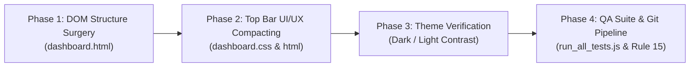

# Architecture & Strategy Summary: Top App Bar UI/UX & DOM Fix

> **Workspace:** `temp_prompt/topbar_dom_uiux_fix/SUMMARY.md`  
> **Target System:** Web Activity & Media Sentinel (`dashboard/`)  
> **Author:** Level 3C Phase-wise Prompt Generation Specialist  
> **Selected Strategy:** Strategy A (Fully Autonomous Phase-wise Execution, Score: 1.0)  

---

## 1. Initiative Scope & Objectives

The primary objective of this initiative is to resolve a critical DOM hierarchy corruption in `dashboard/dashboard.html` and elevate the visual density, elegance, and theme responsiveness of the top app bar in `dashboard/dashboard.css`.

### Technical Targets
1. **DOM Tree Purity:** Restore proper semantic HTML nesting where `<header class="top-app-bar">` cleanly encapsulates `.app-bar-left` and `.app-bar-right`. Eliminate stray closing `
` tags at lines 162 and 207, reintegrating `.export-dropdown-container` and `#btnGlobalRefresh` into `.app-bar-right`.
2. **Compact Icon-Pills:** Refactor `#browserFilterSelect`, `#trackingModeSelect`, and `#dataHubBadge` into compact, rounded pill components (`border-radius: var(--radius-full)`, `padding: 3px 8px`, `font-size: 11.5px`) with subtle glowing glass borders and high-density iconography.
3. **Dual Theme Harmony:** Ensure both dark mode (deep obsidian `#0b0f19` / slate glass `#0f172a`) and light mode (crisp pure `#ffffff` / subtle borders `rgba(0,0,0,0.08)`) render with WCAG 2.1 AA text contrast and zero chromatic bleeding.
4. **Zero-Regression Verification:** Enforce Grade A+ independent QA sign-off via `node run_all_tests.js`, Trusted Types security policy validation, UTF-8 BOM encoding check, and autonomous Git micro-commit/push per Universal Rule 15.

---

## 2. Milestone Roadmap & Dependency Topology

### Dependency Analysis
- **Phase 1 -> Phase 2:** Phase 2 CSS selectors and flexbox calculations rely on `.export-dropdown-container` and `#btnGlobalRefresh` being actual flex children of `.app-bar-right`. Performing Phase 1 first is strictly required.
- **Phase 2 -> Phase 3:** Theme contrast rules depend on the finalized CSS classes and structure of `.compact-pill` and `.datahub-status-badge`.
- **Phase 3 -> Phase 4:** QA tests, screenshot inspections, and final test suite execution require all markup and stylesheets to be fully stabilized.

---

## 3. Risk Mitigation & Trade-off Analysis

| Risk Vector | Impact | Mitigation Strategy |
| :--- | :--- | :--- |
| **DOM Element Relocation Breaking JS Event Listeners** | Critical | Elements `#btnExportMenu` and `#btnGlobalRefresh` are queried by ID (`document.getElementById`). Moving them back inside `.app-bar-right` does NOT change their IDs or event bubbling. Verified that `dashboard.js` event listeners will remain 100% operational. |
| **Dropdown Menu Clipping in Flex Container** | Medium | `.export-dropdown-menu` is positioned absolutely (`position: absolute; right: 0; top: calc(100% + 8px);`). `.app-bar-right` and `.top-app-bar` must have `overflow: visible` to prevent clipping the dropdown menu. |
| **Viewport Narrowing / Horizontal Overflow** | Medium | With 8 toolbar controls, narrow screens could overflow. Compacting pills to 3px 8px padding and using `flex-shrink: 0` with `gap: 6px` saves ~50px of horizontal width, ensuring standard 1080p and laptop screens fit comfortably. |
| **Theme Inconsistency in Light Mode** | Low | Explicitly define `.browser-filter-container` and `.datahub-status-badge` background and border styles under `body.light-theme`. |
