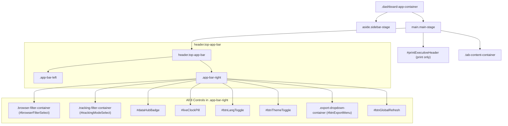

# Technical Requirements Document (TRD): Top App Bar DOM Architecture & CSS Tokens

> **Task Workspace:** `temp_prompt/topbar_dom_uiux_fix/TRD.md`  
> **System Stack:** HTML5, CSS3 Glassmorphism, Vanilla ES6+, WebSocket, Node.js Test Harness  
> **Target Files:** `dashboard/dashboard.html`, `dashboard/dashboard.css`  
> **Author:** Level 3C Phase-wise Prompt Generation Specialist  

---

## 1. High-Level Design (HLD)

### 1.1 Structural Layout Model
The dashboard layout follows a persistent sidebar (`aside.sidebar-stage`) and main stage (`main.main-stage`) flex structure:



---

## 2. Low-Level Design (LLD) & Code Specifications

### 2.1 DOM Correction in `dashboard/dashboard.html`

#### Defective State (Lines ~160-209):
```html
          <!-- 1-Click Theme Switcher (Dark / Light Mode) -->
          <button id="btnThemeToggle" ...>
            ...
          </button>
          </div> <!-- BUG 1: Premature closure of .app-bar-right -->

          <!-- Consolidated Export Dropdown Hub -->
          <div class="export-dropdown-container">
            ...
          </div>
          <button id="btnGlobalRefresh" ...>
            ...
          </button>
        </div>   <!-- BUG 2: Extra </div> closing <header> instead of .app-bar-right -->
      </header>  <!-- BUG 3: Orphaned </header> or closing <main> -->
```

#### Corrected Architecture:
```html
          <!-- 1-Click Theme Switcher (Dark / Light Mode) -->
          <button id="btnThemeToggle" class="btn-action-icon-only topbar-btn btn-theme-toggle" title="Switch to Light Mode" aria-label="Switch to Light Mode" data-i18n-title="theme_toggle_light">
            <svg class="topbar-icon theme-toggle-icon" viewBox="0 0 24 24" fill="none" stroke="currentColor" stroke-width="2" stroke-linecap="round" stroke-linejoin="round">
              <circle cx="12" cy="12" r="5"></circle>
              <line x1="12" y1="1" x2="12" y2="3"></line>
              <line x1="12" y1="21" x2="12" y2="23"></line>
              <line x1="4.22" y1="4.22" x2="5.64" y2="5.64"></line>
              <line x1="18.36" y1="18.36" x2="19.78" y2="19.78"></line>
              <line x1="1" y1="12" x2="3" y2="12"></line>
              <line x1="21" y1="12" x2="23" y2="12"></line>
              <line x1="4.22" y1="19.78" x2="5.64" y2="18.36"></line>
              <line x1="18.36" y1="5.64" x2="19.78" y2="4.22"></line>
            </svg>
            <span id="themeToggleText" class="sr-only">Light</span>
          </button>

          <!-- Consolidated Export Dropdown Hub -->
          <div class="export-dropdown-container">
            <button type="button" id="btnExportMenu" class="btn-action-icon-only btn-export-trigger" aria-haspopup="true" aria-expanded="false" title="Export & Reports" aria-label="Export & Reports">
              <span class="action-btn-icon">📥</span>
              <span id="btnExportMenuText" class="sr-only">Export</span>
              <span class="dropdown-chevron-micro">▾</span>
            </button>
            <div id="exportDropdownMenu" class="export-dropdown-menu liquid-glass-card hidden" role="menu" aria-label="Export Formats">
              <button type="button" id="btnPrintPdf" class="export-menu-item" role="menuitem">
                <span class="menu-item-icon">🖨️</span>
                <div class="menu-item-info">
                  <span class="menu-item-title" id="btnPrintPdfText">Save PDF Executive Digest</span>
                  <span class="menu-item-desc">Print-optimized multi-page report</span>
                </div>
              </button>
              <button type="button" id="btnDownloadHtmlDigest" class="export-menu-item" role="menuitem">
                <span class="menu-item-icon">📄</span>
                <div class="menu-item-info">
                  <span class="menu-item-title" id="btnDownloadHtmlDigestText">Offline HTML Report</span>
                  <span class="menu-item-desc">Self-contained interactive dashboard</span>
                </div>
              </button>
              <div class="dropdown-divider"></div>
              <button type="button" id="btnExportTimeCsv" class="export-menu-item" role="menuitem">
                <span class="menu-item-icon">📊</span>
                <div class="menu-item-info">
                  <span class="menu-item-title">Export Time Data (CSV)</span>
                  <span class="menu-item-desc">RFC 4180 raw tabular records</span>
                </div>
              </button>
              <button type="button" id="btnExportMediaCsvMenu" class="export-menu-item" role="menuitem">
                <span class="menu-item-icon">🎬</span>
                <div class="menu-item-info">
                  <span class="menu-item-title">Export Media History (CSV)</span>
                  <span class="menu-item-desc">Full audio/video play records</span>
                </div>
              </button>
            </div>
          </div>

          <!-- Global Refresh Trigger -->
          <button id="btnGlobalRefresh" class="btn-action-icon-only" title="Refresh Data" aria-label="Refresh Data">
            <span class="refresh-spinner-icon">🔄</span>
            <span id="btnGlobalRefreshText" class="sr-only">Refresh</span>
          </button>
        </div> <!-- CLEAN CLOSURE OF .app-bar-right -->
      </header> <!-- CLEAN CLOSURE OF <header class="top-app-bar"> -->
```

---

### 2.2 CSS Token & Class Refinement in `dashboard/dashboard.css`

#### Pill Styling Specifications:
```css
/* Sleek Compact Icon-Pill Component */
.browser-filter-container.compact-pill,
.browser-filter-container {
  display: flex;
  align-items: center;
  gap: 5px;
  background: rgba(15, 23, 42, 0.85);
  border: 1px solid rgba(16, 185, 129, 0.35);
  border-radius: var(--radius-full); /* Pure pill geometry */
  padding: 3px 8px; /* High-density compact padding */
  backdrop-filter: blur(12px);
  box-shadow: 0 2px 8px rgba(0, 0, 0, 0.2);
  transition: all 0.2s cubic-bezier(0.4, 0, 0.2, 1);
  flex-shrink: 0;
  white-space: nowrap;
  height: 28px;
  box-sizing: border-box;
}

.browser-filter-container:hover,
.browser-filter-container:focus-within {
  border-color: rgba(16, 185, 129, 0.8);
  box-shadow: 0 0 10px rgba(16, 185, 129, 0.3);
  transform: translateY(-1px);
}

.browser-filter-icon {
  font-size: 13px;
  line-height: 1;
}

.browser-filter-select {
  background: transparent;
  border: none;
  color: #6ee7b7;
  font-size: 11.5px;
  font-weight: 700;
  font-family: var(--font-family);
  cursor: pointer;
  outline: none;
  padding: 0 2px;
  line-height: 1;
}

/* Data Hub Status Badge Compacting */
.datahub-status-badge {
  display: flex;
  align-items: center;
  gap: 5px;
  padding: 3px 8px;
  height: 28px;
  box-sizing: border-box;
  border-radius: var(--radius-full);
  font-size: 11px;
  font-weight: 700;
  background: rgba(255, 255, 255, 0.04);
  border: 1px solid var(--border-dim);
  cursor: pointer;
  transition: all 0.2s cubic-bezier(0.4, 0, 0.2, 1);
  flex-shrink: 0;
  white-space: nowrap;
}

.datahub-status-badge:hover {
  transform: translateY(-1px);
  box-shadow: 0 0 8px rgba(255, 255, 255, 0.1);
}

/* Light Theme Overrides */
body.light-theme .browser-filter-container {
  background: rgba(248, 250, 252, 0.95);
  border-color: rgba(16, 185, 129, 0.5);
  box-shadow: 0 1px 4px rgba(0, 0, 0, 0.06);
}

body.light-theme .browser-filter-select {
  color: #065f46;
}

body.light-theme .browser-filter-select option {
  background-color: #ffffff;
  color: #0f172a;
}

body.light-theme .datahub-status-badge {
  background: rgba(241, 245, 249, 0.9);
  border-color: rgba(0, 0, 0, 0.12);
  color: #334155;
}
```

---

## 3. Verification Test Plan & Integrity Gates

1. **HTML Validator:** Run an automated script or regex check verifying that all `<div>`, `<header>`, and `<main>` tags in `dashboard/dashboard.html` are balanced.
2. **Node Test Harness:** Execute `node run_all_tests.js`. Target: 100% tests passing, zero unhandled rejections, exit code 0.
3. **Encoding Sentinel:** Verify `dashboard.html` and `dashboard.css` begin with UTF-8 BOM (`0xEF, 0xBB, 0xBF`).
4. **Security Audit:** Execute `gitleaks detect --redact` across git diff to guarantee zero API tokens or credentials leaked.
